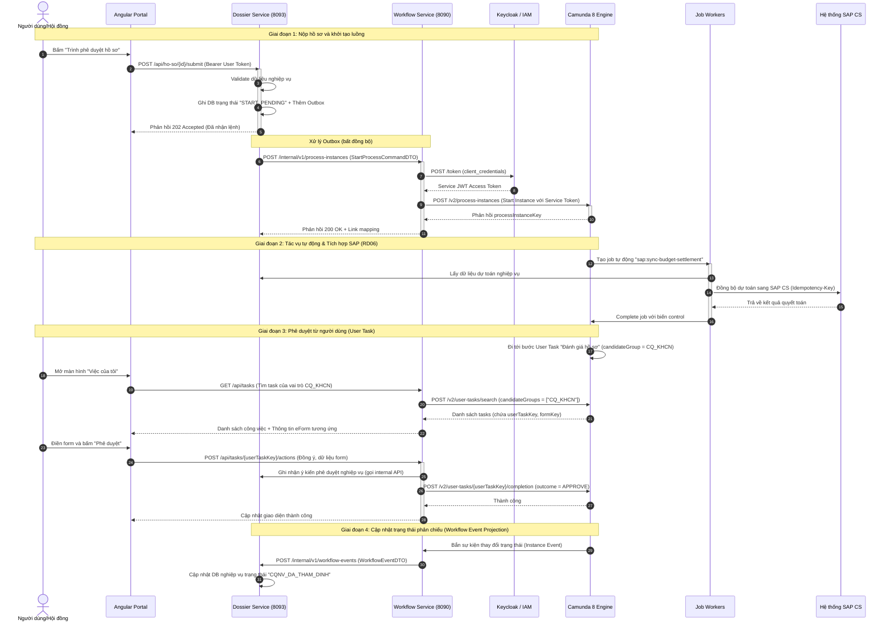

# TÀI LIỆU TÍCH HỢP CAMUNDA 8 VỚI HỆ THỐNG QUY TRÌNH, NHIỆM VỤ VÀ HỒ SƠ KHCN

> **Trạng thái:** Chốt kiến trúc triển khai (Finalized Architecture Specification)  
> **Phạm vi tích hợp:** Phân hệ Quản lý Quy trình (Workflow Engine Service - `8090`) ↔ Phân hệ Quản lý Nhiệm vụ KHCN (Dossier Service - `8093`) ↔ Hạ tầng Camunda 8 Self-Managed.  
> **Các luồng RD đáp ứng:** RD01 (Chủ trương), RD02 (Xét duyệt), RD03.6 (Báo cáo tiến độ), RD05 (Nghiệm thu), RD06 (Quyết toán), RD08 (Sở hữu trí tuệ), RD10 (Lưu trữ hồ sơ master).

---

## 1. Nguyên tắc thiết kế cốt lõi
Hệ thống tích hợp tuân thủ các nguyên tắc kiến trúc nghiêm ngặt nhằm tránh các sai lầm phổ biến khi vận hành workflow engine:

*   **Nguyên tắc Lớp điều phối (Orchestration-only):** Camunda 8 chỉ chịu trách nhiệm quản lý luồng đi, trạng thái và điều phối các bước (bước tiếp theo là gì, hạn xử lý là bao giờ, ai là người xử lý, rẽ nhánh nào). Camunda **không lưu trữ dữ liệu nghiệp vụ** của nhiệm vụ hay hồ sơ (danh sách biểu mẫu chi tiết, dự toán kinh phí, files đính kèm, ý kiến nhận xét chi tiết...).
*   **Duy trì một nguồn sự thật (Single Source of Truth):**
    *   Dữ liệu nghiệp vụ và trạng thái nghiệp vụ thuộc sở hữu duy nhất của **Database nghiệp vụ** (`qtkhcn_ho_so`).
    *   Trạng thái luồng và các tokens xử lý thuộc sở hữu của **Camunda 8** và DB quy trình (`qtkhcn`).
    *   Tránh việc đồng bộ hai chiều liên tục dẫn đến xung đột (split-brain). Mọi thay đổi về trạng thái hồ sơ nghiệp vụ chỉ được thực hiện thông qua cơ chế phản chiếu sự kiện luồng (workflow events projection) từ quy trình gửi sang.
*   **Kỷ luật Process Variables tối thiểu:**
    *   Các biến truyền vào quy trình Camunda chỉ bao gồm khóa định danh hồ sơ (`maHoSo` / `dossierId`), thông tin định danh context nghiệp vụ (`initiatorUserId`, `organizationId`), và các biến điều khiển rẽ nhánh (control variables) có kiểu dữ liệu phẳng tối giản (như `cap`: `"CS"` | `"TD"`, `ketQuaThamDinh`: `"dat"` | `"tu_choi"`...).
    *   Tuyệt đối không nhồi nhét cấu trúc dữ liệu phức tạp hoặc file nhị phân vào biến Camunda để tránh phình dung lượng bộ nhớ của Zeebe và Elasticsearch.
*   **BPMN vs. Code:** BPMN trả lời câu hỏi *"Quy trình đi đâu, qua ai và khi nào?"*. Code ứng dụng trả lời câu hỏi *"Dữ liệu được xử lý thế nào, validate ra sao và có hợp lệ không?"*.

---

## 2. Ranh giới Dịch vụ & Cơ chế Giao tiếp (Service Boundary)
Hệ thống được tách biệt thành 2 bounded context độc lập để đảm bảo khả năng mở rộng và cô lập lỗi (Quyết định D18 & D20 & D21):

```
┌────────────────────────────────────────────────────────┐
│                      GATEWAY                           │
└───────────┬────────────────────────────────┬───────────┘
            │ /api/ho-so/**                  │ /api/tasks/**
            │ /api/nhiem-vu/**               │ /api/workflow-definitions/**
            ▼                                ▼
┌──────────────────────────────┐ ┌──────────────────────────────┐
│  Service Quản lý NV & Hồ sơ  │ │   Service Quản trị quy trình │
│         (Port 8093)          │ │         (Port 8090)          │
├──────────────────────────────┤ ├──────────────────────────────┤
│ - DB: qtkhcn_ho_so           │ │ - DB: qtkhcn                 │
│ - Thực thể: NhiemVu, HoSo... │ │ - BPMN/DMN/eForm (Form Lib)  │
│ - Trạng thái nghiệp vụ       │ │ - Quản lý Action Studio      │
│ - Task/Process Projection    │ │ - Camunda Process & Tasks    │
└───────────┬──────────────────┘ └───────────▲──────────────────┘
            │                                │
            │      TRANSACTIONAL OUTBOX      │
            └────────────────────────────────┘
             POST /internal/v1/process-instances (idempotent)
```

### 2.1 Service Quản lý NV KHCN & Hồ sơ (Port 8093)
*   **Sở hữu:** Dữ liệu Master `NhiemVu` (đề tài, nhiệm vụ xuyên suốt vòng đời) và các `HoSo` chi tiết ở từng giai đoạn (RD01, RD02, RD05, RD06, RD08, RD10...).
*   **Công nghệ lưu trữ:** PostgreSQL (`qtkhcn_ho_so`), migration quản lý bằng Flyway.
*   **Nhiệm vụ tích hợp:** Khi hồ sơ được nộp hoặc có thay đổi trạng thái từ phía người dùng, service này sẽ ghi nhận trạng thái tạm thời (ví dụ: `START_PENDING`) và đẩy lệnh yêu cầu khởi tạo quy trình vào bảng Outbox trong cùng một transaction.

### 2.2 Service Quản trị quy trình (Port 8090)
*   **Sở hữu:** Toàn bộ cấu hình BPMN, DMN, biểu mẫu điện tử eForm, chính sách Action Studio, và kiểm soát các tác vụ workflow của Camunda.
*   **Công nghệ lưu trữ:** PostgreSQL (`qtkhcn`), lưu trữ metadata và ánh xạ quy trình local ↔ Camunda.
*   **Nhiệm vụ tích hợp:** Đóng vai trò là cổng giao tiếp trực tiếp với cụm Camunda 8 (qua gRPC và REST), tiếp nhận lệnh từ service Hồ sơ, gán tác vụ (User Tasks), đánh giá luật nghiệp vụ (DMN), và phát đi các sự kiện trạng thái quy trình.

### 2.3 Cơ chế Tích hợp Bất đồng bộ Đảm bảo Tin cậy
Hệ thống **không sử dụng** distributed transaction (2PC) hay dual-write nhằm tránh treo hệ thống khi một bên gặp sự cố. Kênh liên lạc được xây dựng qua mô hình **Transactional Outbox + Inbox**:

1.  **Gửi yêu cầu khởi chạy quy trình (Hồ sơ ➔ Quy trình):**
    *   `ho-so-service` ghi nhận thông tin hồ sơ và lưu bản tin lệnh `StartProcessInstance` vào bảng Outbox của DB `qtkhcn_ho_so`.
    *   Một luồng Dispatcher quét bảng Outbox và gọi API nội bộ `POST /internal/v1/process-instances` của `quy-trinh-service` kèm theo **Idempotency Key** (thường là mã hash hoặc tổ hợp mã hồ sơ + lần submit).
    *   `quy-trinh-service` lưu thông tin vào Inbox để tránh xử lý trùng lặp, điều khiển Camunda 8 khởi chạy instance, và cập nhật ánh xạ mapping.
2.  **Đồng bộ sự kiện trạng thái luồng (Quy trình ➔ Hồ sơ):**
    *   Khi quy trình chuyển bước hoặc kết thúc, Camunda kích hoạt các workflow events.
    *   `quy-trinh-service` ghi nhận sự kiện và đẩy vào bảng Outbox của mình.
    *   Dispatcher gửi `POST /internal/v1/workflow-events` sang `ho-so-service`.
    *   `ho-so-service` tiếp nhận, giải trùng lặp (deduplicate theo eventId) và cập nhật dữ liệu hiển thị (projection) của hồ sơ nghiệp vụ.

---

## 3. Hợp đồng Dữ liệu Nội bộ (Internal Data Contracts)

Để Phân hệ Quản lý Nhiệm vụ KHCN nhận đầy đủ thông tin vận hành quy trình mà không truy cập trực tiếp DB của nhau, hai dịch vụ trao đổi qua các chuẩn Data Transfer Object (DTO) như sau:

### 3.1 Contract Khởi tạo Quy trình: `StartProcessCommandDTO`
Được gửi từ `ho-so-service` (`8093`) sang `quy-trinh-service` (`8090`) tại endpoint `POST /internal/v1/process-instances`:

```json
{
  "idempotencyKey": "START-HS-2026-0012-V1",
  "dossierId": "HS-2026-0012",
  "missionId": "NV-2026-0005",
  "processCode": "RD01.01",
  "initiatorUserId": "usr_nguyenvana",
  "organizationId": "ORG_VHT_TT01",
  "cap": "CS",
  "controlVariables": {
    "loaiNhiemVu": "DE_TAI_KHCN",
    "tongKinhPhi": 1500000000,
    "hasCapTapDoan": false
  }
}
```

### 3.2 Contract Sự kiện Workflow: `WorkflowEventDTO`
Được gửi từ `quy-trinh-service` (`8090`) sang `ho-so-service` (`8093`) tại endpoint `POST /internal/v1/workflow-events`:

```json
{
  "eventId": "evt_99812401-20260715",
  "idempotencyKey": "EVT-HS-2026-0012-STEP-03",
  "dossierId": "HS-2026-0012",
  "missionId": "NV-2026-0005",
  "processCode": "RD01.01",
  "processInstanceKey": "2251799813685249",
  "eventType": "STEP_TRANSITION",
  "previousStepCode": "STEP_02_KY_CAP_TT",
  "currentStepCode": "STEP_03_CQNV_THAM_DINH",
  "currentStepName": "Chuyên quản NV thẩm định hồ sơ",
  "stepStatus": "PENDING",
  "candidateGroups": ["CQ_KHCN"],
  "assignedUserId": null,
  "actionCode": "APPROVE_STEP",
  "actorUserId": "usr_tranthib",
  "opinion": "Hồ sơ đủ điều kiện trình Hội đồng xét duyệt",
  "dueDate": "2026-08-20T17:00:00Z",
  "slaStatus": "ON_TIME",
  "returnToStepCode": null,
  "dossierStatusProjection": "CQNV_DANG_THAM_DINH",
  "decisionMetadata": {
    "decisionNumber": null,
    "issuedAt": null,
    "signedPdfFileId": null
  },
  "timestamp": "2026-07-15T14:30:00Z"
}
```

*Các giá trị `eventType` chuẩn:*
*   `STEP_TRANSITION`: Chuyển bước trong quy trình.
*   `TASK_COMPLETED`: Một tác vụ người dùng hoàn thành.
*   `RETURNED`: Hồ sơ bị trả lại bước trước để chỉnh sửa.
*   `REJECTED`: Hồ sơ bị từ chối / dừng thực hiện.
*   `PROCESS_COMPLETED`: Quy trình hoàn tất thành công (ban hành QĐ/kết thúc).
*   `PROCESS_TERMINATED`: Quy trình bị hủy vận hành (bởi Admin).

---

## 4. Tích hợp các Luồng Đặc thù của Phân hệ Quản lý NV KHCN

### 4.1 Cơ chế Hội đồng KHCN (Multi-instance Sign-off & Quorum)
Các quy trình xét duyệt (RD01, RD02) và nghiệm thu (RD05) có sự tham gia của các Hội đồng (HĐ KHCN, HĐ Xét duyệt, HĐ Nghiệm thu):
*   **Danh sách thành viên:** Được xác định tự động qua DMN hoặc do Chuyên quản nhập. Số lượng thành viên $N$ tạo ra $N$ task song song (`Multi-instance User Task`).
*   **Thu thập Phiếu đánh giá:** Mỗi thành viên nhập phiếu đánh giá cá nhân qua eForm (`phieuNhanXet.json`). Dữ liệu phiếu chi tiết lưu tại DB `qtkhcn_ho_so`; chỉ truyền kết quả tổng hợp cá nhân (`dat` | `khong_dat`) sang Camunda.
*   **Tính Quorum (Đạt ngưỡng):** BPMN sử dụng `Completion Condition` để kiểm tra điều kiện đạt:
    $$\text{quorumDat} = \left( \frac{\text{số phiếu Đạt}}{N} \ge \text{tỷ lệ quy định (VD: 2/3)} \right)$$
*   **Phiên họp 1 & Phiên họp 2 (RD02):** Nếu phiên 1 yêu cầu chỉnh sửa, BPMN điều hướng sang sub-process Phiên 2 sau khi chủ nhiệm cập nhật hồ sơ. `WorkflowEventDTO` truyền trạng thái `CHO_HOP_PHIEN_2` về cho Phân hệ Nhiệm vụ KHCN.

### 4.2 Luồng Rework / Trả lại & Từ chối Hồ sơ
*   **Trả lại yêu cầu sửa đổi (`RETURN_STEP`):** Khi người duyệt chọn hành động Trả lại, eForm bắt buộc nhập `lý do trả lại` và `chọn bước trả về`. Workflow Event phát đi mang `eventType = RETURNED`, `returnToStepCode = STEP_01_KHOT_TAO`, và trạng thái projection `CHO_SUA_DOI`. Hồ sơ tại Phân hệ Nhiệm vụ KHCN được mở khóa (editable) cho Chủ nhiệm sửa đổi.
*   **Từ chối hồ sơ (`REJECT_STEP`):** Khi người duyệt chọn Từ chối, quy trình đi vào End Event kết thúc không đạt. Workflow Event phát đi mang `eventType = REJECTED`, trạng thái projection `TU_CHOI_DUYET`. Hồ sơ chuyển sang trạng thái đóng, không được tiếp tục sửa.

### 4.3 Tích hợp 5 Hệ thống Ngoài qua Job Workers
Các tác vụ tự động kết nối hệ thống ngoài được thực hiện bởi các Job Worker chạy ngầm tại Backend, giao tiếp với Camunda qua gRPC long-poll:

| Quy trình KHCN | Hệ thống tích hợp | Tên Job Worker | Nội dung xử lý |
|---|---|---|---|
| **RD06 (Quyết toán)** | **SAP CS** | `sap:sync-budget-settlement` | Lấy dữ liệu chi phí thực tế từ SAP CS, đối chiếu dự toán và lưu kết quả quyết toán. |
| **RD01 - RD06** | **QLNS (Nhân sự)** | `qlns:verify-personnel` | Ràng buộc số giờ tham gia đề tài của Chủ nhiệm/Thành viên, kiểm tra trùng lặp nhân sự. |
| **RD08 (SHTT)** | **PLM / DMS** | `dms:sync-patent-doc` | Đẩy tài liệu bài báo, sáng chế, công nghệ lõi sang kho lưu trữ tập trung VHT. |
| **RD01, RD02, RD05** | **Ký số VHT** | `signature:sign-decision` | Gọi dịch vụ ký số tập trung VHT để ký CA vào file PDF Quyết định (Chủ trương/Giao nhiệm vụ/Nghiệm thu). |
| **RD03, RD06** | **QLTS (Tài sản)** | `qlts:register-asset` | Đăng ký tài sản hình thành từ nhiệm vụ KHCN vào hệ thống quản lý tài sản Tập đoàn. |

### 4.4 Chuyển tiếp Giai đoạn Vòng đời (Stage Gatekeeping)
Vòng đời Nhiệm vụ KHCN đi qua chuỗi giai đoạn: `RD01 (Chủ trương) ➔ RD02 (Xét duyệt) ➔ RD03.6 (Tiến độ) ➔ RD05 (Nghiệm thu) ➔ RD06 (Quyết toán)`:
*   Mỗi giai đoạn là một quy trình Camunda độc lập (D4).
*   **Gatekeeping:** Phân hệ Quản lý Nhiệm vụ KHCN chỉ cho phép người dùng ấn nút "Tạo hồ sơ giai đoạn tiếp theo" (ví dụ: tạo hồ sơ RD02) khi giai đoạn trước (RD01) có `WorkflowEventDTO` mang `eventType = PROCESS_COMPLETED` và chứa đầy đủ thông tin `decisionNumber` (Số Quyết định ban hành) hợp lệ.

---

## 5. Kiến trúc Triển khai (Deployment Topology)
Môi trường phát triển và vận hành thực tế (Self-Managed) được cài đặt trên cụm Kubernetes nội bộ của VHT nhằm đáp ứng yêu cầu an toàn thông tin và tích hợp với các hệ thống lõi khác.

```
                             Internet nội bộ VHT
                                     │  HTTPS (443)
                                     ▼
                      ┌──────────────────────────────┐
                      │    Ingress Controller VHT    │
                      └──────────────┬───────────────┘
                                     │
         ┌───────────────────────────┼───────────────────────────┐
         ▼ app.qtkhcn...             ▼ api.qtkhcn...             ▼ sso.vht.local
┌────────────────────────┐  ┌────────────────────────┐  ┌────────────────────────┐
│      namespace: iam    │  │  namespace: qlnvkhcn   │  │   namespace: camunda   │
│ ┌────────────────────┐ │  │ ┌────────────────────┐ │  │ ┌────────────────────┐ │
│ │ Keycloak (IdP/SSO)  │◀┼──┼│ backend-qlnvkhcn   │ │  │ │ zeebe-gateway:26500│ │
│ └────────────────────┘ │  │ │ (Spring Boot BE)   │─┼─▶│ operate:8081       │ │
└────────────────────────┘  │ ├────────────────────┤ │  │ │ tasklist:8082      │ │
                            │ │ postgres (DB App)  │ │  │ │ identity:8084      │ │
                            │ └────────────────────┘ │  │ │ elasticsearch      │ │
                            └────────────────────────┘  │ └────────────────────┘ │
                                                        └────────────────────────┘
```

### 5.1 Cấu trúc Namespace trên Kubernetes
*   **`ns: qlnvkhcn` (Khối ứng dụng):**
    *   `frontend-qlnvkhcn` (Ứng dụng Angular + thư viện UI `ng-zorro-antd`).
    *   `backend-qlnvkhcn` (Chứa 2 services `ho-so-service` và `quy-trinh-service` viết bằng Spring Boot, Java 21).
    *   `postgres-db` (StatefulSet lưu trữ cơ sở dữ liệu nghiệp vụ của hai dịch vụ).
*   **`ns: camunda` (Khối hạ tầng quy trình):** Được cài đặt thông qua Helm chart `camunda-platform` có bản quyền.
    *   `Zeebe Broker + Gateway` (Port `26500` gRPC): Lõi điều phối quy trình.
    *   `Operate` (Port `8081` REST): Giao diện giám sát luồng, xử lý sự cố.
    *   `Tasklist` (Port `8082` REST): Cung cấp các REST API truy vấn tác vụ người dùng.
    *   `Identity` (Port `8084` REST): Quản lý tích hợp người dùng và phân quyền dịch vụ.
    *   `Elasticsearch` (StatefulSet): Lưu trữ lịch sử thực thi và nhật ký sự kiện quy trình.
*   **`ns: iam` (Khối xác thực):** Keycloak hoặc hệ thống SSO nội bộ của VHT, cung cấp chuẩn OpenID Connect (OIDC).

### 5.2 Cơ chế Xác thực và An toàn Kênh truyền
*   **Xác thực người dùng:** Người dùng truy cập Frontend và đăng nhập thông qua cơ chế SSO/OIDC (Authorization Code Grant với PKCE). Token JWT nhận về chứa thông tin danh tính, vai trò và phạm vi dữ liệu. Khi FE gọi sang BE, token này được đính kèm trong header `Authorization: Bearer <user-token>`.
*   **Xác thực Service-to-Service (BE ↔ Camunda):** Backend không bao giờ chuyển trực tiếp token của người dùng cuối sang Camunda. Thay vào đó, Backend sử dụng tài khoản hệ thống (**Service Account**) cấu hình trên Identity/Keycloak để lấy token hệ thống thông qua luồng **OAuth2 client_credentials**:
    1.  Backend gọi tới SSO token endpoint của Keycloak bằng `client-id` và `client-secret`.
    2.  Nhận về token JWT dịch vụ.
    3.  Backend gắn token dịch vụ này vào tất cả các yêu cầu gRPC (Zeebe) và REST (Operate/Tasklist).
    4.  Quyền hạn được kiểm soát thông qua cấu hình phân quyền API cụ thể của client-id trên Camunda Identity, tuân thủ nguyên tắc đặc quyền tối thiểu (Least Privilege).

---

## 6. Biểu mẫu Điện tử & Tương tác Action (eForm & Action Studio)

### 6.1 Mô hình eForm gắn liền với Action (Quyết định D10)
Thay vì tạo ra một liên kết tĩnh cứng nhắc giữa một UserTask nghiệp vụ và một Form duy nhất, hệ thống phân tách theo hướng **Per-outcome actions**:
*   Một bước phê duyệt (UserTask) có thể dẫn đến nhiều kết quả đầu ra khác nhau: Đồng ý (`APPROVE`), Từ chối (`REJECT`), Trả lại yêu cầu sửa đổi (`RETURN`).
*   Mỗi hành động đầu ra (action) yêu cầu một eForm điền thông tin khác nhau (ví dụ: Đồng ý cần form nhập ý kiến đánh giá và chọn bước tiếp theo; Trả lại cần form nhập lý do lỗi và chỉ định bước trả về).
*   Chính sách Action Availability Policy lưu trữ thông tin liên kết:
    $$\text{ActionAvailabilityPolicy} \rightarrow (taskDefinitionKey, actionCode) \mapsto formKey$$
*   Các eForm được thiết kế và lưu trữ dưới dạng schema JSON chuẩn của Camunda Forms (`form-js`), lưu tại Form Library. Khi người dùng click nút hành động tương ứng, giao diện sẽ tải schema bằng `formKey` và render động.

### 6.2 Bộ dựng Form B-engine (Quyết định D12 & D13)
Để khắc phục nhược điểm về giao diện của thư viện mặc định `@bpmn-io/form-js` không đồng bộ với ngôn ngữ thiết kế Ant Design (ng-zorro-antd) của dự án, hệ thống áp dụng giải pháp **B-engine**:
1.  **Duy trì Schema JSON của form-js làm chuẩn trao đổi dữ liệu:** BA vẫn sử dụng các công cụ kéo thả để thiết kế form, xuất ra file JSON giữ nguyên cấu trúc chuẩn để dễ dàng import/export.
2.  **Thay thế bộ render động (Renderer):** Viết lại `AntFormRenderer` trên Angular ng-zorro-antd. Khi chạy, renderer đọc cấu trúc JSON của form-js và render tương ứng thành các Angular components chuẩn của dự án.
3.  **Tích hợp bộ xử lý logic FEEL:** Sử dụng thư viện Feel-in để đánh giá các biểu thức điều kiện ẩn hiện (`conditional.hide`) và tính toán động các trường dữ liệu tự động (`expression`) ngay tại client-side.
4.  **Hỗ trợ bảng động (dynamiclist):** Render thành bảng chỉnh sửa lưới (editable table) của AntD, hỗ trợ nhập liệu danh sách có cấu trúc (ví dụ: danh sách thành viên hội đồng, danh mục dự toán chi phí).
5.  **Giao diện thiết kế FormDesigner chuẩn AntD (Quyết định D13):** Thay thế phần khung hiển thị bên ngoài của Palette và Properties Panel bằng các thành phần của Ant Design, trong khi lõi điều phối vị trí kéo thả bên dưới vẫn là engine form-js nhằm tối ưu hóa chi phí phát triển.

---

## 7. Kênh tích hợp và Hợp đồng API Camunda 8
Backend của ứng dụng kết nối và điều phối với Camunda 8 thông qua 4 kênh chính:

### Kênh 1: Deploy BPMN / DMN
Được thực hiện khi Admin/BA phát lệnh xuất bản quy trình từ giao diện Quản trị.
*   **API gọi tới Camunda:** `POST /v2/deployments` (Multipart upload các file `.bpmn`, `.dmn`, `.form`).
*   **Dữ liệu lưu lại sau khi deploy thành công:** `deploymentKey`, danh sách các `processDefinitionKey` và `version` tương ứng.

### Kênh 2: Khởi tạo Quy trình (Start Instance)
Được gọi khi hồ sơ bắt đầu đi vào luồng phê duyệt chính thức.
*   **API gọi tới Camunda:** `POST /v2/process-instances`
*   **Body mẫu:**
    ```json
    {
      "processDefinitionId": "rd0101",
      "tenantId": "<default>",
      "variables": {
        "dossierId": "HS-2026-0012",
        "initiatorUserId": "u9872",
        "cap": "CS"
      }
    }
    ```
*   **Dữ liệu lưu lại:** `processInstanceKey` (Làm correlation key để đối chiếu về sau).

### Kênh 3: Job Worker (Long-poll Task xử lý hệ thống)
Sử dụng khi quy trình gặp các bước tích hợp tự động với các hệ thống ngoài (như SAP, QLNS, PLM...).
*   **Cơ chế:** Backend duy trì các luồng Job Worker thực hiện gRPC long-poll (`ActivateJobs`) lên Zeebe Gateway theo các loại `jobType` đã đăng ký (ví dụ: `sap:sync-budget`).

### Kênh 4: Query và Hoàn thành Human Task (User Task)
Được gọi khi người dùng thực hiện các thao tác phê duyệt trên giao diện Portal.
*   **Truy vấn công việc:** Để hiển thị danh sách "Việc của tôi" (Worklist), BE gọi REST API tìm kiếm tác vụ người dùng:
    *   `POST /v2/user-tasks/search` với bộ lọc `candidateGroups` (theo role codes nghiệp vụ như `CQ_KHCN`, `PM`, `HDKHCN`...) hoặc `assignee`.
*   **Thực thi hành động hoàn thành:** Khi người dùng click nút Phê duyệt/Trả lại/Từ chối, BE ghi nhận kết quả quyết định nghiệp vụ vào DB ứng dụng trước, sau đó phát lệnh hoàn thành sang Camunda:
    *   `POST /v2/user-tasks/{userTaskKey}/completion`
    *   **Body truyền biến kết quả để định tuyến tiếp:**
        ```json
        {
          "variables": {
            "outcome": "APPROVE",
            "ketQuaThamDinh": "dat"
          }
        }
        ```

---

## 8. Luồng Tích hợp Chi tiết (Sequence Flows)



---

## 9. Các Quy tắc Đảm bảo Tính Nhất quán, Phân quyền & Audit

1.  **Chống xử lý trùng lặp (Idempotent Operations):**
    *   Tất cả các API giao tiếp giữa `ho-so-service` và `quy-trinh-service` bắt buộc phải gửi kèm trường `idempotencyKey` được sinh từ lớp nghiệp vụ.
    *   Tác vụ Job Worker khi gọi ra các hệ thống ngoài (như SAP, Ký số...) phải truyền kèm khóa này để đảm bảo nếu mạng bị ngắt quãng giữa chừng và Zeebe thực hiện gọi lại (retry), hệ thống ngoài không tạo ra các giao dịch trùng lặp.
2.  **Phân quyền và Phạm vi Dữ liệu (D11 & D19):**
    *   `RolePermissionPolicy` xác định quyền vai trò thao tác trên từng tính năng.
    *   `UserRoleAssignment` bổ sung lớp overlay phạm vi dữ liệu (`dataScope`: Cá nhân / Đơn vị / Toàn Tập đoàn) của từng người dùng cụ thể.
    *   Phần frontend tổ chức dưới dạng **1 Angular Shell bọc 3 App logic** (`qlnvkhcn`, `quytrinh`, `he-thong`) kiểm soát truy cập theo entitlement và SSO claims.
3.  **Pin Version của Định nghĩa quy trình (BPMN versioning strategy):**
    *   Khi một phiên bản BPMN/DMN được cập nhật và deploy lên Camunda, các hồ sơ đang chạy dở dang ở phiên bản cũ sẽ **tiếp tục chạy trên phiên bản cũ** cho tới khi kết thúc vòng đời.
    *   Chỉ các hồ sơ mới bắt đầu tạo mới được áp dụng phiên bản quy trình mới nhất.
4.  **Job đối soát định kỳ (Reconciliation Job):**
    *   Một cron job chạy ngầm 5 phút/lần so khớp trực tiếp trạng thái giữa DB hồ sơ nghiệp vụ và trạng thái instance thực tế trên Camunda (thông qua API Operate). Nếu phát hiện hồ sơ mang trạng thái `START_PENDING` quá 2 phút mà chưa có `processInstanceKey` tương ứng trên Camunda, hệ thống sẽ thực hiện gửi lại lệnh.
5.  **Fail-closed khi lỗi phân quyền:**
    *   Nếu danh sách vai trò xử lý (`candidateGroups`) của một UserTask bị rỗng, hệ thống sẽ chuyển sang cơ chế **fail-closed** (chỉ có Admin hệ thống có quyền can thiệp), tránh fail-open rò rỉ dữ liệu.
6.  **Bằng chứng kiểm toán (Decision Evidence & Audit Store):**
    *   Mỗi lần hệ thống đưa ra quyết định tự động dựa trên DMN hoặc Ma trận phê duyệt, toàn bộ dữ liệu đầu vào (input snapshot), mã phiên bản của bảng luật (decision table version), và dữ liệu đầu ra phải được băm và ghi nhận vào nhật ký kiểm toán `AuditStore` của ứng dụng nghiệp vụ phục vụ thanh tra.
