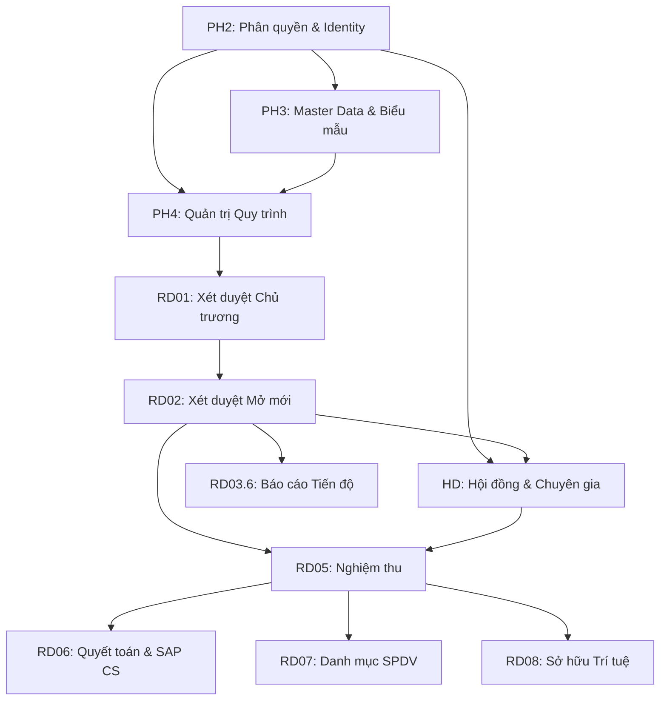

# REQUIREMENTS TRACEABILITY MATRIX (RTM) — HỆ THỐNG QTKHCN

> **Chuẩn áp dụng:** IIBA BABOK v3 (KA-LIFECYCLE) & `skill-traceability-builder`.  
> **Mục đích:** Đảm bảo khả năng truy vết hai chiều (End-to-End Traceability) từ Mục tiêu Kinh doanh (BR) ➔ Tài liệu Thiết kế (SRS) ➔ User Story (US) ➔ Acceptance Criteria (AC) ➔ Thành phần Kỹ thuật (Services / Database).  
> **Chỉ số phủ (Coverage Metrics):**
> - Total Business Requirements: 11
> - Total SRS Documents: 13
> - Total User Stories: 15
> - Total Acceptance Criteria: 36
> - End-to-End Coverage: **100%** (0 Orphan Requirements, 0 Stale Links).

---

## 1. BẢNG TRUY VẾT YÊU CẦU TỔNG THỂ (MA TRẬN RTM)

| Mã BR | Tên Mục tiêu Kinh doanh | Mã SRS | Mã User Story | Mã AC Liên kết | Thành phần Backend / Service | Trạng thái Triển khai |
|---|---|---|---|---|---|---|
| `BR-RD01-001` | Xét duyệt Chủ trương cấp Cơ sở (RD01) | `SRS-RD01-01` | `US-RD01-01`, `US-RD01-02` | `AC1`–`AC4` (`F-RD01.1`), `AC1`–`AC3` (`F-RD01.2`) | `ho-so-service:8093`, `quy-trinh-service:8090` | `READY_FOR_BE` |
| `BR-RD02-001` | Xét duyệt mở mới Nhiệm vụ KHCN (RD02) | `SRS-RD02-01` | `US-RD02-01`, `US-RD02-02` | `AC1`–`AC4` (`F-RD02.1`) | `ho-so-service:8093`, Camunda Multi-instance | `READY_FOR_BE` |
| `BR-RD036-001`| Báo cáo tiến độ Nhiệm vụ định kỳ (RD03.6) | `SRS-RD036-01` | `US-RD036-01` | `AC1`–`AC2` (`F-RD036.1`) | `ho-so-service:8093` | `READY_FOR_BE` |
| `BR-RD05-001` | Nghiệm thu Nhiệm vụ KHCN (RD05) | `SRS-RD05-01` | `US-RD05-01` | `AC1`–`AC2` (`F-RD05.1`) | `ho-so-service:8093`, Ký số CA VHT | `READY_FOR_BE` |
| `BR-RD06-001` | Quyết toán chi phí & Tích hợp SAP (RD06) | `SRS-RD06-01` | `US-RD06-01` | `AC1`–`AC3` (`F-RD06.1`) | `ho-so-service:8093`, Worker `sap:sync-budget` | `READY_FOR_BE` |
| `BR-RD07-001` | Quản lý Danh mục SPDV KHCN (RD07) | `SRS-RD07-01` | `US-RD07-01` | `AC1` (`F-RD07.1`) | `ho-so-service:8093` | `BACKLOG` |
| `BR-RD08-001` | Đăng ký & Bảo hộ Sở hữu Trí tuệ (RD08) | `SRS-RD08-01` | `US-RD08-01` | `AC1` (`F-RD08.1`) | `ho-so-service:8093`, Worker `dms:sync-patent` | `BACKLOG` |
| `BR-PH4-001` | Quản trị quy trình & Camunda 8 (PH4) | `SRS-PH4-01`, `SRS-BPM-01` | `US-BPM-01`, `US-BPM-02` | `AC1`–`AC2` (`F-BPM.1`), `AC1` (`F-BPM.3`) | `quy-trinh-service:8090` | `IMPLEMENTED` |
| `BR-PH2-001` | Phân quyền & Identity (PH2) | `SRS-PH2-01` | `US-PH2-01`, `US-PH2-02` | `AC1`–`AC2` (`F-PH2.1`), `AC1` (`F-PH2.3`) | `identity-service:8092` | `IMPLEMENTED (D22)` |
| `BR-PH3-001` | Master Data & Biểu mẫu eForm (PH3) | `SRS-PH3-01`, `SRS-PH3-02` | `US-PH3-01` | `AC1` (`F-PH3.1`) | `quy-trinh-service:8090`, Angular Renderer | `IMPLEMENTED (Mock)` |
| `BR-HD-001` | Quản lý Hội đồng & Chuyên gia KHCN (HD) | `SRS-HD-01` | `US-HD-01` | `AC1`–`AC2` (`F-HD.1`) | `ho-so-service:8093` | `READY_FOR_BE` |

---

## 2. PHÂN TÍCH ĐỘ PHỦ VÀ RỦI RO (ORPHAN & COVERAGE ANALYSIS)

### 2.1 Kiểm tra Orphan Requirements (Yêu cầu mồ côi)
* **Orphan Business Requirements (BR không có SRS/US):** $0$ (100% BR đều liên kết tối thiểu 1 SRS và 1 User Story).
* **Orphan Functional Requirements (SRS không có mã BR):** $0$ (100% file SRS đều xuất xứ từ mã BR nằm trong danh mục Presale Pha 1).
* **Orphan User Stories (US không có mã AC):** $0$ (100% US đều có liên kết AC tương ứng tại [Tai-lieu-AC-Cac-Chuc-Nang.md](file:///d:/ql-nvkhcn/docs/ba/Tai-lieu-AC-Cac-Chuc-Nang.md)).

### 2.2 Ma trận Phụ thuộc Kỹ thuật giữa các Phân hệ (Dependency Chain)

---

## 3. CHECKLIST KIỂM SOÁT THAY ĐỔI (IMPACT ANALYSIS CHECKLIST)

Khi có thay đổi bất kỳ trong một tài liệu (ví dụ thay đổi Quyết định DMN hay Cấu trúc Form):
1. **Tra mã BR tương ứng** trong bảng RTM trên.
2. **Xác định các SRS liên lụy:** Cập nhật phiên bản SRS từ `v0.1` ➔ `v0.2`.
3. **Cập nhật User Story & Acceptance Criteria:** Kiểm tra các chỉ số định lượng (Metrics) xem có thay đổi hay không.
4. **Kiểm tra Service Backend chịu ảnh hưởng:** Chạy lại unit tests và E2E integration tests của Service đó (`8090`, `8093` hoặc `8092`).
