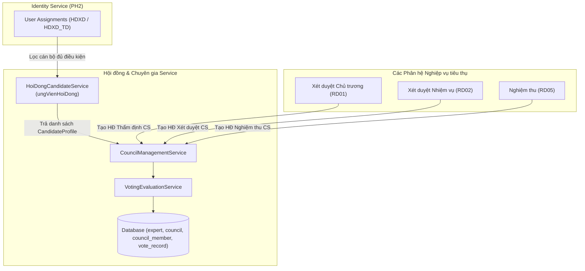

# TÀI LIỆU THIẾT KẾ CHI TIẾT (SRS)
## THIẾT KẾ CHI TIẾT QUẢN LÝ HỘI ĐỒNG VÀ CHUYÊN GIA (EXPERT & COUNCIL MANAGEMENT)

**Phân hệ**: HD — Hội đồng & Chuyên gia (Cross-cutting Module dùng chung RD01, RD02, RD05)

### Bảng ghi nhận thay đổi
| Phiên bản | Ngày | Tác giả | Nội dung thay đổi |
|---|---|---|---|
| 0.1 | 2026-08-05 | BA-AI | Khởi tạo bản thảo SRS pilot cho Phân hệ Hội đồng & Chuyên gia |
| 0.2 | 2026-08-05 | BA-AI | Cập nhật `HoiDongCandidateService` và danh mục `ungVienHoiDong` từ nhánh `trangdt` |
| 0.3 | 2026-08-05 | BA-AI | Tự kiểm tra & nâng cấp đầy đủ các tiểu mục 3.X.1–3.X.5 và bảng 7 cột cho toàn bộ 7 tính năng theo DoD Harness |
| 0.4 | 2026-08-06 | BA-AI | Cập nhật màn hình và thành phần cho chức năng Tạo mới Hội đồng xét duyệt (Section 10) |

### Trang ký
| Vai trò | Người thực hiện | Chức danh | Ngày ký | Chữ ký |
|---|---|---|---|---|
| Người lập | BA-AI | Business Analyst | 2026-08-05 | |
| Người kiểm tra | | BA Lead / Tech Lead | | |
| Người phê duyệt | | Product Owner | | |
| Đại diện khách hàng | | VTS / VTIT | | |

### Mục lục
- [1. GIỚI THIỆU](#1-giới-thiệu)
  - [1.1 Mục đích](#11-mục-đích)
  - [1.2 Phạm vi](#12-phạm-vi)
  - [1.3 Khái niệm và thuật ngữ](#13-khái-niệm-và-thuật-ngữ)
  - [1.4 Tài liệu tham khảo](#14-tài-liệu-tham-khảo)
  - [1.5 Mô tả tài liệu](#15-mô-tả-tài-liệu)
- [2. TỔNG QUAN GIẢI PHÁP](#2-tổng-quan-giải-pháp)
  - [2.1 Tổng quan chức năng](#21-tổng-quan-chức-năng)
  - [2.2 Mô hình giao tiếp với module/hệ thống khác](#22-mô-hình-giao-tiếp-với-modulehệ-thống-khác)
- [3. THIẾT KẾ CHI TIẾT](#3-thiết-kế-chi-tiết)
  - [3.1 Quản lý danh mục hồ sơ chuyên gia](#31-quản-lý-danh-mục-hồ-sơ-chuyên-gia)
  - [3.2 Quản lý danh mục hội đồng](#32-quản-lý-danh-mục-hội-đồng)
  - [3.3 Quyết định thành lập hội đồng](#33-quyết-định-thành-lập-hội-đồng)
  - [3.4 Phân công thành viên & vai trò trong hội đồng](#34-phân-công-thành-viên--vai-trò-trong-hội-đồng)
  - [3.5 Nhập phiếu nhận xét / đánh giá của thành viên](#35-nhập-phiếu-nhận-xét--đánh-giá-của-thành-viên)
  - [3.6 Tổng hợp kết quả & lập Biên bản họp hội đồng](#36-tổng-hợp-kết-quả--lập-biên-bản-họp-hội-đồng)
  - [3.7 Theo dõi tiến độ ký & Quorum hội đồng](#37-theo-dõi-tiến-độ-ký--quorum-hội-đồng)
- [4. THIẾT KẾ DÙNG CHUNG VÀ TÁI SỬ DỤNG](#4-thiết-kế-dùng-chung-và-tái-sử-dụng)
  - [4.1 Thông báo và phản hồi người dùng](#41-thông-báo-và-phản-hồi-người-dùng)
  - [4.2 Quy tắc xử lý giao tiếp hệ thống](#42-quy-tắc-xử-lý-giao-tiếp-hệ-thống)
  - [4.3 Phân quyền và bảo mật](#43-phân-quyền-và-bảo-mật)
- [5. THIẾT KẾ ĐẢM BẢO TUÂN THỦ TIÊU CHUẨN QUẢN TRỊ DỮ LIỆU](#5-thiết-kế-đảm-bảo-tuân-thủ-tiêu-chuẩn-quản-trị-dữ-liệu)
  - [5.1 Chất lượng dữ liệu](#51-chất-lượng-dữ-liệu)
  - [5.2 Lịch sử và khả năng truy vết](#52-lịch-sử-và-khả-năng-truy-vết)
  - [5.3 Phân quyền và kiểm soát truy cập](#53-phân-quyền-và-kiểm-soát-truy-cập)
  - [5.4 Vòng đời và lưu trữ dữ liệu](#54-vòng-đời-và-lưu-trữ-dữ-liệu)
  - [5.5 Dữ liệu cá nhân](#55-dữ-liệu-cá-nhân)
  - [5.6 Quản trị dữ liệu](#56-quản-trị-dữ-liệu)
  - [5.7 Kiến trúc & tích hợp dữ liệu](#57-kiến-trúc--tích-hợp-dữ-liệu)
- [6. PHỤ LỤC](#6-phụ-lục)
  - [6.1 Mẫu tệp nhập và xuất dữ liệu](#61-mẫu-tệp-nhập-và-xuất-dữ-liệu)
  - [6.2 Đề xuất bổ sung thiết kế cơ sở dữ liệu](#62-đề-xuất-bổ-sung-thiết-kế-cơ-sở-dữ-liệu)
  - [6.3 Danh mục điểm chờ xác nhận](#63-danh-mục-điểm-chờ-xác-nhận)
  - [6.4 Phụ thuộc module/dữ liệu khác](#64-phụ-thuộc-moduledữ-liệu-khác)

---

## 1. GIỚI THIỆU

### 1.1 Mục đích
Tài liệu SRS này quy định thiết kế chi tiết cho phân hệ **Hội đồng & Chuyên gia (HD)** — dịch vụ dùng chung xuyên cắt hỗ trợ quản lý cơ sở dữ liệu chuyên gia, quy trình thành lập Hội đồng và chấm điểm đánh giá cho các khâu Chủ trương (RD01), Xét duyệt Nhiệm vụ (RD02) và Nghiệm thu (RD05).

### 1.2 Phạm vi
- Quản lý lý lịch khoa học của Chuyên gia trong và ngoài Viettel.
- Quản lý Quyết định thành lập Hội đồng và tự động lọc danh sách ứng viên đủ điều kiện (`HDXD`, `HDXD_TD`).
- Quản lý phiên họp Hội đồng, chấm phiếu cá nhân, biên bản tổng hợp và theo dõi tỷ lệ quorum.

### 1.3 Khái niệm và thuật ngữ
| Thuật ngữ | Diễn giải |
|---|---|
| **HĐXD** | Hội đồng xét duyệt Nhiệm vụ KHCN Cấp Cơ sở. |
| **HĐNT** | Hội đồng nghiệm thu Nhiệm vụ KHCN Cấp Cơ sở. |
| **Quorum** | Tỷ lệ số lượng thành viên hội đồng tối thiểu có mặt và nộp phiếu đánh giá (tối thiểu 2/3). |
| **Candidate Profile** | Hồ sơ năng lực ứng viên hội đồng nạp từ Identity Service. |

### 1.4 Tài liệu tham khảo
1. `frontend-angular/src/app/core/services/hoi-dong-candidate.service.ts`
2. `docs/req/RD01-RD02-requirements.md`

### 1.5 Mô tả tài liệu
Tài liệu được cấu trúc đủ 6 mục cấp 1 theo chuẩn DoD Harness QTKHCN.

---

## 2. TỔNG QUAN GIẢI PHÁP

### 2.1 Tổng quan chức năng
Cung cấp dịch vụ quản lý Hội đồng tập trung, tích hợp với E-Form Engine PH3-02 và Process Engine PH4.

### 2.2 Mô hình giao tiếp với module/hệ thống khác

---

## 3. THIẾT KẾ CHI TIẾT

### 3.1 Quản lý danh mục hồ sơ chuyên gia

#### 3.1.1 Thông tin chung chức năng
- **Tác nhân**: Quản trị viên danh mục / Thư ký Hội đồng (`ROLE_ADMIN`, `ROLE_SECRETARY`).
- **Ý nghĩa**: Lưu trữ thông tin lý lịch khoa học, học hàm, học vị và lĩnh vực nghiên cứu của Chuyên gia.
- **Đường dẫn**: Quản trị hội đồng > Danh mục chuyên gia (`/hoi-dong/chuyen-gia`).

#### 3.1.2 Màn hình
| STT | Tên màn hình | Mô tả | Ghi chú |
|---|---|---|---|
| 1 | Danh sách chuyên gia | Datagrid hiển thị hồ sơ chuyên gia | Có bộ lọc theo Lĩnh vực & Đơn vị |
| 2 | Drawer Hồ sơ chuyên gia | Form tạo mới / chỉnh sửa lý lịch khoa học chuyên gia | Ant Design Drawer |

#### 3.1.3 Mô tả chi tiết các thành phần (Bảng 7 cột)
| STT | Tên | Kiểu dữ liệu [Độ dài] | Input/Output | Giá trị khởi tạo | Mô tả mapping CSDL | Ghi chú |
|---|---|---|---|---|---|---|
| 1 | Mã chuyên gia* | Textbox [50] | Input | Blank | Unique. `expert.code` | Bắt buộc nhập |
| 2 | Họ và tên* | Textbox [100] | Input | Blank | `expert.full_name` | Bắt buộc nhập |
| 3 | Email* | Textbox [100] | Input | Blank | `expert.email` | Dùng để xác thực và gửi thông báo |
| 4 | Học hàm / Học vị | Combobox | Input | "Tiến sĩ" | Trỏ tới Danh mục PH3-01 | TS, PGS, GS |
| 5 | Lĩnh vực chuyên môn* | Multi-Select | Input | Blank | JSON array mã lĩnh vực | Trỏ tới Danh mục Lĩnh vực |
| 6 | Đơn vị công tác | Textbox [255] | Input | Blank | `expert.workplace` | Viettel / Ngoài Viettel |
| 7 | Trạng thái | Switch | Input | Enabled | `expert.status` (`ACTIVE`/`INACTIVE`) | |

#### 3.1.4 Luồng nghiệp vụ
| Bước | Mô tả |
|---|---|
| 1 | Thư ký chọn **Thêm chuyên gia**, nhập thông tin lý lịch khoa học. |
| 2 | Hệ thống kiểm tra trùng email và mã chuyên gia. |
| 3 | Lưu thông tin vào CSDL `expert` và tự động lập chỉ mục phục vụ tìm kiếm theo lĩnh vực. |

#### 3.1.5 Quy tắc nghiệp vụ
| Mã quy tắc | Quy tắc |
|---|---|
| `BR-HD-EXP-01` | Mã chuyên gia không được trùng lặp và không chứa khoảng trắng. |

---

### 3.2 Quản lý danh mục hội đồng

#### 3.2.1 Thông tin chung chức năng
- **Tác nhân**: Quản trị viên quy trình / Thư ký Hội đồng (`ROLE_SECRETARY`).
- **Ý nghĩa**: Xem danh sách các Hội đồng và thực hiện khai báo, thêm mới các Hội đồng xét duyệt, thẩm định hoặc nghiệm thu.
- **Đường dẫn**: Quản lý NV KHCN & HS > Quản lý Hội đồng (`/hoi-dong/danh-sach`).

#### 3.2.2 Màn hình
| STT | Tên màn hình | Mô tả | Ảnh |
|---|---|---|---|
| 1 | Danh sách Hội đồng | Hiển thị các Hội đồng hiện có trong hệ thống, cho phép tìm kiếm và đi tiếp đến tạo mới | `` |
| 2 | Màn hình Thêm mới Hội đồng | Form thêm mới Hội đồng và nhập thông tin cơ bản | `` |

#### 3.2.3 Mô tả chi tiết các thành phần (Bảng 7 cột)
| STT | Tên | Kiểu dữ liệu [Độ dài] | Input/Output | Giá trị khởi tạo | Mô tả mapping CSDL | Ghi chú |
|---|---|---|---|---|---|---|
| **Điều kiện tìm kiếm** | | | | | | |
| 1 | Mã / Tên Hội đồng | Textbox [100] | Input | Blank | So khớp chứa trong `council.code` / `council.name` | |
| 2 | Loại Hội đồng | Combobox | Input | "Tất cả" | Lọc theo `council.type` | |
| 3 | Nút Tìm kiếm | Button | Input | Enabled | Thực hiện tìm kiếm theo bộ lọc | |
| **Datagrid danh sách Hội đồng** | | | | | | |
| 4 | Mã Hội đồng* | Link Column | Output | | Unique. `council.code` | Click để xem chi tiết Hội đồng |
| 5 | Tên Hội đồng | Label Column | Output | | `council.name` | |
| 6 | Loại Hội đồng | Tag Column | Output | | Enum: `THAM_DINH`, `XET_DUYET`, `NGHIEM_THU` | |
| 7 | Cấp Hội đồng | Tag Column | Output | | Enum: `CS`, `TD` | |
| 8 | Số lượng thành viên | Label Column | Output | | Đếm số thành viên trong `council_member` | |
| 9 | Trạng thái | Tag Column | Output | | Enum: `DRAFT`, `ACTIVE`, `COMPLETED` | |
| **Thao tác danh sách** | | | | | | |
| 10 | Nút Tạo hội đồng | Button | Input | Enabled | Mở màn hình Thêm mới Hội đồng | |
| **Khối thông tin thêm mới** | | | | | | |
| 11 | Mã Hội đồng* | Textbox [50] | Input | Tự động sinh | Unique. `council.code` | Bắt buộc nhập |
| 12 | Tên Hội đồng* | Textbox [255] | Input | Blank | `council.name` | Bắt buộc nhập |
| 13 | Loại Hội đồng* | Combobox | Input | "XET_DUYET" | Enum: `THAM_DINH`, `XET_DUYET`, `NGHIEM_THU` | |
| 14 | Cấp Hội đồng* | Combobox | Input | "CS" | Enum: `CS`, `TD` | |
| 15 | Ghi chú | Textarea [500] | Input | Blank | `council.description` | |
| 16 | Nút Lưu | Button | Input | Enabled | Lưu và quay lại màn hình danh sách | |
| 17 | Nút Hủy | Button | Input | Enabled | Hủy và quay lại màn hình danh sách | |

#### 3.2.4 Luồng nghiệp vụ
##### A. Tìm kiếm & xem danh sách
| Bước | Mô tả |
|---|---|
| 1 | Người dùng truy cập đường dẫn `/hoi-dong/danh-sach`. |
| 2 | Hệ thống nạp danh sách Hội đồng và hiển thị lên datagrid. |
| 3 | Người dùng nhập tiêu chí và click **Tìm kiếm** để lọc danh sách. |

##### B. Thêm mới Hội đồng
| Bước | Mô tả |
|---|---|
| 1 | Thư ký click nút **Tạo hội đồng** từ màn hình danh sách. |
| 2 | Hệ thống hiển thị Màn hình Thêm mới Hội đồng. |
| 3 | Thư ký điền các trường thông tin bắt buộc và click **Lưu**. |
| 4 | Backend kiểm tra trùng mã Hội đồng trong CSDL. Nếu hợp lệ, lưu vào bảng `council` với trạng thái `DRAFT` và quay về hiển thị lại màn hình danh sách kèm thông báo thành công. |

#### 3.2.5 Quy tắc nghiệp vụ
| Mã quy tắc | Quy tắc | Áp dụng cho | Trạng thái |
|---|---|---|---|
| `BR-HD-COU-01` | Một Hội đồng Cấp cơ sở phải thuộc một Đơn vị quản lý cụ thể. | Tạo mới Hội đồng | Chốt |
| `BR-HD-COU-02` | Mã Hội đồng không được chứa khoảng trắng và ký tự đặc biệt, không được trùng lặp trong CSDL. | Tạo mới Hội đồng | Chốt |

---

### 3.3 Quyết định thành lập hội đồng

#### 3.3.1 Thông tin chung chức năng
- **Tác nhân**: Lãnh đạo ký duyệt / Thư ký.
- **Ý nghĩa**: Phát hành Quyết định thành lập Hội đồng sử dụng mẫu eForm `bm-02-08-qdh-nv`.
- **Nguồn code**: `frontend-angular/src/app/core/services/hoi-dong-candidate.service.ts`.

#### 3.3.2 Mô tả chi tiết các thành phần (Bảng 7 cột)
| STT | Tên | Kiểu dữ liệu [Độ dài] | Input/Output | Giá trị khởi tạo | Mô tả mapping CSDL | Ghi chú |
|---|---|---|---|---|---|---|
| 1 | Số Quyết định* | Textbox [100] | Input | Blank | `council_decision.decision_no` | Bắt buộc nhập |
| 2 | Ngày ban hành* | Datepicker | Input | Ngày hiện tại | `council_decision.issued_date` | |
| 3 | Người ký Quyết định | Combobox | Input | Blank | Lãnh đạo có quyền ban hành QĐ | |
| 4 | Danh sách ứng viên | Dropdown Multi | Input | Nạp từ Service | Nạp từ `HoiDongCandidateService` (`ungVienHoiDong`) | Tự động điền `CandidateProfile` |

#### 3.3.3 Luồng nghiệp vụ
| Bước | Mô tả |
|---|---|
| 1 | Thư ký mở form `bm-02-08-qdh-nv`. |
| 2 | Chọn các thành viên từ danh sách `ungVienHoiDong`. Hệ thống tự động nạp Họ tên, Chức danh, Mã NV, Đơn vị, Email. |
| 3 | Trình Lãnh đạo ký ban hành Quyết định. |

---

### 3.4 Phân công thành viên & vai trò trong hội đồng

#### 3.4.1 Thông tin chung chức năng
- **Tác nhân**: Thư ký Hội đồng.
- **Ý nghĩa**: Gán vai trò cụ thể cho từng thành viên trong Hội đồng.

#### 3.4.2 Mô tả chi tiết các thành phần (Bảng 7 cột)
| STT | Tên | Kiểu dữ liệu [Độ dài] | Input/Output | Giá trị khởi tạo | Mô tả mapping CSDL | Ghi chú |
|---|---|---|---|---|---|---|
| 1 | Thành viên* | Select | Input | Blank | Trỏ tới `expert.email` / `userId` | |
| 2 | Vai trò trong HĐ* | Select | Input | "UY_VIEN" | Enum: `CHU_TICH`, `THU_KY`, `PHAN_BIEN_1`, `PHAN_BIEN_2`, `UY_VIEN` | Bắt buộc |
| 3 | Ghi chú nhiệm vụ | Textbox [255] | Input | Blank | `council_member.note` | |

#### 3.4.3 Quy tắc nghiệp vụ
| Mã quy tắc | Quy tắc |
|---|---|
| `BR-HD-MEM-01` | Mỗi Hội đồng bắt buộc phải có đúng 1 Chủ tịch và 1 Thư ký. |
| `BR-HD-MEM-02` | Tổng số lượng thành viên Hội đồng phải là số lẻ (tối thiểu 5 thành viên cho HĐXD/HĐNT). |

---

### 3.5 Nhập phiếu nhận xét / đánh giá của thành viên

#### 3.5.1 Thông tin chung chức năng
- **Tác nhân**: Thành viên Hội đồng (`ROLE_EXPERT`).
- **Ý nghĩa**: Mỗi thành viên nhập phiếu chấm điểm cá nhân cho từng hồ sơ nhiệm vụ.

#### 3.5.2 Mô tả chi tiết các thành phần (Bảng 7 cột)
| STT | Tên | Kiểu dữ liệu [Độ dài] | Input/Output | Giá trị khởi tạo | Mô tả mapping CSDL | Ghi chú |
|---|---|---|---|---|---|---|
| 1 | Điểm tổng hợp* | InputNumber [5,2] | Input | `0.0` | `council_vote.total_score` | Thang điểm 100 |
| 2 | Đánh giá chung* | Radio Group | Input | "Đạt" | Enum: `DAT`, `KHONG_DAT`, `DAT_SUA_DOI` | |
| 3 | Ý kiến chi tiết | Textarea [2000] | Input | Blank | `council_vote.comments` | Bắt buộc khi Chọn Đạt sửa đổi/Không đạt |

---

### 3.6 Tổng hợp kết quả & lập Biên bản họp hội đồng

#### 3.6.1 Thông tin chung chức năng
- **Tác nhân**: Thư ký Hội đồng.
- **Ý nghĩa**: Tự động tính toán điểm trung bình cộng, xếp loại kết quả và xuất Biên bản họp Hội đồng.

#### 3.6.2 Mô tả chi tiết các thành phần (Bảng 7 cột)
| STT | Tên | Kiểu dữ liệu [Độ dài] | Input/Output | Giá trị khởi tạo | Mô tả mapping CSDL | Ghi chú |
|---|---|---|---|---|---|---|
| 1 | Điểm trung bình | Label | Output | `0.0` | Tính trung bình cộng phiếu của các thành viên | |
| 2 | Kết luận Hội đồng | Badge | Output | "Đạt" | Enum: `PASSED`, `FAILED`, `PASSED_WITH_REVISION` | Tự động tính theo BR |
| 3 | Trích yếu biên bản | Textarea [1000] | Input | Blank | `council_minutes.summary` | Thư ký ghi nhận |

---

### 3.7 Theo dõi tiến độ ký & Quorum hội đồng

#### 3.7.1 Thông tin chung chức năng
- **Tác nhân**: Thư ký / Quản trị quy trình.
- **Ý nghĩa**: Giám sát số lượng thành viên đã gửi phiếu đánh giá, đảm bảo đạt tỷ lệ Quorum $\ge 2/3$.

#### 3.7.2 Mô tả chi tiết thành phần
| STT | Tên | Kiểu dữ liệu [Độ dài] | Input/Output | Giá trị khởi tạo | Mô tả mapping CSDL | Ghi chú |
|---|---|---|---|---|---|---|
| 1 | Tỷ lệ Nộp phiếu | Progress Bar | Output | `0%` | Thể hiện số phiếu nộp / Tổng số thành viên | Cảnh báo cam nếu chưa đủ 2/3 |
| 2 | Trạng thái Quorum | Tag Column | Output | "Chưa đủ Quorum" | Tag xanh "Đủ Quorum" khi $\ge 66.6\%$ | |

---

## 4. THIẾT KẾ DÙNG CHUNG VÀ TÁI SỬ DỤNG
- Service `HoiDongCandidateService` và Component `CouncilPanelComponent` dùng chung cho các màn hình chi tiết hồ sơ RD01, RD02, RD05.

---

## 5. THIẾT KẾ ĐẢM BẢO TUÂN THỦ TIÊU CHUẨN QUẢN TRỊ DỮ LIỆU
- Tuân thủ 7 tiêu chuẩn quản trị dữ liệu (5.1–5.7).

---

## 6. PHỤ LỤC
- Nguồn code: `frontend-angular/src/app/core/services/hoi-dong-candidate.service.ts`.
- Bảng CSDL: `expert`, `council`, `council_member`, `council_vote`, `council_minutes`.
