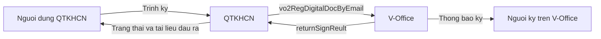
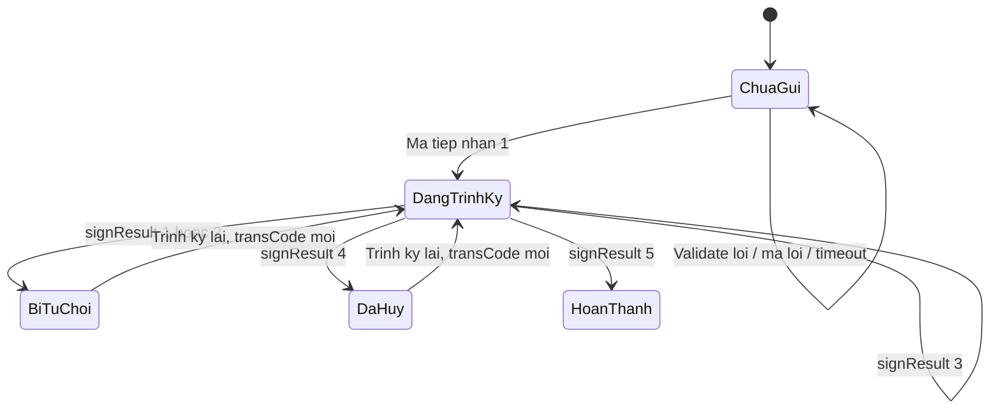

# SRS-INT-01 — Trình ký văn bản điện tử qua V-Office

## TÀI LIỆU THIẾT KẾ CHI TIẾT (SRS)

**Phân hệ**: Tích hợp — Trình ký văn bản điện tử qua V-Office (VOffice Sign)

**Nháp chờ xác nhận.** Còn OQ mức Cao đang Mở: `OQ-QTKHCN-031`, `OQ-QTKHCN-037`. Tài liệu chưa đủ điều kiện ký duyệt (TBD > 10%).

## BẢNG GHI NHẬN THAY ĐỔI TÀI LIỆU

| Phiên bản | Ngày | Người sửa | Phần bị sửa | Lý do |
|---|---|---|---|---|
| 0.1.0 | 23/09/2026 | BA-AI | Toàn bộ | Tạo mới từ URD-VOFFICE-SIGN-01 v1.1, US-VOFFICE-01, US-VOFFICE-02 theo ISO/IEC/IEEE 29148:2018 |

## TRANG KÝ

| Vai trò | Họ và tên | Chức danh | Chữ ký | Ngày |
|---|---|---|---|---|
| Người lập | | Chuyên viên phân tích nghiệp vụ | | |
| Người kiểm tra | | Trưởng nhóm phân tích nghiệp vụ | | |
| Người phê duyệt | | Quản trị dự án | | |
| Đại diện khách hàng | | | | |

## MỤC LỤC

1. [Introduction](#1-introduction)
2. [Overall Description](#2-overall-description)
3. [Specific Requirements](#3-specific-requirements)
4. [Verification](#4-verification)
5. [Appendices](#5-appendices)
6. [Completeness Report](#6-completeness-report)

---

## 1. Introduction

### 1.1 Mục đích

SRS này đặc tả yêu cầu phần mềm cho chức năng trình ký văn bản điện tử hai chiều giữa QTKHCN và V-Office: QTKHCN gọi Web Service `vo2RegDigitalDocByEmail` để gửi trình ký, và công bố Web Service callback để nhận `returnSignReult`.

Đối tượng dùng tài liệu: lập trình viên backend, kiểm thử, kiến trúc sư, quản trị hạ tầng/bảo mật, Product Owner. Tài liệu là căn cứ lập technical design, test case và chuẩn bị kết nối trước go-live.

### 1.2 Phạm vi

**Trong phạm vi**

- Gửi yêu cầu trình ký (outbound, đồng bộ) và xử lý mã tiếp nhận.
- Tiếp nhận callback kết quả ký (inbound), xác thực nguồn, cập nhật trạng thái, lịch sử, số ban hành.
- Validate trước khi gọi V-Office, mã hóa tham số nhạy cảm, log, cảnh báo lỗi cấu hình, gửi lại khi lỗi kết nối, đối soát giao dịch treo, tra cứu lịch sử trình ký.

**Ngoài phạm vi**

- Soạn thảo nội dung văn bản và tạo file PDF.
- Ký số và xác thực chữ ký trên V-Office.
- Cấu hình sơ đồ tổ chức, phân quyền người ký và mẫu hình thức văn bản trên V-Office.
- Đồng bộ danh mục người dùng V-Office (hạ tầng dữ liệu dùng chung). QTKHCN chỉ tra cứu/tiêu thụ `userId`, `adOrgId`.
- Cập nhật trạng thái thủ công hàng loạt.
- Callback batch `returnMultiSignReult` — chỉ đưa vào phạm vi nếu `OQ-QTKHCN-032` được xác nhận là cần.

### 1.3 Định nghĩa

| Thuật ngữ | Định nghĩa |
|---|---|
| V-Office / VOffice | Hệ thống văn phòng điện tử của Viettel, điều phối ký duyệt và ban hành văn bản |
| transCode | Mã giao dịch duy nhất do QTKHCN sinh cho mỗi lần gửi trình ký, dùng đối chiếu callback |
| APP_CODE / APP_PASS | Mã và mật khẩu ứng dụng tích hợp do VIC cấp |
| Callback | SOAP request V-Office gửi về QTKHCN khi trạng thái ký đổi |
| ResultObj | Đối tượng dữ liệu trong callback |
| KTTSVofficeCommInpuParam | Đối tượng tham số của `vo2RegDigitalDocByEmail` |
| Văn thư xét duyệt | Bước xét duyệt hành chính trước người ký chính thức; tắt được bằng `isCanVanthuXetduyet = false` |
| Đơn vị ban hành | Đơn vị phát hành văn bản sau khi ký xong |
| Idempotent | Gọi lại cùng khóa đã xử lý không tạo thêm lịch sử và không đính kèm file lần hai |

Trạng thái task trình ký trên QTKHCN (bộ trạng thái duy nhất của SRS này):

| Trạng thái | Ý nghĩa |
|---|---|
| Trạng thái trước khi bấm Trình ký | Giữ nguyên khi gửi thất bại, timeout, hoặc validate lỗi |
| Đang trình ký | V-Office đã tiếp nhận (mã 1). Giữ nguyên khi nhận `signResult = 3` |
| Hoàn thành | `signResult = 5`. Không được trình ký lại |
| Bị từ chối | `signResult = 1` (văn thư) hoặc `signResult = 2` (người ký). Được trình ký lại bằng transCode mới |
| Đã hủy | `signResult = 4`. Được trình ký lại bằng transCode mới |

`signResult = 1` và `signResult = 2` cùng nhãn tổng thể **Bị từ chối**, và QTKHCN SHALL lưu phân loại bước (văn thư / người ký) để thống kê.

### 1.4 Tài liệu tham chiếu

| Mã | Tài liệu |
|---|---|
| URD-VOFFICE-SIGN-01 v1.1 | URD chức năng trình ký văn bản điện tử qua V-Office |
| US-VOFFICE-01 | User story trình ký văn bản qua V-Office |
| US-VOFFICE-02 | User story tiếp nhận kết quả ký từ V-Office |
| VIC-WS | Tài liệu đặc tả Web Service trình ký V-Office do VIC cung cấp (được URD dẫn chiếu; file gốc không nằm trong gói đầu vào lần này) |
| D3 | Camunda chỉ giữ biến điều phối, không giữ dữ liệu nghiệp vụ trình ký |
| D18 | Dữ liệu hồ sơ/văn bản nằm ở service Quản lý NV KHCN & Hồ sơ |
| OQ-QTKHCN-010 | OQ sẵn có: cơ chế tích hợp V-Office khi BGĐ ký quyết định dự thảo ở RD02. SRS này đặc tả năng lực dùng chung; không thay OQ đó |

### 1.5 Tổng quan tài liệu

Phần 2 mô tả bối cảnh và ràng buộc. Phần 3 là yêu cầu đặc tả (FR theo EARS, giao diện, NFR). Phần 4 là cách kiểm chứng. Phần 5 là phụ lục và điểm chờ xác nhận. Phần 6 là báo cáo mức độ hoàn chỉnh.

---

## 2. Overall Description

### 2.1 Bối cảnh

Hiện tại người dùng xuất file, đăng nhập V-Office để tạo trình ký, rồi tra cứu kết quả và cập nhật lại hồ sơ trên QTKHCN. SRS này thay chuỗi thao tác đó bằng một lệnh Trình ký trên QTKHCN và callback tự động.

QTKHCN đồng thời là client (gọi `vo2RegDigitalDocByEmail`) và server (công bố endpoint callback). Lời gọi trình ký chỉ nhận mã tiếp nhận. Kết quả ký đến sau, bất đồng bộ.

*Sơ đồ ngữ cảnh diễn giải từ URD §3.3, không phải hình gốc blueprint.*

### 2.2 Chức năng chính

1. Chuẩn bị người ký, file PDF và tham số luồng ký.
2. Validate, sinh transCode, mã hóa, gọi trình ký, cập nhật **Đang trình ký** hoặc giữ nguyên trạng thái.
3. Nhận callback, xác thực, cập nhật lịch sử và trạng thái theo `signResult`.
4. Khi ban hành: ghi số văn bản, ngày ban hành, đơn vị ban hành, đính kèm file kết quả nếu V-Office trả file.
5. Tra cứu lịch sử, đối soát giao dịch treo, cảnh báo lỗi cấu hình.

### 2.3 Người dùng

| Lớp | Mô tả | Tần suất | Quyền đề xuất |
|---|---|---|---|
| Người trình ký | Soạn xong văn bản, bấm Trình ký | Theo từng văn bản | `VOFFICE_SIGN.CREATE` |
| Người xem | Xem trạng thái, lý do, lịch sử | Theo từng văn bản | `VOFFICE_SIGN.VIEW`, `VOFFICE_SIGN.VIEW_HISTORY` |
| Quản trị hệ thống | Nhận cảnh báo cấu hình, đối soát, cập nhật thủ công đơn lẻ có log | Khi có lỗi hoặc giao dịch treo | `VOFFICE_SIGN.ADMIN` |
| V-Office | Gọi callback | Theo sự kiện ký | Xác thực `appCode` / `appPass` và/hoặc IP whitelist, không dùng quyền UI |

Ánh xạ 4 mã quyền này sang catalog quyền QTKHCN: `OQ-QTKHCN-035`.

### 2.4 Môi trường vận hành

| Môi trường | WSDL trình ký (URD §6.2) |
|---|---|
| Test | `http://10.30.132.82:8591/WS_AutoSign/Vo2AutoSignSystemImpl?wsdl` |
| Production | `http://10.60.101.245:8868/WS_AutoSign/Vo2AutoSignSystemImpl?wsdl` |

Callback mẫu trong URD: `POST http://<host>:<port>/api/v1/voffice-gateway/soap/ws/voffice`, `Content-Type: text/xml`, SOAP RPC, namespace `http://vo.voffice.viettel.com/`. URL production do QTKHCN công bố và VIC cấu hình theo APP_CODE.

Giao diện người dùng: Web, trên màn chi tiết văn bản. Figma chưa có trong gói đầu vào.

### 2.5 Ràng buộc (CON)

| Mã | Ràng buộc | Nguồn |
|---|---|---|
| CON-01 | File ký chính của `vo2RegDigitalDocByEmail` chỉ được là PDF | URD §6.2, §9.1 |
| CON-02 | Lời gọi trình ký là đồng bộ và chỉ trả mã tiếp nhận (Long), không trả kết quả ký cuối | URD §6.2 |
| CON-03 | `appCode`, `appPass`, `accountPass` mã hóa bằng `viettelsecurity2.0.jar` đúng các bước ở §3.2 | URD §6.3 |
| CON-04 | `lstEmail` deprecated; danh sách người ký dùng `lstUserVof2` | URD §6.2.1 |
| CON-05 | Trạng thái trình ký, transCode, file và lịch sử ký nằm ở cơ sở dữ liệu nghiệp vụ QTKHCN, không đưa vào biến Camunda | D3, D18 |
| CON-06 | Khóa mã hóa không được commit vào mã nguồn | URD §6.3, §7.1 |

### 2.6 Giả định (AS)

Mỗi giả định có mã OQ. Người xác nhận đề xuất: đầu mối VIC với các mục tích hợp; Product Owner với các mục nghiệp vụ QTKHCN.

| Mã | Giả định | OQ | Người xác nhận |
|---|---|---|---|
| AS-01 | PDF đã hoàn chỉnh trước khi trình ký | — (ngoài phạm vi, đã chốt ở URD §1.2) | Product Owner |
| AS-02 | `getListVof2UserByMail` trả `userId` và `adOrgId` đúng trước khi trình ký | — (phụ thuộc, URD §11.1) | VIC |
| AS-03 | WSDL Test/Production truy cập được từ hạ tầng QTKHCN sau khi mở mạng | OQ-QTKHCN-031 | Hạ tầng + VIC |
| AS-04 | Độ dài tối đa `docTitle` phía QTKHCN = 250 ký tự, cho đến khi VIC chốt số khác | OQ-QTKHCN-025 | VIC |
| AS-05 | Timeout outbound mặc định 30 giây, nằm trong khoảng nguồn đề xuất 15–30 giây | OQ-QTKHCN-028 | VIC + hạ tầng |
| AS-06 | Ngưỡng đối soát = 48 giờ làm việc; job chạy mỗi 4 giờ | OQ-QTKHCN-030 | Product Owner |
| AS-07 | Khóa idempotent = (`transCode`, `signResult`) | OQ-QTKHCN-033 | Kiến trúc + VIC |
| AS-08 | Khi `signStatus` và `signResult` khác nhau, QTKHCN lấy `signResult` | OQ-QTKHCN-034 | VIC |
| AS-09 | Kênh báo cho người tạo văn bản là thông báo trong ứng dụng. Email là kênh bổ sung chưa chốt | OQ-QTKHCN-036 | Product Owner |
| AS-10 | Văn bản trình ký là tài liệu gắn với một hồ sơ nhiệm vụ KHCN | OQ-QTKHCN-010 | Product Owner |

---

## 3. Specific Requirements

### 3.1 Yêu cầu chức năng

Cột **Câu EARS** là yêu cầu. Từ khóa mức độ nằm ở cột riêng. Nguồn truy về URD/US. Kiểm chứng dùng một trong bốn phương pháp: Inspection, Analysis, Demonstration, Test.

#### 3.1.1 Chuẩn bị và gửi trình ký

| Mã | Câu EARS | Từ khóa | Nguồn | Kiểm chứng | MoSCoW |
|---|---|---|---|---|---|
| SRS-FR-001 | WHEN người dùng mở văn bản chưa ở trạng thái Đang trình ký hoặc Hoàn thành, hệ thống QTKHCN SHALL cho phép đính kèm đúng 1 file ký chính định dạng PDF, dung lượng lớn hơn 0 byte, và 0 hoặc nhiều file phụ lục (`fileSign = 2`) | SHALL | REQ-01; US-VOFFICE-01 AC-1, AC-5 | Test | Must |
| SRS-FR-002 | WHEN người dùng chọn người ký, hệ thống QTKHCN SHALL chỉ nhận người ký có `userId` và `adOrgId` lấy từ danh mục V-Office, và SHALL lưu thứ tự ký | SHALL | REQ-02; US-VOFFICE-01 AC-5 | Test | Must |
| SRS-FR-003 | WHEN người dùng cấu hình luồng ký, hệ thống QTKHCN SHALL ghi `isCanVanthuXetduyet`, đơn vị ban hành (`isPublicText` và/hoặc `emailPublishGroup`) và `autoPromulgateText` (0 hoặc 1) để gửi kèm request | SHALL | REQ-03; US-VOFFICE-01 AC-5 | Test | Must |
| SRS-FR-004 | WHEN người dùng bấm Trình ký, hệ thống QTKHCN SHALL validate tại máy chủ các điều kiện SRS-FR-010 đến SRS-FR-014 trước khi đóng gói SOAP | SHALL | REQ-04; US-VOFFICE-01 AC-2 | Test | Must |
| SRS-FR-005 | WHEN validate đạt, hệ thống QTKHCN SHALL sinh `transCode` mới, khác mọi transCode đã sinh, kể cả giao dịch gửi thất bại hoặc timeout | SHALL | REQ-05; US-VOFFICE-01 AC-1, AC-4 | Test | Must |
| SRS-FR-006 | WHEN đóng gói request, hệ thống QTKHCN SHALL mã hóa `appCode`, `appPass`, `accountPass` theo §3.2 trước khi gọi mạng | SHALL | REQ-06; URD §6.3 | Test | Must |
| SRS-FR-007 | WHEN request đã mã hóa, hệ thống QTKHCN SHALL gọi đồng bộ `vo2RegDigitalDocByEmail` và đọc mã Long trả về trong cùng phiên bấm Trình ký | SHALL | REQ-07; US-VOFFICE-01 AC-1 | Test | Must |
| SRS-FR-008 | WHEN V-Office trả mã 1, hệ thống QTKHCN SHALL chuyển task sang Đang trình ký, lưu `transCode`, và hiển thị đúng câu "Trình ký thành công" | SHALL | REQ-08; US-VOFFICE-01 AC-1 | Test | Must |
| SRS-FR-009 | IF V-Office trả mã khác 1, THEN hệ thống QTKHCN SHALL giữ nguyên trạng thái trước khi bấm Trình ký và SHALL hiển thị mô tả tương ứng mã ở Phụ lục B | SHALL | REQ-09; US-VOFFICE-01 AC-2, AC-3 | Test | Must |
| SRS-FR-010 | IF file ký chính không phải PDF hoặc dung lượng bằng 0 byte, THEN hệ thống QTKHCN SHALL từ chối gửi và SHALL không gọi V-Office | SHALL | REQ-10; US-VOFFICE-01 AC-2 | Test | Must |
| SRS-FR-011 | IF `lstUserVof2` rỗng hoặc một phần tử thiếu `userId` hoặc `adOrgId`, THEN hệ thống QTKHCN SHALL từ chối gửi và SHALL không gọi V-Office | SHALL | REQ-11; US-VOFFICE-01 AC-2 | Test | Must |
| SRS-FR-012 | IF `docTitle` rỗng hoặc dài hơn 250 ký tự, THEN hệ thống QTKHCN SHALL từ chối gửi và SHALL không gọi V-Office | SHALL | REQ-12; US-VOFFICE-01 AC-2; AS-04 | Test | Must |
| SRS-FR-013 | IF người dùng chọn `emailPublishGroup`, THEN hệ thống QTKHCN SHALL chỉ chấp nhận giá trị nằm trong `lstUserVof2` đã chọn | SHALL | REQ-13; US-VOFFICE-01 §1.2 | Test | Must |
| SRS-FR-014 | WHEN sắp gọi V-Office, IF thiếu `accountName`, `accountPass`, `appCode` hoặc `appPass`, THEN hệ thống QTKHCN SHALL không gọi V-Office và SHALL cảnh báo quản trị | SHALL | REQ-14; US-VOFFICE-01 AC-3 | Test | Must |
| SRS-FR-015 | IF văn bản đang Đang trình ký hoặc Hoàn thành, THEN hệ thống QTKHCN SHALL không tạo request trình ký mới | SHALL | US-VOFFICE-01 §1.1, §12; US-VOFFICE-02 §12 | Test | Must |
| SRS-FR-016 | WHEN người dùng bấm Trình ký, hệ thống QTKHCN SHALL kiểm tra phiên đăng nhập và quyền `VOFFICE_SIGN.CREATE` tại máy chủ | SHALL | US-VOFFICE-01 tiền điều kiện | Test | Must |
| SRS-FR-017 | IF `isCanVanthuXetduyet = false`, THEN hệ thống QTKHCN SHALL gửi cờ này để V-Office bỏ qua bước văn thư | SHALL | US-VOFFICE-01 §1.1 | Test | Must |

SRS-FR-012 dùng ngưỡng 250 ký tự theo AS-04. Nếu VIC chốt số khác, đổi ngưỡng bằng phiên bản PATCH và không đổi các FR còn lại.

#### 3.1.2 Lỗi gửi và gửi lại

| Mã | Câu EARS | Từ khóa | Nguồn | Kiểm chứng | MoSCoW |
|---|---|---|---|---|---|
| SRS-FR-018 | IF mã trả về thuộc nhóm Critical (9, 13, 17, 18, 102, 109), THEN hệ thống QTKHCN SHALL ghi log đã che bí mật, giữ nguyên trạng thái, hiển thị lỗi cho người dùng, và gửi cảnh báo riêng tới vai trò `VOFFICE_SIGN.ADMIN` | SHALL | REQ-29; US-VOFFICE-01 AC-3 | Test | Must |
| SRS-FR-019 | IF mã trả về thuộc nhóm Warning ở Phụ lục B, THEN hệ thống QTKHCN SHALL chỉ hiển thị cho người dùng và SHALL không gửi cảnh báo vận hành | SHALL | US-VOFFICE-01 AC-3 (mã 108); URD §6.4 | Test | Must |
| SRS-FR-020 | IF không nhận phản hồi trong 30 giây hoặc lỗi mạng không có mã nghiệp vụ, THEN hệ thống QTKHCN SHALL giữ nguyên trạng thái, ghi log kỹ thuật riêng, hiển thị lỗi kết nối, và SHALL cho phép Gửi lại | SHALL | REQ-30; US-VOFFICE-01 AC-4; AS-05 | Test | Must |
| SRS-FR-021 | WHEN người dùng bấm Gửi lại sau timeout, hệ thống QTKHCN SHALL sinh transCode mới và SHALL không tái sử dụng transCode của lần timeout | SHALL | US-VOFFICE-01 AC-4 | Test | Must |
| SRS-FR-022 | IF V-Office trả mã 11, THEN hệ thống QTKHCN SHALL giữ nguyên trạng thái, phân loại Critical, và SHALL cho phép người dùng Gửi lại | SHALL | URD §6.4 mã 11 | Test | Must |
| SRS-FR-023 | IF V-Office trả mã 4, THEN hệ thống QTKHCN SHALL sinh transCode mới khi người dùng Gửi lại | SHALL | URD §6.4 mã 4 | Test | Must |

#### 3.1.3 Tiếp nhận callback

| Mã | Câu EARS | Từ khóa | Nguồn | Kiểm chứng | MoSCoW |
|---|---|---|---|---|---|
| SRS-FR-024 | Hệ thống QTKHCN SHALL công bố endpoint SOAP `returnSignReult` nhận `ResultObj` và trả Long | SHALL | REQ-15; REQ-21; URD §6.5.2 | Demonstration | Must |
| SRS-FR-025 | WHEN nhận callback, hệ thống QTKHCN SHALL xác thực `appCode` khớp cấu hình đã đăng ký trước khi đọc nghiệp vụ | SHALL | REQ-16; US-VOFFICE-02 AC-4 | Test | Must |
| SRS-FR-026 | WHERE hạ tầng đã cung cấp dải IP V-Office, hệ thống QTKHCN SHALL từ chối callback có IP ngoài whitelist trước khi xử lý nghiệp vụ | SHALL | REQ-16; US-VOFFICE-02 AC-4; OQ-QTKHCN-031 | Test | Must |
| SRS-FR-027 | IF xác thực thất bại, THEN hệ thống QTKHCN SHALL trả 0, SHALL không đổi dữ liệu nghiệp vụ, và SHALL ghi log an ninh gồm thời điểm, IP nguồn và appCode nhận được | SHALL | REQ-16; US-VOFFICE-02 §1.5 | Test | Must |
| SRS-FR-028 | WHEN callback đã xác thực, IF không có văn bản ứng với `transCode`, THEN hệ thống QTKHCN SHALL trả 0 và SHALL ghi log cảnh báo, không tạo văn bản mới | SHALL | REQ-17; US-VOFFICE-02 §1.2 ngoại lệ | Test | Must |
| SRS-FR-029 | WHEN `signResult = 3` và văn bản đang Đang trình ký, hệ thống QTKHCN SHALL thêm một dòng lịch sử (người ký, `actionDate`) và SHALL giữ trạng thái tổng thể Đang trình ký | SHALL | US-VOFFICE-02 §1.1; URD §4.2 bước 9 | Test | Must |
| SRS-FR-030 | WHEN `signResult = 5` và văn bản đang Đang trình ký, hệ thống QTKHCN SHALL ghi `documentCode`, `publishDate`, `publishOganizationCode`, chuyển trạng thái Hoàn thành, và SHALL không cho trình ký lại | SHALL | REQ-19; US-VOFFICE-02 AC-1 | Test | Must |
| SRS-FR-031 | WHEN `signResult = 5` và callback có file kết quả, hệ thống QTKHCN SHALL đính kèm file đó vào Tài liệu đầu ra đúng một lần | SHALL | REQ-19; US-VOFFICE-02 AC-1; OQ-QTKHCN-037 | Test | Must |
| SRS-FR-032 | WHEN `signResult = 1` hoặc `signResult = 2` và văn bản đang Đang trình ký, hệ thống QTKHCN SHALL chuyển Bị từ chối, lưu phân loại bước, lưu người từ chối, và SHALL lưu lý do | SHALL | REQ-23; US-VOFFICE-02 AC-2 | Test | Must |
| SRS-FR-033 | IF `signComment` và `commentSign` đều rỗng khi từ chối, THEN hệ thống QTKHCN SHALL lưu lý do bằng đúng câu "Không có ý kiến" | SHALL | US-VOFFICE-02 §1.3 | Test | Must |
| SRS-FR-034 | WHEN `signResult = 4` và văn bản đang Đang trình ký, hệ thống QTKHCN SHALL chuyển Đã hủy, SHALL không xóa văn bản gốc, và SHALL cho phép trình ký lại bằng transCode mới | SHALL | REQ-24; US-VOFFICE-02 AC-3 | Test | Must |
| SRS-FR-035 | WHEN xử lý nghiệp vụ callback thành công, hệ thống QTKHCN SHALL trả 1 cho V-Office | SHALL | REQ-21 | Test | Must |
| SRS-FR-036 | IF lỗi lưu nghiệp vụ sau khi đã ghi nhận callback gốc, THEN hệ thống QTKHCN SHALL trả 0 để V-Office gửi lại | SHALL | US-VOFFICE-02 §14 | Test | Must |
| SRS-FR-037 | WHEN đã xử lý thành công một cặp (`transCode`, `signResult`), IF nhận lại đúng cặp đó, THEN hệ thống QTKHCN SHALL không thêm lịch sử, SHALL không đính kèm file lần hai, và SHALL trả 1 | SHALL | REQ-20; US-VOFFICE-02 AC-5; AS-07 | Test | Must |
| SRS-FR-038 | WHEN callback hợp lệ làm đổi trạng thái hoặc hoàn thành, hệ thống QTKHCN SHALL gửi thông báo trong ứng dụng cho người tạo văn bản, kèm lý do nếu Bị từ chối | SHALL | REQ-23; US-VOFFICE-02 AC-1, AC-2; AS-09 | Demonstration | Must |
| SRS-FR-039 | WHERE VIC xác nhận cần `returnMultiSignReult`, hệ thống QTKHCN SHALL áp dụng SRS-FR-025 đến SRS-FR-037 cho từng `ResultObj` trong danh sách | MAY | REQ-22; OQ-QTKHCN-032 | Test | Could |

SRS-FR-026 phụ thuộc dải IP. Trước khi có whitelist, xác thực bắt buộc vẫn là SRS-FR-025. SRS-FR-031 phụ thuộc `OQ-QTKHCN-037`: trường file chưa có trong `ResultObj` mẫu.

#### 3.1.4 Tra cứu, đối soát, nhật ký

| Mã | Câu EARS | Từ khóa | Nguồn | Kiểm chứng | MoSCoW |
|---|---|---|---|---|---|
| SRS-FR-040 | WHEN người có `VOFFICE_SIGN.VIEW` mở chi tiết văn bản, hệ thống QTKHCN SHALL hiển thị trạng thái hiện tại | SHALL | US-VOFFICE-02 §8; REQ-25 | Demonstration | Must |
| SRS-FR-041 | WHILE trạng thái là Hoàn thành, hệ thống QTKHCN SHALL hiển thị `documentCode`, `publishDate` và mã đơn vị ban hành | SHALL | US-VOFFICE-02 §8 | Demonstration | Must |
| SRS-FR-042 | WHILE trạng thái là Bị từ chối, hệ thống QTKHCN SHALL hiển thị lý do đã lưu và phân loại văn thư hoặc người ký | SHALL | REQ-25; US-VOFFICE-02 §8 | Demonstration | Must |
| SRS-FR-043 | WHEN người có `VOFFICE_SIGN.VIEW_HISTORY` mở Lịch sử trình ký, hệ thống QTKHCN SHALL liệt kê mọi lần gửi (kể cả thất bại) và mọi callback đã xác thực, sắp theo thời gian tăng dần, mỗi mốc có trạng thái, thời điểm và người thao tác nếu có | SHALL | REQ-26; US-VOFFICE-02 AC-7 | Test | Must |
| SRS-FR-044 | IF người dùng không có quyền xem văn bản đó, THEN hệ thống QTKHCN SHALL không trả lịch sử trình ký của văn bản | SHALL | US-VOFFICE-02 §1.8 | Test | Must |
| SRS-FR-045 | EVERY 4 giờ, hệ thống QTKHCN SHALL quét văn bản Đang trình ký mà không có callback mới trong 48 giờ làm việc và SHALL gửi danh sách (`transCode`, người tạo, thời điểm trình ký) cho `VOFFICE_SIGN.ADMIN` | SHALL | REQ-27; US-VOFFICE-02 AC-6; AS-06 | Test | Must |
| SRS-FR-046 | WHEN quản trị xác nhận một cập nhật trạng thái thủ công đơn lẻ sau đối soát, hệ thống QTKHCN SHALL ghi log riêng gồm người thực hiện, lý do và thời điểm, tách khỏi log callback tự động | SHALL | US-VOFFICE-02 §1.7; URD §6.8 | Test | Must |
| SRS-FR-047 | WHEN gọi trình ký hoặc nhận callback, hệ thống QTKHCN SHALL lưu log gồm thời điểm, transCode, mã kết quả và kết quả xử lý, kể cả callback trùng và callback bị từ chối xác thực | SHALL | REQ-28; US-VOFFICE-01 §15; US-VOFFICE-02 §15 | Inspection | Must |
| SRS-FR-048 | Hệ thống QTKHCN SHALL lưu nguyên bản callback đã xác thực trước khi cập nhật trạng thái nghiệp vụ, để replay khi xử lý giữa chừng lỗi | SHALL | US-VOFFICE-02 §13; URD §7.3 | Test | Must |

SRS-FR-045 và SRS-FR-046 không thay callback. Job không gọi API tra cứu ngược vì URD §9.1 ghi V-Office chưa cung cấp API đó (`OQ-QTKHCN-029`).

### 3.2 Giao diện ngoài

#### 3.2.1 Giao diện người dùng

Trên màn chi tiết văn bản, QTKHCN SHALL có các vùng sau. Tọa độ và Figma chưa có.

| Vùng | Nội dung | Điều kiện hiển thị |
|---|---|---|
| File | 1 file PDF chính; file phụ lục | Trước khi trình ký |
| Người ký | Tên, đơn vị, thứ tự ký | Trước khi trình ký |
| Tuỳ chọn luồng | Qua văn thư hay không; đơn vị ban hành; tự động ban hành hay không | Trước khi trình ký |
| Nút Trình ký | Gửi SRS-FR-004 | Ẩn hoặc vô hiệu khi Đang trình ký hoặc Hoàn thành |
| Nút Gửi lại | SRS-FR-021 | Chỉ sau lỗi kết nối/timeout hoặc mã 11 hoặc mã 4 |
| Nhãn trạng thái | Đang trình ký / Hoàn thành / Bị từ chối / Đã hủy | Sau lần gửi thành công hoặc callback |
| Kết quả ban hành | Số, ngày, đơn vị | Hoàn thành |
| Lý do | Lý do từ chối | Bị từ chối |
| Lịch sử | SRS-FR-043 | Người có VIEW_HISTORY |
| Tài liệu đầu ra | File ban hành | Khi đã đính kèm theo SRS-FR-031 |

WHILE đang gọi `vo2RegDigitalDocByEmail`, hệ thống QTKHCN SHALL hiển thị trạng thái đang xử lý trên nút Trình ký và SHALL chặn bấm Trình ký lần hai cho đến khi có mã trả về hoặc hết 30 giây.

#### 3.2.2 Phần mềm — outbound

Phương thức: `vo2RegDigitalDocByEmail(KTTSVofficeCommInpuParam): Long`.

| Tham số | Kiểu | Bắt buộc | Ràng buộc |
|---|---|---|---|
| appCode | String | Có | `EncryptionUtils.encrypt(appCode, key)` |
| appPass | String | Có | Lớp 1 `PassWordUtil.encrypt`; lớp 2 `EncryptionUtils.encrypt` |
| accountName | String | Có | Mã nhân viên hoặc email SSO được cấp quyền trình ký |
| accountPass | String | Có | `PassTranformer.encrypt` với khóa thuộc tính `input` |
| transCode | String | Có | Duy nhất mỗi lần gửi |
| sender | String | Có | Định danh nguồn. Giá trị chữ cố định cho QTKHCN: `QTKHCN` |
| docTitle | String | Có | Không rỗng; dài tối đa 250 ký tự theo AS-04 |
| registerNumber | String | Không | Mã hiệu văn bản nội bộ |
| hinhthucVanban | Long | Không | Null nghĩa là V-Office dùng mặc định Tờ trình. Danh mục mã: `OQ-QTKHCN-026` |
| isCanVanthuXetduyet | Boolean | Không | `true` hoặc null: qua văn thư. `false`: bỏ qua |
| lstFileAttach | List | Có | `filename`, `attachBytes`, `fileSign` (1 = PDF chính, 2 = phụ lục). Trường `path` không dùng |
| lstEmail | List | Không dùng | Deprecated |
| moneyUnitID | Integer | Không | 0 USD, 1 VND, 2 EUR, 3 GBP, 4 HKD, 5 SGD |
| moneyTransfer | Double | Không | Chỉ khi văn bản có khoản tiền |
| areaId | Integer | Không | Không truyền thì V-Office lấy mặc định lĩnh vực tài chính |
| emailPublishGroup | String | Không | Phải thuộc `lstUserVof2` |
| lstUserVof2 | List | Có | `userId` Long, `adOrgId` Long, `signImageIndex` Integer hoặc null, `isPublicText` 0 hoặc 1 |
| autoPromulgateText | Integer | Không | 1 = tự ban hành; 0 = ban hành thủ công trên V-Office |

#### 3.2.3 Phần mềm — inbound ResultObj

| Trường | Kiểu | Cách dùng |
|---|---|---|
| transCode | String | Khóa tìm văn bản. Bắt buộc để xử lý nghiệp vụ |
| appCode | String | Xác thực nguồn |
| signResult | Integer | Trường quyết định trạng thái. Bảng Phụ lục C |
| signStatus | Integer | Lưu kèm. Nếu khác `signResult`, áp dụng AS-08 |
| documentCode | String | Số quyết định/chỉ thị khi đã ban hành; rỗng nếu chưa |
| publishDate | String | Ngày ban hành; rỗng nếu chưa |
| publishOganizationCode | String | Mã đơn vị ban hành |
| lastSign / lastSignEmail | String | Người thao tác gần nhất |
| signComment / commentSign | String | Ý kiến hoặc lý do. Hai trường cùng nội dung theo mẫu URD |
| actionDate | String | `dd/MM/yyyy HH:mm:ss` |
| voTextId | String | Id văn bản trên V-Office. QTKHCN SHALL lưu |
| wsdl | String | Không dùng cho xử lý nghiệp vụ |

Trường chứa byte file ban hành không có trong mẫu ResultObj. Xem `OQ-QTKHCN-037`.

Hợp đồng trả về: Long `1` thành công, Long `0` thất bại. Phương thức tối thiểu: `returnSignReult(ResultObj)`. `receiverSignResult(ResultObj, appCode, appPass)` là cách xác thực được URD khuyến nghị; SRS-FR-025 bắt buộc kiểm tra appCode trước nghiệp vụ dù tên phương thức triển khai là một trong hai tên trên.

### 3.3 Yêu cầu phi chức năng

Chuẩn chất lượng: ISO/IEC 25010. Ngưỡng lấy từ URD/US. Chỗ nguồn chỉ đề xuất được gắn AS/OQ, không bịa thêm chỉ số.

| Mã | Thuộc tính | Chỉ số và ngưỡng | Kiểm chứng |
|---|---|---|---|
| SRS-NFR-001 | Hiệu năng | Timeout outbound = 30 giây (AS-05). Hết hạn thì áp dụng SRS-FR-020 | Test |
| SRS-NFR-002 | Hiệu năng | Thời gian từ khi nhận callback hợp lệ đến khi trả 0 hoặc 1 không vượt quá 3 giây. Đính kèm file và gửi thông báo chạy sau khi đã trả mã | Test |
| SRS-NFR-003 | Bảo mật | 100% request outbound có `appCode`, `appPass`, `accountPass` đã mã hóa theo §3.2 trước khi ra mạng | Test |
| SRS-NFR-004 | Bảo mật | 0 dòng log chứa mật khẩu, khóa mã hóa hoặc byte file ở dạng plain-text | Inspection |
| SRS-NFR-005 | Bảo mật | File `viettelsecurity.properties` không nằm trong kho mã nguồn | Inspection |
| SRS-NFR-006 | Bảo mật | 100% callback sai appCode hoặc sai IP whitelist bị trả 0 và không đổi trạng thái | Test |
| SRS-NFR-007 | Độ tin cậy | 0 lần nhân đôi lịch sử hoặc file khi cùng (`transCode`, `signResult`) bị gửi lại | Test |
| SRS-NFR-008 | Độ tin cậy | 100% văn bản Đang trình ký quá 48 giờ làm việc không có callback mới xuất hiện trong danh sách SRS-FR-045 | Test |
| SRS-NFR-009 | Bảo mật | Kênh HTTPS/TLS cho outbound và inbound chỉ được bật khi VIC xác nhận. Trước đó dùng đúng URL HTTP đã cấp ở §2.4 | Analysis |
| SRS-NFR-010 | Khả năng bảo trì | Tham số APP_CODE, timeout, ngưỡng đối soát, chu kỳ job đặt ở cấu hình triển khai, không hard-code rải trong luồng RD | Inspection |
| SRS-NFR-011 | Khả năng sử dụng | Mỗi mã lỗi Phụ lục B có một câu thông báo tiếng Việt ánh xạ 1-1 với cột Ý nghĩa. Hai câu đã chốt: "Trình ký thành công"; "Không có ý kiến" | Demonstration |

SRS-NFR-009 là Analysis vì chưa có quyết định TLS (`OQ-QTKHCN-027`). Không ghi SHALL "phải HTTPS" khi nguồn chỉ ghi điều kiện "nếu hạ tầng hỗ trợ".

### 3.4 Yêu cầu dữ liệu

Thực thể logic. Tên bảng vật lý chưa khóa; thuộc về service hồ sơ (D18).

| Thực thể | Thuộc tính bắt buộc từ nguồn | Khóa |
|---|---|---|
| Yêu cầu trình ký | transCode, định danh văn bản, trạng thái task, thời điểm gửi, người gửi, mã tiếp nhận, voTextId, documentCode, publishDate, publishOganizationCode | transCode duy nhất |
| Dòng lịch sử ký | transCode, signResult, phân loại bước khi từ chối, lastSign, lastSignEmail, lý do, actionDate | (`transCode`, `signResult`) theo AS-07 |
| Nhật ký callback gốc | nguyên bản SOAP đã xác thực hoặc bản bị từ chối, thời điểm, IP, appCode, kết quả xử lý | Mỗi lần nhận một bản ghi; bản trùng vẫn được ghi log nhưng không tạo thêm dòng lịch sử ký |
| Nhật ký cập nhật thủ công | người thực hiện, lý do, thời điểm, trạng thái trước, trạng thái sau | Tách bảng hoặc cờ nguồn = thủ công |

`actionDate` lưu đúng chuỗi nguồn `dd/MM/yyyy HH:mm:ss` và thêm thời điểm máy chủ nhận callback theo ISO-8601 múi giờ Asia/Ho_Chi_Minh.

QTKHCN SHALL không lưu `accountPass`, `appPass` hoặc khóa mã hóa trong các bảng trên.

---

## 4. Verification

| Nhóm | Phương pháp | Tiêu chí đạt |
|---|---|---|
| SRS-FR-001 → SRS-FR-017 | Test | PDF hợp lệ + người ký hợp lệ → mã 1, trạng thái Đang trình ký, thông báo "Trình ký thành công". File không PDF, thiếu người ký, tiêu đề rỗng hoặc quá 250 ký tự → không có lời gọi ra ngoài |
| SRS-FR-005, SRS-FR-021, SRS-FR-023 | Test | 3 lần gửi liên tiếp, gồm 1 lần timeout, sinh 3 transCode khác nhau |
| SRS-FR-018, SRS-FR-019 | Test | Mã 9 tạo cảnh báo quản trị. Mã 108 không tạo cảnh báo quản trị |
| SRS-FR-024 → SRS-FR-038 | Test + Demonstration | Giả lập SOAP: signResult 3, 5, 2, 1, 4, transCode không tồn tại, appCode sai, gửi trùng signResult 5. Kết quả khớp bảng trạng thái §1.3 |
| SRS-FR-037 | Test | Hai callback signResult 5 cùng transCode → một dòng hoàn thành, một file, cả hai lần trả 1 |
| SRS-FR-043 → SRS-FR-044 | Test | Chuỗi gửi lỗi → gửi lại → từ chối → trình ký lại → hoàn thành hiển thị đủ mốc, đúng thứ tự. User ngoài phạm vi xem không nhận lịch sử |
| SRS-FR-045 | Test | Văn bản quá 48 giờ làm việc có trong danh sách. Văn bản trong ngưỡng không có trong danh sách |
| SRS-NFR-002 | Test | Phản hồi callback ≤ 3 giây khi file lớn được đẩy sang xử lý sau |
| SRS-NFR-003, SRS-NFR-004, SRS-NFR-005 | Test + Inspection | Request ra mạng không chứa bí mật plain-text; rà log và kho mã |
| SRS-FR-006 | Test | Đối chiếu bản mã hóa với thư viện `viettelsecurity2.0.jar` trên môi trường Test |
| Nghiệm thu tích hợp | Demonstration | Trên WSDL Test: một vòng ký và ban hành, một vòng từ chối, một vòng hủy, một vòng lỗi trình ký. VIC xác nhận APP_CODE và endpoint callback trước Production |

Chưa đủ điều kiện Demonstration end-to-end cho SRS-FR-031 cho đến khi `OQ-QTKHCN-037` có tên trường hoặc API file.

---

## 5. Appendices

### 5.1 Phụ lục A — Máy trạng thái task trình ký

*Sơ đồ diễn giải từ US-VOFFICE-01 và US-VOFFICE-02, không phải hình gốc blueprint.*

| Từ | Sự kiện | Đến | Ghi chú |
|---|---|---|---|
| Chưa gửi hoặc trạng thái hồ sơ trước trình ký | Mã tiếp nhận 1 | Đang trình ký | Lưu transCode |
| Bất kỳ trạng thái chưa gửi | Validate lỗi, mã khác 1, timeout | Giữ nguyên | Không có trạng thái trung gian |
| Đang trình ký | signResult 3 | Đang trình ký | Thêm lịch sử |
| Đang trình ký | signResult 1 hoặc 2 | Bị từ chối | Lưu phân loại và lý do |
| Đang trình ký | signResult 4 | Đã hủy | Cho trình ký lại |
| Đang trình ký | signResult 5 | Hoàn thành | Khóa trình ký lại |
| Bị từ chối hoặc Đã hủy | Người dùng trình ký lại | Đang trình ký | TransCode mới |
| Hoàn thành hoặc Đang trình ký | Bấm Trình ký | Không đổi | SRS-FR-015 |

### 5.2 Phụ lục B — Mã tiếp nhận `vo2RegDigitalDocByEmail`

| Mã | Ý nghĩa | Mức | Hành động QTKHCN |
|---|---|---|---|
| 1 | Trình ký thành công | Info | SRS-FR-008 |
| 3 | File trình ký không đúng định dạng | Warning | Chặn; không gọi lại cho đến khi đổi file |
| 4 | Trùng transCode | Warning | SRS-FR-023 |
| 5 | transCode null | Error | Sửa lỗi sinh mã; không cho người dùng tự bịa transCode |
| 8 | Danh sách file null | Warning | Yêu cầu đính kèm file |
| 9 | Account không đúng | Critical | SRS-FR-018 |
| 11 | Lỗi Web Service V-Office | Critical | SRS-FR-022 |
| 12 | Thiếu thông tin trình ký | Warning | SRS-FR-019 |
| 13 | Account null | Critical | SRS-FR-018 |
| 14 | Mã đơn vị null | Warning | SRS-FR-019 |
| 15 | Danh sách người ký null | Warning | SRS-FR-011 |
| 16 | Mã nhân viên ban hành null | Warning | SRS-FR-019 |
| 17 | Không có thông tin tài khoản V-Office | Critical | SRS-FR-018 |
| 18 | Không truyền tài khoản đăng nhập | Critical | SRS-FR-018 |
| 20 | Tên file đính kèm không an toàn | Warning | SRS-FR-019 |
| 22 | File đính kèm không có dung lượng | Warning | SRS-FR-010 |
| 28 | Không có tài khoản V-Office khớp mail | Warning | SRS-FR-019 |
| 102 | Lỗi đăng nhập SSO | Critical | SRS-FR-018 |
| 103 | Lỗi trình ký cho văn thư | Warning | SRS-FR-019 |
| 104 | Sai đơn vị ban hành | Warning | SRS-FR-019 |
| 105 | Dữ liệu rỗng | Warning | SRS-FR-019 |
| 106 | File đính kèm không hợp lệ | Warning | SRS-FR-019 |
| 107 | Mail trình ký không tồn tại trên V-Office | Warning | SRS-FR-019 |
| 108 | Tiêu đề quá dài | Warning | SRS-FR-012 và SRS-FR-019 |
| 109 | Lỗi giải mã mật khẩu | Critical | SRS-FR-018 |
| 110 | Thiếu đơn vị hoặc id người ký | Warning | SRS-FR-011 |

### 5.3 Phụ lục C — `signResult`

| Mã | Ý nghĩa nguồn | Trạng thái task | Phân loại lưu thêm |
|---|---|---|---|
| 1 | Văn thư từ chối | Bị từ chối | Bước văn thư |
| 2 | Từ chối | Bị từ chối | Người ký |
| 3 | Đã ký | Đang trình ký | Dòng lịch sử |
| 4 | Hủy luồng ký | Đã hủy | — |
| 5 | Đã ký và ban hành | Hoàn thành | Số, ngày, đơn vị ban hành |

URD §6.6 gọi `signResult = 3` là "Đang ký". US-VOFFICE-02 giữ nhãn tổng thể **Đang trình ký**. SRS này theo US-VOFFICE-02.

### 5.4 Phụ lục D — Ma trận truy vết

| Nguồn | SRS |
|---|---|
| REQ-01 | SRS-FR-001 |
| REQ-02 | SRS-FR-002 |
| REQ-03 | SRS-FR-003 |
| REQ-04 | SRS-FR-004 |
| REQ-05 | SRS-FR-005 |
| REQ-06 | SRS-FR-006 |
| REQ-07 | SRS-FR-007 |
| REQ-08 | SRS-FR-008 |
| REQ-09 | SRS-FR-009 |
| REQ-10 | SRS-FR-010 |
| REQ-11 | SRS-FR-011 |
| REQ-12 | SRS-FR-012 |
| REQ-13 | SRS-FR-013 |
| REQ-14 | SRS-FR-014 |
| REQ-15 | SRS-FR-024 |
| REQ-16 | SRS-FR-025, SRS-FR-026, SRS-FR-027 |
| REQ-17 | SRS-FR-028 |
| REQ-18 | SRS-FR-029, SRS-FR-032, SRS-FR-034 |
| REQ-19 | SRS-FR-030, SRS-FR-031 |
| REQ-20 | SRS-FR-037 |
| REQ-21 | SRS-FR-024, SRS-FR-035, SRS-NFR-002 |
| REQ-22 | SRS-FR-039 |
| REQ-23 | SRS-FR-032, SRS-FR-033, SRS-FR-038 |
| REQ-24 | SRS-FR-034 |
| REQ-25 | SRS-FR-040, SRS-FR-042 |
| REQ-26 | SRS-FR-043 |
| REQ-27 | SRS-FR-045 |
| REQ-28 | SRS-FR-047 |
| REQ-29 | SRS-FR-018 |
| REQ-30 | SRS-FR-020 |
| US-VOFFICE-01 AC-1 → AC-5 | SRS-FR-001, 005, 007, 008, 010, 011, 016, 018, 020, 021 |
| US-VOFFICE-02 AC-1 → AC-7 | SRS-FR-029, 030, 031, 032, 034, 037, 043, 045 |

REQ-01 đến REQ-30 đều có ít nhất một SRS-FR. Không có SRS-FR thiếu nguồn.

### 5.5 Phụ lục E — Điểm chờ xác nhận

Nội dung cột Câu hỏi khớp `docs/ba/OQ-TRACKER.md`. Cột Phản hồi để trống cho người xác nhận.

| Mã | Câu hỏi | Ưu tiên | Chặn ký duyệt? | Phản hồi | Nguồn |
|---|---|---|---|---|---|
| OQ-QTKHCN-010 | Cơ chế tích hợp Voffice / chữ ký số khi BGĐ ký Quyết định dự thảo | Trung bình | Không chặn SRS này | | SRS-RD02-01; AS-10 |
| OQ-QTKHCN-025 | Giới hạn độ dài tối đa của docTitle theo cấu hình thực tế của V-Office là bao nhiêu? URD đề xuất 250 ký tự phía QTKHCN. | Trung bình | Không, nếu chấp nhận AS-04 | | US-VOFFICE-01 OQ-01; URD §5.2 REQ-12 |
| OQ-QTKHCN-026 | Danh mục mã hình thức văn bản (hinhthucVanban) áp dụng cho dự án gồm những giá trị nào? | Trung bình | Không | | US-VOFFICE-01 OQ-02; URD §11.1 |
| OQ-QTKHCN-027 | V-Office có hỗ trợ nâng cấp kênh truyền HTTPS/TLS cho Web Service trình ký hay không? | Trung bình | Không | | US-VOFFICE-01 OQ-03; URD §7.1 |
| OQ-QTKHCN-028 | Timeout khuyến nghị chính thức khi gọi Web Service trình ký là bao nhiêu giây? Nguồn đề xuất 15–30 giây; SRS tạm khóa 30 giây. | Trung bình | Không, nếu chấp nhận AS-05 | | US-VOFFICE-01 OQ-04; URD §7.2 |
| OQ-QTKHCN-029 | V-Office có cung cấp API để chủ động tra cứu ngược trạng thái theo transCode trong tương lai không? | Thấp | Không | | US-VOFFICE-02 OQ-01; URD §6.8 |
| OQ-QTKHCN-030 | Ngưỡng thời gian chính thức cho cơ chế đối soát định kỳ (ví dụ 48 giờ) đã phù hợp với SLA nghiệp vụ chưa? Chu kỳ job nguồn đề xuất 1–4 giờ; SRS tạm khóa 4 giờ và 48 giờ làm việc. | Trung bình | Không, nếu chấp nhận AS-06 | | US-VOFFICE-02 OQ-02; URD §6.8 |
| OQ-QTKHCN-031 | Cơ chế whitelist IP hai chiều giữa hệ thống QTKHCN và hạ tầng V-Office được thực hiện như thế nào? | Cao | Có — chặn go-live và chặn kiểm chứng SRS-FR-026 | | US-VOFFICE-02 OQ-03; URD §11.1 |
| OQ-QTKHCN-032 | Có cần hỗ trợ callback dạng batch (returnMultiSignReult) hay V-Office chỉ gọi lẻ từng văn bản? | Thấp | Không | | US-VOFFICE-02 OQ-04 |
| OQ-QTKHCN-033 | Khóa idempotent là (transCode, signResult) theo US-VOFFICE-02 hay (transCode, signResult, actionDate) theo phương án còn mở ở URD §6.7? SRS tạm khóa cặp (transCode, signResult). | Trung bình | Không, nếu chấp nhận AS-07 | | US-VOFFICE-02 AC-5; URD §6.7 |
| OQ-QTKHCN-034 | Khi signStatus và signResult khác nhau, hệ thống lấy trường nào? Mẫu URD ghi hai trường thường cùng giá trị. SRS tạm lấy signResult. | Trung bình | Không, nếu chấp nhận AS-08 | | URD §6.5.1 |
| OQ-QTKHCN-035 | Bốn mã quyền đề xuất VOFFICE_SIGN.CREATE, VIEW, VIEW_HISTORY, ADMIN ánh xạ vào mã catalog quyền hiện có của QTKHCN như thế nào? | Trung bình | Có — chặn cấu hình phân quyền production | | US-VOFFICE-01 §10; US-VOFFICE-02 §10 |
| OQ-QTKHCN-036 | Thông báo cho người tạo văn bản dùng kênh nào? URD ghi in-app/email tùy thiết kế. SRS tạm khóa thông báo trong ứng dụng. | Trung bình | Không, nếu chấp nhận AS-09 | | URD §4.2 bước 13; US-VOFFICE-02 §6 |
| OQ-QTKHCN-037 | ResultObj mẫu không có trường file kết quả. File văn bản đã ban hành được trả bằng trường nào hoặc bằng API nào? | Cao | Có — chặn SRS-FR-031 và nghiệm thu ban hành kèm file | | US-VOFFICE-02 §1.2; URD §6.5.1 |

### 5.6 Phụ lục F — Phụ thuộc

| Phụ thuộc | Hướng | Trạng thái |
|---|---|---|
| Service hồ sơ QTKHCN (văn bản, tài liệu đầu ra, trạng thái) | QTKHCN ghi | Đang xây; biên giới đã khóa ở D18 |
| Danh mục người dùng V-Office `getListVof2UserByMail` | QTKHCN đọc | Ngoài phạm vi xây danh mục; cần VIC cấp API |
| Web Service V-Office và thư viện `viettelsecurity2.0.jar` | QTKHCN gọi | Do VIC cấp |
| Endpoint callback, APP_CODE, tài khoản SSO trình ký | VIC cấu hình | Điều kiện Ready của US |
| Thông báo trong ứng dụng | QTKHCN gọi | Kênh email chưa chốt (OQ-QTKHCN-036) |
| Camunda | Không giữ dữ liệu trình ký | D3 |

### 5.7 Rủi ro đã nhận từ nguồn

| Rủi ro | Mức nguồn | Kiểm soát trong SRS |
|---|---|---|
| Callback không tới do mạng hoặc firewall | Cao | SRS-FR-045 |
| Sai người ký giữa hai hệ thống | Trung bình | SRS-FR-002, SRS-FR-011 |
| Lộ tài khoản hoặc khóa | Cao | SRS-NFR-003, SRS-NFR-004, SRS-NFR-005 |
| Callback giả mạo | Cao | SRS-FR-025, SRS-FR-026, SRS-FR-027 |
| V-Office đổi cấu trúc API | Trung bình | Log SRS-FR-047; kênh thông báo thay đổi với VIC nằm ngoài phần mềm |
| Retry trùng callback | Cao ở US | SRS-FR-037 |

---

## 6. Completeness Report

Ngày chấm: 23/09/2026. Bản 0.1.0 là nháp, chưa phải baseline ký duyệt.

| Hạng mục | Kết quả |
|---|---|
| Phần ISO 29148 có nội dung | 5/5 (Introduction, Overall Description, Specific Requirements, Verification, Appendices) |
| FR đủ 6 trường (mã, câu EARS, từ khóa, nguồn, kiểm chứng, MoSCoW) | 48/48 = 100% |
| NFR có ngưỡng đo được | 11/11. SRS-NFR-009 là Analysis vì TLS chưa được VIC xác nhận |
| FR thiếu nguồn | 0 |
| FR thiếu phương pháp kiểm chứng | 0 |
| REQ-01 → REQ-30 không có SRS | 0 |
| TBD / giả định chưa xác nhận chính thức | 13 OQ mới (025–037) + OQ-010 đang Mở. Tỷ lệ yêu cầu phụ thuộc giả định chưa chốt: SRS-FR-012, 020, 026, 031, 037, 038, 039, 045 và SRS-NFR-001, 008, 009 = 11/59 yêu cầu FR+NFR ≈ 19% |
| Nhãn [AMBIGUOUS] còn trong câu yêu cầu | 0 câu yêu cầu dùng "nhanh", "phù hợp", "tối ưu", "linh hoạt", "v.v.". Các chỗ nguồn còn mở đã chuyển thành OQ, không để trong câu SHALL |

TBD trên 10% nên bản này **không đủ điều kiện ký duyệt**. Các giả định AS-04, AS-05, AS-06, AS-07, AS-08, AS-09 cho phép thiết kế và kiểm thử tiếp nếu Product Owner chấp nhận tạm khóa đúng số đã ghi.

**Thứ tự người cần duyệt**

1. Product Owner — trạng thái, trình ký lại, thông báo, ngưỡng 48 giờ, quyền.
2. Đầu mối VIC — độ dài tiêu đề, hình thức văn bản, timeout, TLS, whitelist, trường file ban hành, khóa idempotent, `signStatus` lệch `signResult`.
3. Kiến trúc sư — biên giới dữ liệu với service hồ sơ, không đưa nghiệp vụ trình ký vào Camunda.
4. Bảo mật — mã hóa, log, xác thực callback.
5. Hạ tầng — WSDL, firewall, whitelist.
6. Kiểm thử — ma trận Phụ lục D và tiêu chí mục 4.

SRS này cần người duyệt trước khi ký duyệt chính thức. Xem Completeness Report để biết thứ tự ưu tiên review.
