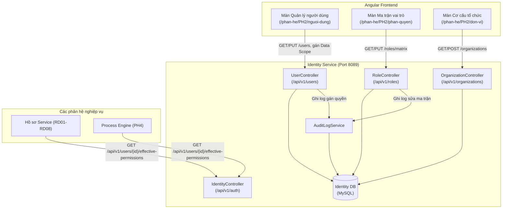

# TÀI LIỆU THIẾT KẾ CHI TIẾT (SRS)
## THIẾT KẾ CHI TIẾT PHÂN HỆ PHÂN QUYỀN VÀ XÁC THỰC (IDENTITY & ACCESS MANAGEMENT)

**Phân hệ**: PH2 — Phân quyền & Xác thực (Identity Service / Access Control)

### Bảng ghi nhận thay đổi
| Phiên bản | Ngày | Tác giả | Nội dung thay đổi |
|---|---|---|---|
| 0.1 | 2026-08-05 | BA-AI | Khởi tạo bản thảo SRS pilot cho Phân hệ PH2 Phân quyền & Xác thực theo chuẩn Harness QTKHCN (D12–D18) |
| 0.2 | 2026-08-06 | BA-AI | Bổ sung mục 3.7 Đăng nhập và 3.8 Chọn phân hệ theo Section Figma |

### Trang ký
| Vai trò | Người thực hiện | Chức danh | Ngày ký | Chữ ký |
|---|---|---|---|---|
| Người lập | BA-AI | Business Analyst | 2026-08-05 | |
| Người kiểm tra | | BA Lead / Tech Lead | | |
| Người phê duyệt | | Product Owner | | |
| Đại diện khách hàng | | VTS / VTIT | | |

### Mục lục
- [1. GIỚI THIỆU](#1-giới-thiệu)
  - [1.1 Mục đích](#11-mục-đích)
  - [1.2 Phạm vi](#12-phạm-vi)
  - [1.3 Khái niệm và thuật ngữ](#13-khái-niệm-và-thuật-ngữ)
  - [1.4 Tài liệu tham khảo](#14-tài-liệu-tham-khảo)
  - [1.5 Mô tả tài liệu](#15-mô-tả-tài-liệu)
- [2. TỔNG QUAN GIẢI PHÁP](#2-tổng-quan-giải-pháp)
  - [2.1 Tổng quan chức năng](#21-tổng-quan-chức-năng)
  - [2.2 Mô hình giao tiếp với module/hệ thống khác](#22-mô-hình-giao-tiếp-với-modulehệ-thống-khác)
- [3. THIẾT KẾ CHI TIẾT](#3-thiết-kế-chi-tiết)
  - [3.1 Quản trị đơn vị / cơ cấu tổ chức](#31-quản-trị-đơn-vị--cơ-cấu-tổ-chức)
  - [3.2 Quản trị người dùng](#32-quản-trị-người-dùng)
  - [3.3 Quản trị vai trò nghiệp vụ](#33-quản-trị-vai-trò-nghiệp-vụ)
  - [3.4 Ma trận phân quyền](#34-ma-trận-phân-quyền)
  - [3.5 Gán vai trò / phạm vi dữ liệu cho người dùng](#35-gán-vai-trò--phạm-vi-dữ-liệu-cho-người-dùng)
  - [3.6 Nhật ký thao tác phân quyền](#36-nhật-ký-thao-tác-phân-quyền)
  - [3.7 Đăng nhập hệ thống QTKHCN](#37-đăng-nhập-hệ-thống-qtkhcn)
  - [3.8 Chọn phân hệ sau đăng nhập](#38-chọn-phân-hệ-sau-đăng-nhập)
- [4. THIẾT KẾ DÙNG CHUNG VÀ TÁI SỬ DỤNG](#4-thiết-kế-dùng-chung-và-tái-sử-dụng)
- [5. THIẾT KẾ ĐẢM BẢO TUÂN THỦ TIÊU CHUẨN QUẢN TRỊ DỮ LIỆU](#5-thiết-kế-đảm-bảo-tuân-thủ-tiêu-chuẩn-quản-trị-dữ-liệu)
- [6. PHỤ LỤC](#6-phụ-lục)

---

## 1. GIỚI THIỆU

### 1.1 Mục đích
Tài liệu này mô tả chi tiết yêu cầu phần mềm (SRS) cho **Phân hệ PH2: Phân quyền & Xác thực** của Hệ thống Quản lý Nhiệm vụ Khoa học & Công nghệ (QTKHCN). Tài liệu làm cơ sở cho lập trình viên (BE/FE), tester (QA/QC) triển khai và nghiệm thu.

### 1.2 Phạm vi
- **Phạm vi áp dụng**: Cấp Cơ sở (CS) — Viện/Trung tâm/Công ty con thuộc Tập đoàn Viettel.
- **Bao gồm các tính năng chính**:
  1. Quản trị đơn vị / cơ cấu tổ chức hình cây (Tree Organization Structure).
  2. Quản trị tài khoản người dùng, trạng thái kích hoạt và gán đơn vị công tác.
  3. Quản trị danh mục vai trò nghiệp vụ (Role Catalog).
  4. Ma trận phân quyền 2 chiều: Feature (Chức năng) $\times$ Action (Hành động).
  5. Gán vai trò, phạm vi truy cập ứng dụng (App-access) và Phạm vi dữ liệu (Data Scope: `OWN`, `OWN_MISSION`, `ORG`, `ALL`) cho người dùng.
  6. Ghi nhật ký audit trail các thao tác phân quyền.
- **Không bao gồm**: Tích hợp SSO SSO/OAuth2 tập đoàn nâng cao (dành cho Phase Tập đoàn).

### 1.3 Khái niệm và thuật ngữ
| Thuật ngữ | Diễn giải |
|---|---|
| **RBAC** | Role-Based Access Control — Phân quyền dựa trên vai trò. |
| **Data Scope** | Phạm vi dữ liệu người dùng được phép truy vấn (`OWN`: Chính mình, `OWN_MISSION`: Nhiệm vụ tham gia, `ORG`: Đơn vị, `ALL`: Toàn hệ thống). |
| **App Access** | Quyền truy cập vào các ứng dụng phân hệ (`qlnvkhcn`, `quytrinh`, `he-thong`). |
| **Identity Service** | Dịch vụ backend quản lý người dùng, vai trò và phân quyền trung tâm. |

### 1.4 Tài liệu tham khảo
1. `docs/research/phan-quyen-ph2-ma-tran-app-access-data-scope-de-xuat-2026-07-29.md`
2. `docs/research/identity-service-phan-he-2-plan-2026-07-29.md`
3. `.harness/rules/srs-definition-of-done.md`

### 1.5 Mô tả tài liệu
Tài liệu bao gồm 6 mục tiêu chuẩn theo quy định Harness SRS QTKHCN.

---

## 2. TỔNG QUAN GIẢI PHÁP

### 2.1 Tổng quan chức năng
Identity Service cung cấp các dịch vụ cốt lõi:
- Quản lý cây cơ cấu tổ chức từ Tập đoàn $\rightarrow$ Viện/Công ty $\rightarrow$ Trung tâm $\rightarrow$ Phòng ban.
- Cung cấp API `effective()` phục vụ Frontend Angular và Backend các phân hệ khác kiểm tra quyền hạn tức thời.
- Quản lý Ma trận phân quyền 2 chiều linh hoạt: N nhóm tính năng (Features) $\times$ M loại hành động (Permissions).

### 2.2 Mô hình giao tiếp với module/hệ thống khác

---

## 3. THIẾT KẾ CHI TIẾT

### 3.1 Quản trị đơn vị / cơ cấu tổ chức

#### 3.1.1 Thông tin chung chức năng
- **Tác nhân**: Quản trị hệ thống (`ROLE_ADMIN`).
- **Ý nghĩa**: Xây dựng cây đơn vị phục vụ phân vùng dữ liệu (Data Scope `ORG`).
- **Nền tảng**: Web Admin.
- **Đường dẫn**: Quản trị hệ thống > Cơ cấu tổ chức (`/phan-he/PH2/don-vi`).

#### 3.1.2 Màn hình
| STT | Tên màn hình | Mô tả |
|---|---|---|
| 1 | Cây đơn vị & Danh sách phòng ban | Hiển thị dạng TreeView bên trái, thông tin chi tiết bên phải |
| 2 | Modal Tạo mới / Chỉnh sửa Đơn vị | Form nhập tên, mã đơn vị, cấp đơn vị, đơn vị cha |

#### 3.1.3 Mô tả chi tiết các thành phần (Xem danh sách & Form)
| STT | Tên | Kiểu dữ liệu [Độ dài] | Input/Output | Giá trị khởi tạo | Mô tả mapping CSDL | Ghi chú |
|---|---|---|---|---|---|---|
| 1 | Mã đơn vị* | Textbox [50] | Input | Blank | Bắt buộc. Unique. `organization.code` | Bắt buộc nhập |
| 2 | Tên đơn vị* | Textbox [255] | Input | Blank | `organization.name` | Bắt buộc nhập |
| 3 | Đơn vị cha | TreeSelect | Input | Root | Trỏ tới `organization.parent_id` | Rỗng nếu là root |
| 4 | Cấp đơn vị | Combobox | Input | "CS" | Enum: `TAP_DOAN`, `KHOI`, `VIEN`, `TRUNG_TAM`, `PHONG` | |
| 5 | Trạng thái | Radio | Input | "Hoạt động" | `organization.status` (`ACTIVE`/`INACTIVE`) | |

#### 3.1.4 Luồng nghiệp vụ
| Bước | Mô tả |
|---|---|
| 1 | Quản trị viên vào màn đơn vị, chọn đơn vị cha trên TreeView và bấm **Thêm đơn vị con**. |
| 2 | Hệ thống hiển thị Modal nhập liệu thông tin đơn vị. |
| 3 | Quản trị viên nhập thông tin và bấm **Lưu**. |
| 4 | Backend kiểm tra trùng mã đơn vị. Nếu hợp lệ, lưu vào `organization` và ghi log audit. |

#### 3.1.5 Quy tắc nghiệp vụ
| Mã quy tắc | Quy tắc |
|---|---|
| `BR-PH2-ORG-01` | Không được xoá đơn vị đang chứa đơn vị con hoặc đang có user công tác. |
| `BR-PH2-ORG-02` | Mã đơn vị không được chứa khoảng trắng và ký tự đặc biệt. |

---

### 3.2 Quản trị người dùng

#### 3.2.1 Thông tin chung chức năng
- **Tác nhân**: Quản trị hệ thống (`ROLE_ADMIN`).
- **Ý nghĩa**: Quản lý tài khoản cán bộ, thông tin định danh và đơn vị trực thuộc.
- **Đường dẫn**: Quản trị hệ thống > Người dùng (`/phan-he/PH2/nguoi-dung`).

#### 3.2.2 Màn hình
| STT | Tên màn hình | Mô tả |
|---|---|---|
| 1 | Danh sách người dùng | Datagrid lọc theo từ khoá, đơn vị, trạng thái |
| 2 | Drawer Chi tiết người dùng | Xem và chỉnh sửa thông tin người dùng |

#### 3.2.3 Mô tả chi tiết các thành phần
| STT | Tên | Kiểu dữ liệu [Độ dài] | Input/Output | Giá trị khởi tạo | Mô tả mapping CSDL | Ghi chú |
|---|---|---|---|---|---|---|
| 1 | Tên đăng nhập* | Textbox [50] | Input | Blank | `users.username` — duy nhất | |
| 2 | Họ và tên* | Textbox [100] | Input | Blank | `users.full_name` | |
| 3 | Email* | Textbox [100] | Input | Blank | `users.email` — kiểm tra format email | |
| 4 | Số điện thoại | Textbox [20] | Input | Blank | `users.phone` | |
| 5 | Đơn vị trực thuộc* | Combobox/Tree | Input | Blank | `users.organization_id` | |
| 6 | Trạng thái | Switch | Input | Enabled | `users.status` (`ACTIVE`/`DISABLED`) | |

#### 3.2.4 Luồng nghiệp vụ
| Bước | Mô tả |
|---|---|
| 1 | Người dùng bấm **Thêm người dùng mới**, nhập các thông tin bắt buộc. |
| 2 | Hệ thống validate email/username trùng lặp. |
| 3 | Lưu thông tin vào bảng `users` và tự động kích hoạt tài khoản. |

#### 3.2.5 Quy tắc nghiệp vụ
| Mã quy tắc | Quy tắc |
|---|---|
| `BR-PH2-USR-01` | Username không được sửa sau khi tạo. |

---

### 3.3 Quản trị vai trò nghiệp vụ

#### 3.3.1 Thông tin chung chức năng
- **Tác nhân**: Quản trị hệ thống (`ROLE_ADMIN`).
- **Ý nghĩa**: Khai báo danh mục vai trò (Role Catalog) trong hệ thống.
- **Đường dẫn**: Quản trị hệ thống > Vai trò (`/phan-he/PH2/vai-tro`).

#### 3.3.2 Màn hình
| STT | Tên màn hình | Mô tả |
|---|---|---|
| 1 | Danh sách vai trò | Hiển thị mã vai trò, tên vai trò, mô tả và số lượng user gán |

#### 3.3.3 Mô tả chi tiết các thành phần
| STT | Tên | Kiểu dữ liệu [Độ dài] | Input/Output | Giá trị khởi tạo | Mô tả mapping CSDL | Ghi chú |
|---|---|---|---|---|---|---|
| 1 | Mã vai trò* | Textbox [50] | Input | Blank | `roles.code` (VD: `ROLE_CQ_KHCN`) | Không chứa khoảng trắng |
| 2 | Tên vai trò* | Textbox [100] | Input | Blank | `roles.name` | |
| 3 | Mô tả | Textarea [500] | Input | Blank | `roles.description` | |

---

### 3.4 Ma trận phân quyền

#### 3.4.1 Thông tin chung chức năng
- **Tác nhân**: Quản trị hệ thống (`ROLE_ADMIN`).
- **Ý nghĩa**: Cấu hình ma trận quyền 2 chiều: Hàng = Nhóm tính năng (Features), Cột = Hành động (Actions).
- **Đường dẫn**: Quản trị hệ thống > Ma trận phân quyền (`/phan-he/PH2/phan-quyen`).

#### 3.4.2 Màn hình

#### 3.4.3 Mô tả chi tiết các thành phần (Bảng Ma trận)
| STT | Tên | Kiểu dữ liệu [Độ dài] | Input/Output | Giá trị khởi tạo | Mô tả mapping CSDL | Ghi chú |
|---|---|---|---|---|---|---|
| 1 | Chọn vai trò | Combobox | Input | Selected Role | Chọn vai trò cần cấu hình ma trận | |
| 2 | Cột Tính năng (Feature) | Label Column | Output | | Danh sách 12 nhóm tính năng (`features.name`) | |
| 3 | Ô checkbox Quyền (Xem/Tạo/Sửa/Duyệt...) | Checkbox Matrix | Input | Off | Lưu vào `role_feature_permissions(role_id, feature_id, permission_id)` | Tick để bật quyền |

#### 3.4.4 Luồng nghiệp vụ
| Bước | Mô tả |
|---|---|
| 1 | Quản trị viên chọn Vai trò từ dropdown. |
| 2 | Hệ thống nạp ma trận quyền hiện tại của vai trò đó. |
| 3 | Quản trị viên tick/untick các ô tương ứng với từng Feature và Action, sau đó bấm **Lưu ma trận**. |
| 4 | Backend cập nhật bảng `role_feature_permissions` và refresh cache quyền. |

#### 3.4.5 Quy tắc nghiệp vụ
| Mã quy tắc | Quy tắc |
|---|---|
| `BR-PH2-MAT-01` | Quyền Chỉnh sửa / Phê duyệt tự động yêu cầu bật quyền Xem của tính năng đó. |

---

### 3.5 Gán vai trò / phạm vi dữ liệu cho người dùng

#### 3.5.1 Thông tin chung chức năng
- **Tác nhân**: Quản trị hệ thống (`ROLE_ADMIN`).
- **Ý nghĩa**: Gán một hoặc nhiều Vai trò, App Access (`qlnvkhcn`, `quytrinh`, `he-thong`) và Data Scope (`OWN`, `OWN_MISSION`, `ORG`, `ALL`) cho từng người dùng.
- **Đường dẫn**: Thao tác "Phân quyền" trên bảng danh sách người dùng.

#### 3.5.2 Màn hình
| STT | Tên màn hình | Mô tả |
|---|---|---|
| 1 | Drawer Phân quyền người dùng | Gồm 3 tab: Gán vai trò, Phạm vi ứng dụng (App Access), Phạm vi dữ liệu (Data Scope) |

#### 3.5.3 Mô tả chi tiết các thành phần
| STT | Tên | Kiểu dữ liệu [Độ dài] | Input/Output | Giá trị khởi tạo | Mô tả mapping CSDL | Ghi chú |
|---|---|---|---|---|---|---|
| 1 | Vai trò gán | Multi-Select Combobox | Input | Empty | Ghi vào `user_roles(user_id, role_id)` | |
| 2 | Scope truy cập App | Checkbox Group | Input | All checked | Ghi vào `user_apps(user_id, app_code)` | `qlnvkhcn`, `quytrinh`, `he-thong` |
| 3 | Phạm vi dữ liệu (Data Scope)* | Combobox | Input | `ORG` | Enum: `OWN`, `OWN_MISSION`, `ORG`, `ALL` | Khai báo trong `user_role_assignment.data_scope` |

---

### 3.6 Nhật ký thao tác phân quyền

#### 3.6.1 Thông tin chung chức năng
- **Tác nhân**: Quản trị hệ thống, Kiểm toán viên.
- **Ý nghĩa**: Ghi vết truy xuất toàn bộ thay đổi về vai trò, quyền hạn và phân quyền người dùng.
- **Đường dẫn**: Quản trị hệ thống > Nhật ký phân quyền (`/phan-he/PH2/audit-log`).

#### 3.6.2 Màn hình & Chi tiết thành phần
Datagrid gồm các cột: Thời gian, Người thực hiện, Đối tượng tác động (User/Role được sửa), Hành động (`ASSIGN_ROLE`, `UPDATE_MATRIX`, `CHANGE_SCOPE`), Chi tiết thay đổi (Giá trị cũ $\rightarrow$ Giá trị mới).

---

### 3.7 Đăng nhập hệ thống QTKHCN

#### 3.7.1 Thông tin chung chức năng
- **Tác nhân**: Tất cả người dùng (`ROLE_USER`, `ROLE_ADMIN`, `ROLE_EXPERT`...).
- **Ý nghĩa**: Đăng nhập vào hệ thống QTKHCN để làm việc.
- **Nền tảng**: Web Application.
- **Đường dẫn**: `/login`.
- **Ràng buộc-ngoại lệ**: Không viết sâu giao thức SSO tập đoàn nếu chưa có tài liệu đặc tả, dùng OQ để xác nhận.

#### 3.7.2 Màn hình
| STT | Tên màn hình | Mô tả | Ảnh |
|---|---|---|---|
| 1 | Màn hình Đăng nhập | Giao diện nhập Username/Password | `` |

#### 3.7.3 Mô tả chi tiết các thành phần (Bảng 7 cột)
| STT | Tên | Kiểu dữ liệu [Độ dài] | Input/Output | Giá trị khởi tạo | Mô tả mapping CSDL | Ghi chú |
|---|---|---|---|---|---|---|
| **Khối đăng nhập** | | | | | | |
| 1 | Tên đăng nhập* | Textbox [50] | Input | Blank | `users.username` | |
| 2 | Mật khẩu* | Password [50] | Input | Blank | So khớp mật khẩu đã mã hóa | |
| 3 | Nút Đăng nhập | Button | Input | Enabled | Xác thực thông tin | |
| 4 | Thông báo lỗi | Label | Output | Blank | Hiển thị khi sai mật khẩu / tài khoản bị khóa | |

#### 3.7.4 Luồng nghiệp vụ
##### A. Đăng nhập thành công
| Bước | Mô tả |
|---|---|
| 1 | Người dùng truy cập đường dẫn `/login`. |
| 2 | Nhập Tên đăng nhập và Mật khẩu hợp lệ, bấm **Đăng nhập**. |
| 3 | Hệ thống xác thực thành công, lưu token phiên và chuyển hướng tới màn hình **Chọn phân hệ** (`/chon-phan-he`). |

##### B. Đăng nhập thất bại (Sai mật khẩu)
| Bước | Mô tả |
|---|---|
| 1 | Người dùng nhập sai Tên đăng nhập hoặc Mật khẩu, bấm **Đăng nhập**. |
| 2 | Hệ thống hiển thị thông báo lỗi: "Tên đăng nhập hoặc mật khẩu không chính xác." |

##### C. Hết phiên làm việc (Session Timeout)
| Bước | Mô tả |
|---|---|
| 1 | Token của người dùng hết hạn (hoặc không thao tác trong thời gian quy định). |
| 2 | Hệ thống tự động chuyển hướng về màn hình Đăng nhập kèm thông báo: "Phiên làm việc đã hết hạn. Vui lòng đăng nhập lại." |

#### 3.7.5 Quy tắc nghiệp vụ
| Mã quy tắc | Quy tắc | Áp dụng cho | Trạng thái |
|---|---|---|---|
| `BR-PH2-ATH-01` | Khóa tài khoản tạm thời 15 phút nếu nhập sai mật khẩu quá 5 lần liên tiếp. | Đăng nhập hệ thống | Chốt |

---

### 3.8 Chọn phân hệ sau đăng nhập

#### 3.8.1 Thông tin chung chức năng
- **Tác nhân**: Tất cả người dùng đã đăng nhập thành công.
- **Ý nghĩa**: Lựa chọn phân hệ làm việc phù hợp với vai trò nghiệp vụ (nhóm App Access).
- **Đường dẫn**: `/chon-phan-he`.
- **Ràng buộc-ngoại lệ**: Các card phân hệ hiển thị tùy thuộc vào quyền App Access của người dùng.

#### 3.8.2 Màn hình
| STT | Tên màn hình | Mô tả | Ảnh |
|---|---|---|---|
| 1 | Màn hình Chọn phân hệ | Hiển thị các card ứng dụng: Quản lý NV KHCN & HS, Quản lý Quy trình, Quản trị hệ thống | `` |

#### 3.8.3 Mô tả chi tiết các thành phần (Bảng 7 cột)
| STT | Tên | Kiểu dữ liệu [Độ dài] | Input/Output | Giá trị khởi tạo | Mô tả mapping CSDL | Ghi chú |
|---|---|---|---|---|---|---|
| **Danh sách Card Phân hệ** | | | | | | |
| 1 | Card Quản lý NV KHCN & HS | Card Button | Input | Enabled | Trỏ tới ứng dụng `qlnvkhcn` | Click để chuyển hướng `/rd02` |
| 2 | Card Quản lý Quy trình | Card Button | Input | Enabled | Trỏ tới ứng dụng `quytrinh` | Click để chuyển hướng `/quy-trinh` |
| 3 | Card Quản trị hệ thống | Card Button | Input | Enabled/Disabled | Trỏ tới ứng dụng `he-thong` | Chỉ hiển thị và bật với ROLE_ADMIN |

#### 3.8.4 Luồng nghiệp vụ
##### A. Điều hướng vào phân hệ
| Bước | Mô tả |
|---|---|
| 1 | Người dùng sau khi đăng nhập thành công được chuyển tới màn hình Chọn phân hệ. |
| 2 | Người dùng click vào **Card Quản lý NV KHCN & HS** hoặc **Card Quản lý Quy trình**. |
| 3 | Hệ thống chuyển hướng người dùng đến màn hình chính của phân hệ tương ứng (Màn hình QL NV KHCN & HS hoặc Màn hình Quản lý quy trình). |

#### 3.8.5 Quy tắc nghiệp vụ
| Mã quy tắc | Quy tắc | Áp dụng cho | Trạng thái |
|---|---|---|---|
| `BR-PH2-ENT-01` | Card phân hệ chỉ hiển thị nếu người dùng được gán quyền truy cập ứng dụng tương ứng (`user_apps`). | Chọn phân hệ | Chốt |
| `BR-PH2-ENT-02` | Nếu người dùng chỉ có quyền truy cập duy nhất 1 ứng dụng, hệ thống tự động chuyển hướng vào ứng dụng đó mà không hiển thị màn chọn. | Chọn phân hệ | `[GIẢ ĐỊNH]` `OQ-QTKHCN-003` |

---

## 4. THIẾT KẾ DÙNG CHUNG VÀ TÁI SỬ DỤNG
- **API `effective-permissions`**: Trả về tổng hợp Vai trò, Danh sách Quyền phẳng, Danh sách App được phép và Cặp `(Role, DataScope, OrgId)` để các phân hệ khác kiểm tra điều kiện truy cập.

---

## 5. THIẾT KẾ ĐẢM BẢO TUÂN THỦ TIÊU CHUẨN QUẢN TRỊ DỮ LIỆU
- **5.1 Chất lượng dữ liệu**: Validate mã vai trò, username không trùng lặp.
- **5.2 Lịch sử và truy vết**: Ghi log đầy đủ mọi thao tác ghi/sửa trên phân hệ PH2 vào `audit_log`.
- **5.3 Phân quyền**: Chỉ `ROLE_ADMIN` mới có quyền thay đổi ma trận phân quyền và gán quyền cho user khác.
- **5.4 Vòng đời dữ liệu**: Xoá mềm (Soft delete) người dùng và vai trò qua cờ status `DISABLED` / `ARCHIVED`.
- **5.5 Dữ liệu cá nhân**: Mã hoá mật khẩu bằng BCrypt; không lưu mật khẩu dạng plaintext.
- **5.6 Quản trị dữ liệu**: Bảng `roles` và `features` đóng vai trò Master Data phân quyền.
- **5.7 Kiến trúc tích hợp**: Phục vụ REST API chuẩn JSON mã hoá UTF-8.

---

## 6. PHỤ LỤC

### 6.1 Bảng CSDL chính
- `users`, `organization`, `roles`, `features`, `permissions`, `role_feature_permissions`, `user_apps`, `user_role_assignment`, `audit_log`.

### 6.2 Danh mục điểm chờ xác nhận (OQ)
| Mã OQ | Nội dung | Mức | Trạng thái |
|---|---|---|---|
| `OQ-QTKHCN-003` | Cấu hình quy tắc kết hợp Data Scope khi 1 user được gán 2 vai trò có Scope khác nhau (`ORG` vs `OWN_MISSION`) | Trung bình | Mở |
| `OQ-QTKHCN-004` | Phương án Migrate 30+ vai trò mặc định sang Ma trận 2 chiều Feature x Action mới | Trung bình | Mở |
