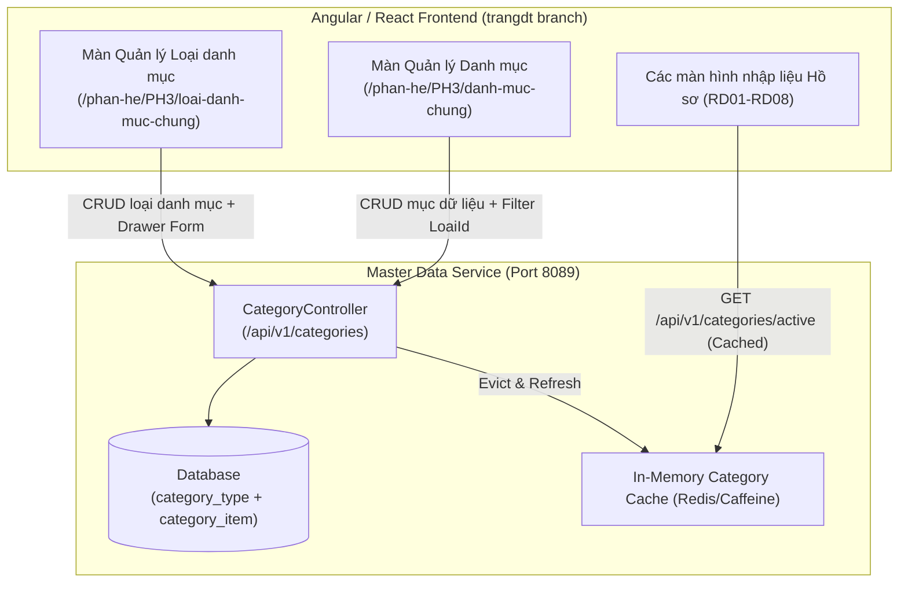

# TÀI LIỆU THIẾT KẾ CHI TIẾT (SRS)
## THIẾT KẾ CHI TIẾT PHÂN HỆ DANH MỤC DÙNG CHUNG (MASTER DATA MANAGEMENT)

**Phân hệ**: PH3 — Danh mục dùng chung (Master Data Management)

### Bảng ghi nhận thay đổi
| Phiên bản | Ngày | Tác giả | Nội dung thay đổi |
|---|---|---|---|
| 0.1 | 2026-08-05 | BA-AI | Khởi tạo bản thảo SRS pilot cho Phân hệ PH3 Danh mục dùng chung |
| 0.2 | 2026-08-05 | BA-AI | Cập nhật mô tả chi tiết giao diện, bảng field-level 7 cột và StatCard KPI theo bản vẽ nhánh `trangdt` (`LoaiDanhMucChung.tsx`, `DanhMucChung.tsx`) |

### Trang ký
| Vai trò | Người thực hiện | Chức danh | Ngày ký | Chữ ký |
|---|---|---|---|---|
| Người lập | BA-AI | Business Analyst | 2026-08-05 | |
| Người kiểm tra | | BA Lead / Tech Lead | | |
| Người phê duyệt | | Product Owner | | |
| Đại diện khách hàng | | VTS / VTIT | | |

### Mục lục
- [1. GIỚI THIỆU](#1-giới-thiệu)
- [2. TỔNG QUAN GIẢI PHÁP](#2-tổng-quan-giải-pháp)
- [3. THIẾT KẾ CHI TIẾT](#3-thiết-kế-chi-tiết)
  - [3.1 Quản lý loại danh mục dùng chung](#31-quản-lý-loại-danh-mục-dùng-chung)
  - [3.2 Quản lý danh mục dùng chung](#32-quản-lý-danh-mục-dùng-chung)
  - [3.3 Trạng thái hiệu lực / ngưng dùng danh mục](#33-trạng-thái-hiệu-lực--ngưng-dùng-danh-mục)
  - [3.4 Tra cứu & lọc danh mục toàn hệ thống](#34-tra-cứu--lọc-danh-mục-toàn-hệ-thống)
- [4. THIẾT KẾ DÙNG CHUNG VÀ TÁI SỬ DỤNG](#4-thiết-kế-dùng-chung-và-tái-sử-dụng)
- [5. THIẾT KẾ ĐẢM BẢO TUÂN THỦ TIÊU CHUẨN QUẢN TRỊ DỮ LIỆU](#5-thiết-kế-đảm-bảo-tuân-thủ-tiêu-chuẩn-quản-trị-dữ-liệu)
- [6. PHỤ LỤC](#6-phụ-lục)

---

## 1. GIỚI THIỆU

### 1.1 Mục đích
Tài liệu SRS này mô tả chi tiết thiết kế phần mềm cho **Phân hệ PH3-01: Danh mục dùng chung**, cung cấp Master Data tiêu chuẩn cho toàn bộ các màn hình nhập liệu, form biểu mẫu và dropdown trong các phân hệ nghiệp vụ (RD01–RD08).

### 1.2 Phạm vi
- Quản lý phân loại danh mục (Category Type: Ngành KHCN, Lĩnh vực nghiên cứu, Loại kết quả NCKH, Loại nhiệm vụ, Cấp nhiệm vụ, Chức danh hội đồng...).
- Quản lý các bản ghi danh mục chi tiết (Category Items) theo từng loại.
- Quản lý trạng thái hiệu lực (Đang sử dụng / Ngừng sử dụng) và thứ tự hiển thị.
- Cung cấp StatCards thống kê chỉ số và REST API tra cứu danh mục dùng chung cho Frontend.

---

## 2. TỔNG QUAN GIẢI PHÁP

### 2.1 Tổng quan chức năng
Phân hệ PH3-01 đóng vai trò quản trị Master Data trung tâm. Giao diện được thiết kế hiện đại trên Ant Design với StatCard tổng quan KPI, bộ lọc đa tiêu chí và Drawer nhập liệu.

### 2.2 Mô hình giao tiếp với module/hệ thống khác

---

## 3. THIẾT KẾ CHI TIẾT

### 3.1 Quản lý loại danh mục dùng chung

#### 3.1.1 Thông tin chung chức năng
- **Tác nhân**: Quản trị viên danh mục / Admin (`ROLE_ADMIN`, `ROLE_BA`).
- **Ý nghĩa**: Khai báo các nhóm/loại danh mục mới trong hệ thống.
- **Đường dẫn**: Quản trị danh mục > Loại danh mục dùng chung (`/phan-he/PH3/loai-danh-muc-chung`).
- **Chỉ số KPI StatCard**:
  - `Tổng số loại danh mục`: Đếm tổng số loại danh mục.
  - `Đang sử dụng`: Số loại danh mục có trạng thái `active`.
  - `Tổng mục con`: Tổng số bản ghi danh mục chi tiết thuộc tất cả các loại.

#### 3.1.2 Danh sách màn hình
| STT | Tên màn hình / Khối | Mô tả | Ghi chú |
|---|---|---|---|
| 1 | Màn hình Danh sách Loại danh mục | Datagrid kèm StatCards chỉ số KPI tổng quan | Nhánh `trangdt` |
| 2 | Drawer Thêm mới / Chỉnh sửa | Form trượt từ lề phải nhập thông tin loại danh mục | Ant Design Drawer |

#### 3.1.3 Mô tả chi tiết các thành phần (Xem danh sách & Drawer Form)

##### A. Thanh tìm kiếm & Datagrid Danh sách
| STT | Tên | Kiểu dữ liệu [Độ dài] | Input/Output | Giá trị khởi tạo | Mô tả mapping CSDL | Ghi chú |
|---|---|---|---|---|---|---|
| 1 | Từ khoá tìm kiếm | Textbox [100] | Input | Blank | Tìm kiếm theo Mã loại hoặc Tên loại | Kiểu so khớp: Chứa, không phân biệt hoa/thường |
| 2 | Lọc Trạng thái | Combobox | Input | "Tất cả" | Lọc theo `active` / `inactive` | |
| 3 | Nút Thêm mới | Button | Input | Enabled | Mở Drawer Tạo mới loại danh mục | Icon PlusOutlined |
| 4 | Cột STT | Label Column | Output | | Đánh số thứ tự tự động (1, 2, 3...) | Width 60px |
| 5 | Cột Mã loại | Label Column | Output | | `category_type.code` (VD: `LINH_VUC_NC`) | Width 150px |
| 6 | Cột Tên loại danh mục | Label Column | Output | | `category_type.name` | |
| 7 | Cột Mô tả | Label Column | Output | | `category_type.description` | Text ellipsis |
| 8 | Cột Số danh mục con | Tag Column | Output | | Đếm tổng số bản ghi chi tiết (`soDanhMuc`) | Width 130px, align center |
| 9 | Cột Trạng thái | Tag Column | Output | | `active` $\rightarrow$ Tag xanh "Đang sử dụng"; `inactive` $\rightarrow$ Tag xám "Ngừng sử dụng" | Width 130px |
| 10 | Cột Thao tác | Action Icons | Input | Enabled | Icon Sửa (EditOutlined) & Icon Xoá (DeleteOutlined) | Có Popconfirm xác nhận xoá |

##### B. Drawer Form Thêm mới / Chỉnh sửa Loại danh mục
| STT | Tên | Kiểu dữ liệu [Độ dài] | Input/Output | Giá trị khởi tạo | Mô tả mapping CSDL | Ghi chú |
|---|---|---|---|---|---|---|
| 1 | Mã loại* | Textbox [50] | Input | Blank | Bắt buộc nhập. `category_type.code` | Unique, viết hoa. Disable khi sửa |
| 2 | Tên loại danh mục* | Textbox [255] | Input | Blank | Bắt buộc nhập. `category_type.name` | |
| 3 | Mô tả | Textarea [500] | Input | Blank | `category_type.description` | |
| 4 | Trạng thái* | Select | Input | "active" | `category_type.status` (`active` / `inactive`) | |

#### 3.1.4 Luồng nghiệp vụ
| Bước | Mô tả |
|---|---|
| 1 | Người dùng bấm **Thêm mới loại danh mục**. Drawer trượt ra từ bên phải. |
| 2 | Nhập thông tin Mã loại, Tên loại danh mục, Mô tả và chọn Trạng thái. |
| 3 | Bấm **Lưu**. Hệ thống kiểm tra trùng `ma`. Nếu hợp lệ, lưu CSDL và cập nhật StatCard KPI. |

---

### 3.2 Quản lý danh mục dùng chung

#### 3.2.1 Thông tin chung chức năng
- **Tác nhân**: Quản trị viên danh mục / BA.
- **Ý nghĩa**: Quản lý chi tiết từng phần tử danh mục thuộc một Loại danh mục.
- **Đường dẫn**: Quản trị danh mục > Danh mục dùng chung (`/phan-he/PH3/danh-muc-chung`).
- **Chỉ số KPI StatCard**:
  - `Tổng số danh mục`: Tổng số phần tử danh mục chi tiết.
  - `Đang sử dụng`: Số danh mục có trạng thái `active`.
  - `Số loại danh mục`: Số lượng loại danh mục đã phân loại.

#### 3.2.2 Mô tả chi tiết các thành phần (Datagrid & Drawer Form)

##### A. Thanh tìm kiếm & Datagrid
| STT | Tên | Kiểu dữ liệu [Độ dài] | Input/Output | Giá trị khởi tạo | Mô tả mapping CSDL | Ghi chú |
|---|---|---|---|---|---|---|
| 1 | Tìm kiếm | Textbox [100] | Input | Blank | Tìm kiếm theo Mã danh mục hoặc Tên danh mục | Icon SearchOutlined |
| 2 | Lọc Loại danh mục | Combobox | Input | "Tất cả loại" | Chọn loại danh mục (`loaiId`) để lọc | Nạp từ danh sách Loại danh mục |
| 3 | Lọc Trạng thái | Combobox | Input | "Tất cả trạng thái" | Lọc theo `active` / `inactive` | |
| 4 | Nút Thêm mới | Button | Input | Enabled | Mở Drawer tạo mới mục danh mục | Icon PlusOutlined |
| 5 | Cột STT | Label Column | Output | | Đánh số thứ tự 1, 2, 3... | Width 60px |
| 6 | Cột Mã danh mục | Label Column | Output | | `category_item.code` (VD: `CNTT`) | Width 120px |
| 7 | Cột Tên danh mục | Label Column | Output | | `category_item.name` | |
| 8 | Cột Loại | Tag Column | Output | | Tên loại danh mục tương ứng | Nạp từ `LoaiDanhMucMap` |
| 9 | Cột Giá trị | Label Column | Output | | `category_item.value` (Giá trị quy đổi/Code phụ) | |
| 10 | Cột Thứ tự | Number Column | Output | | `category_item.sort_order` | Số nguyên sắp xếp |
| 11 | Cột Trạng thái | Tag Column | Output | | `active` $\rightarrow$ Tag green "Đang sử dụng"; `inactive` $\rightarrow$ Tag default "Ngừng sử dụng" | |
| 12 | Cột Thao tác | Action Icons | Input | Enabled | Icon Sửa (EditOutlined) & Icon Xoá (DeleteOutlined) | Có Popconfirm xác nhận xoá |

##### B. Drawer Form Thêm mới / Chỉnh sửa Mục danh mục
| STT | Tên | Kiểu dữ liệu [Độ dài] | Input/Output | Giá trị khởi tạo | Mô tả mapping CSDL | Ghi chú |
|---|---|---|---|---|---|---|
| 1 | Loại danh mục* | Select | Input | Blank | Trỏ tới `category_item.loai_id` | Bắt buộc chọn. Disable khi sửa |
| 2 | Mã danh mục* | Textbox [50] | Input | Blank | Bắt buộc. `category_item.code` | Unique trong cùng loại |
| 3 | Tên danh mục* | Textbox [255] | Input | Blank | Bắt buộc. `category_item.name` | |
| 4 | Giá trị quy đổi | Textbox [100] | Input | Blank | `category_item.value` | Giá trị mã phụ nếu có |
| 5 | Thứ tự sắp xếp | InputNumber | Input | `1` | `category_item.sort_order` | Định vị vị trí hiển thị dropdown |
| 6 | Mô tả | Textarea [500] | Input | Blank | `category_item.description` | |
| 7 | Trạng thái* | Select | Input | "active" | `category_item.status` (`active` / `inactive`) | |

---

### 3.3 Trạng thái hiệu lực / ngưng dùng danh mục
- Khi một bản ghi chuyển `inactive`, hệ thống giữ nguyên dữ liệu đã lưu trong các hồ sơ cũ nhưng tự động ẩn khỏi dropdown chọn mới ở các màn hình RD01–RD08.

---

### 3.4 Tra cứu & lọc danh mục toàn hệ thống
- REST API `GET /api/v1/categories/by-type/{typeCode}` trả về danh sách đã được sắp xếp theo `sort_order` ASC và lọc `status = 'active'`.

---

## 4. THIẾT KẾ DÙNG CHUNG VÀ TÁI SỬ DỤNG
- Tái sử dụng các StatCard KPI và UI Drawer Form Ant Design dùng chung toàn ứng dụng.

---

## 5. THIẾT KẾ ĐẢM BẢO TUÂN THỦ TIÊU CHUẨN QUẢN TRỊ DỮ LIỆU
- Tuân thủ đầy đủ 7 tiêu chuẩn quản trị dữ liệu (5.1–5.7).

---

## 6. PHỤ LỤC
- File nguồn code: `webapp/src/pages/catalog/LoaiDanhMucChung.tsx`, `webapp/src/pages/catalog/DanhMucChung.tsx`.
- Bảng CSDL: `category_type`, `category_item`.
