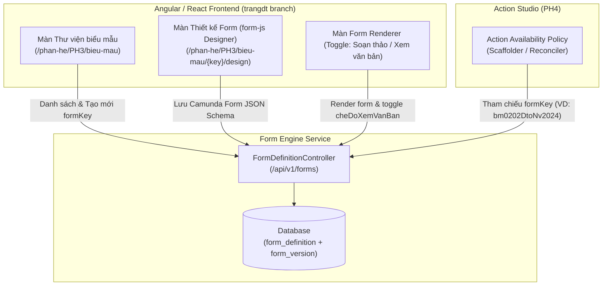

# TÀI LIỆU THIẾT KẾ CHI TIẾT (SRS)
## THIẾT KẾ CHI TIẾT PHÂN HỆ THƯ VIỆN BIỂU MẪU (E-FORM LIBRARY & DESIGNER)

**Phân hệ**: PH3 — Thư viện biểu mẫu (E-Form Engine / Form Designer)

### Bảng ghi nhận thay đổi
| Phiên bản | Ngày | Tác giả | Nội dung thay đổi |
|---|---|---|---|
| 0.1 | 2026-08-05 | BA-AI | Khởi tạo bản thảo SRS pilot cho Thư viện biểu mẫu |
| 0.2 | 2026-08-05 | BA-AI | Bổ sung chi tiết Schema biểu mẫu thực tế BM.02.02 (`bm0202DtoNv2024.form.json`), chế độ xem hoàn chỉnh (`cheDoXemVanBan`) từ nhánh `trangdt` |

### Trang ký
| Vai trò | Người thực hiện | Chức danh | Ngày ký | Chữ ký |
|---|---|---|---|---|
| Người lập | BA-AI | Business Analyst | 2026-08-05 | |
| Người kiểm tra | | BA Lead / Tech Lead | | |
| Người phê duyệt | | Product Owner | | |
| Đại diện khách hàng | | VTS / VTIT | | |

### Mục lục
- [1. GIỚI THIỆU](#1-giới-thiệu)
- [2. TỔNG QUAN GIẢI PHÁP](#2-tổng-quan-giải-pháp)
- [3. THIẾT KẾ CHI TIẾT](#3-thiết-kế-chi-tiết)
  - [3.1 Danh sách thư viện biểu mẫu](#31-danh-sách-thư-viện-biểu-mẫu)
  - [3.2 Tạo mới biểu mẫu](#32-tạo-mới-biểu-mẫu)
  - [3.3 Thiết kế / chỉnh sửa schema biểu mẫu & Mẫu chuẩn BM.02.02](#33-thiết-kế--chỉnh-sửa-schema-biểu-mẫu--mẫu-chuẩn-bm0202)
  - [3.4 Xem trước biểu mẫu & 2 chế độ hiển thị](#34-xem-trước-biểu-mẫu--2-chế-độ-hiển-thị)
  - [3.5 Phiên bản & trạng thái phát hành biểu mẫu](#35-phiên-bản--trạng-thái-phát-hành-biểu-mẫu)
  - [3.6 Gán biểu mẫu vào bước/hành động](#36-gán-biểu-mẫu-vào-bướchành-động)
- [4. THIẾT KẾ DÙNG CHUNG VÀ TÁI SỬ DỤNG](#4-thiết-kế-dùng-chung-và-tái-sử-dụng)
- [5. THIẾT KẾ ĐẢM BẢO TUÂN THỦ TIÊU CHUẨN QUẢN TRỊ DỮ LIỆU](#5-thiết-kế-đảm-bảo-tuân-thủ-tiêu-chuẩn-quản-trị-dữ-liệu)
- [6. PHỤ LỤC](#6-phụ-lục)

---

## 1. GIỚI THIỆU

### 1.1 Mục đích
Tài liệu quy định chi tiết thiết kế cho **Phân hệ Thư viện biểu mẫu (E-Form)** — nơi quản lý, thiết kế kéo-thả (Form Designer dựa trên Camunda `form-js`) và phát hành các biểu mẫu phiếu đánh giá, đơn đăng ký, báo cáo thẩm định và dự toán kinh phí cho các nghiệp vụ KHCN.

### 1.2 Phạm vi
- Quản lý danh mục Form Schema (`formKey`).
- Trình thiết kế kéo-thả (Form Builder) định dạng Camunda Form JSON Schema v8.9.0.
- Xem trước form runtime và hỗ trợ 2 chế độ hiển thị: **Soạn thảo (Form Input)** và **Xem văn bản hoàn chỉnh (`cheDoXemVanBan`)**.
- Liên kết `formKey` với Action Availability Policy tại Action Studio (PH4).

---

## 2. TỔNG QUAN GIẢI PHÁP

### 2.1 Tổng quan chức năng
Sử dụng công nghệ E-Form B-Engine (`form-js` / Dynamic Form Renderer) để sinh form động từ JSON Schema.

### 2.2 Mô hình giao tiếp với module/hệ thống khác

---

## 3. THIẾT KẾ CHI TIẾT

### 3.1 Danh sách thư viện biểu mẫu

#### 3.1.1 Thông tin chung chức năng
- **Tác nhân**: BA / Quản trị viên biểu mẫu.
- **Ý nghĩa**: Danh sách quản lý tất cả các mẫu form động của hệ thống.
- **Đường dẫn**: Quản trị biểu mẫu > Thư viện biểu mẫu (`/phan-he/PH3/bieu-mau`).

#### 3.1.2 Mô tả chi tiết các thành phần (Datagrid & Actions)
| STT | Tên | Kiểu dữ liệu [Độ dài] | Input/Output | Giá trị khởi tạo | Mô tả mapping CSDL | Ghi chú |
|---|---|---|---|---|---|---|
| 1 | Từ khoá tìm kiếm | Textbox [100] | Input | Blank | Tìm theo tên form hoặc mã `formKey` | |
| 2 | Loại biểu mẫu | Combobox | Input | "Tất cả" | Lọc theo phân hệ (RD01, RD02, RD05, Dùng chung) | |
| 3 | Cột Mã FormKey | Label Column | Output | | `form_definition.form_code` (VD: `bm0202DtoNv2024`) | Unique |
| 4 | Cột Tên biểu mẫu | Label Column | Output | | `form_definition.name` (VD: "BM.02.02 Đề xuất dự toán NV 2024") | |
| 5 | Cột Phiên bản active | Tag Column | Output | | `form_version.version` hiện thời | |
| 6 | Thao tác Thiết kế | Icon Button | Input | Enabled | Chuyển sang màn Form Designer `form-js` | |

---

### 3.2 Tạo mới biểu mẫu

#### 3.2.1 Mô tả chi tiết thành phần
| STT | Tên | Kiểu dữ liệu [Độ dài] | Input/Output | Giá trị khởi tạo | Mô tả mapping CSDL | Ghi chú |
|---|---|---|---|---|---|---|
| 1 | Mã FormKey* | Textbox [50] | Input | Blank | Bắt buộc. Unique. `form_definition.form_code` | Viết thường, gạch nối |
| 2 | Tên biểu mẫu* | Textbox [255] | Input | Blank | `form_definition.name` | |
| 3 | Nhóm nghiệp vụ | Combobox | Input | "RD02" | Enum: `RD01`, `RD02`, `RD05`, `RD06`, `COMMON` | |

---

### 3.3 Thiết kế / chỉnh sửa schema biểu mẫu & Mẫu chuẩn BM.02.02

#### 3.3.1 Thông tin chung chức năng
- Tích hợp bộ công cụ kéo-thả Component (Textfield, Number, Select, Datepicker, Table, Checkbox, Textarea) từ `form-js-designer`.
- Mẫu biểu mẫu tiêu chuẩn **BM.02.02.DTO.NV_2024** (`bm0202DtoNv2024.form.json`):
  - Khối 1: Thông tin chung Nhiệm vụ (Tên nhiệm vụ, Mã số, Đơn vị chủ trì, Chủ nhiệm đề tài).
  - Khối 2: Chi tiết dự toán kinh phí (Kinh phí NSNN, Kinh phí khác, Chi phí nhân công, Chi phí nguyên vật liệu).
  - Khối 3: Danh sách thành viên tham gia nghiên cứu (Table Datagrid linh hoạt).
  - Khối 4: Tiến độ thực hiện các nội dung công việc.

---

### 3.4 Xem trước biểu mẫu & 2 chế độ hiển thị

#### 3.4.1 Tính năng Nổi bật: Switch `cheDoXemVanBan` (Nhánh `trangdt`)
- Form Renderer hỗ trợ cờ điều khiển `cheDoXemVanBan` (Boolean):
  - **Chế độ Soạn thảo (`cheDoXemVanBan = false`)**: Hiển thị dạng Input Form (Textbox, InputNumber, Dropdown) cho phép người dùng nhập/sửa dữ liệu.
  - **Chế độ Xem văn bản hoàn chỉnh (`cheDoXemVanBan = true`)**: Tự động chuyển toàn bộ các ô nhập liệu sang dạng nhãn xem văn bản tĩnh (Static Text/Read-only Document) định dạng văn bản trình ký hoàn chỉnh.

| STT | Tên | Kiểu dữ liệu [Độ dài] | Input/Output | Giá trị khởi tạo | Mô tả mapping CSDL | Ghi chú |
|---|---|---|---|---|---|---|
| 1 | Switch Chế độ xem văn bản | Switch | Input | `false` (Soạn thảo) | Biến điều khiển UI `cheDoXemVanBan` | Chuyển đổi giữa Input và Read-only Document |

---

### 3.5 Phiên bản & trạng thái phát hành biểu mẫu
- Mỗi lần chỉnh sửa và **Phát hành (Publish)** sẽ tự động tăng số phiên bản `version = version + 1`. Các form cũ ở trạng thái `ARCHIVED`.

---

### 3.6 Gán biểu mẫu vào bước/hành động
- Cung cấp API danh sách `formKey` hoạt động (như `bm0202DtoNv2024`, `phieu-nhan-xet`) để màn Action Studio (PH4) gán vào từng nút bấm Action Availability Policy.

---

## 4. THIẾT KẾ DÙNG CHUNG VÀ TÁI SỬ DỤNG
- Form Renderer Component với 2 chế độ xem (`cheDoXemVanBan`) được đóng gói thành thư viện Angular/React UI dùng chung cho tất cả các bước nhập liệu trong hệ thống.

---

## 5. THIẾT KẾ ĐẢM BẢO TUÂN THỦ TIÊU CHUẨN QUẢN TRỊ DỮ LIỆU
- Tuân thủ đầy đủ 7 tiêu chuẩn quản trị dữ liệu (5.1–5.7).

---

## 6. PHỤ LỤC
- Schema mẫu: `webapp/src/forms/bm0202DtoNv2024.form.json`.
- Bảng CSDL: `form_definition`, `form_version`.
