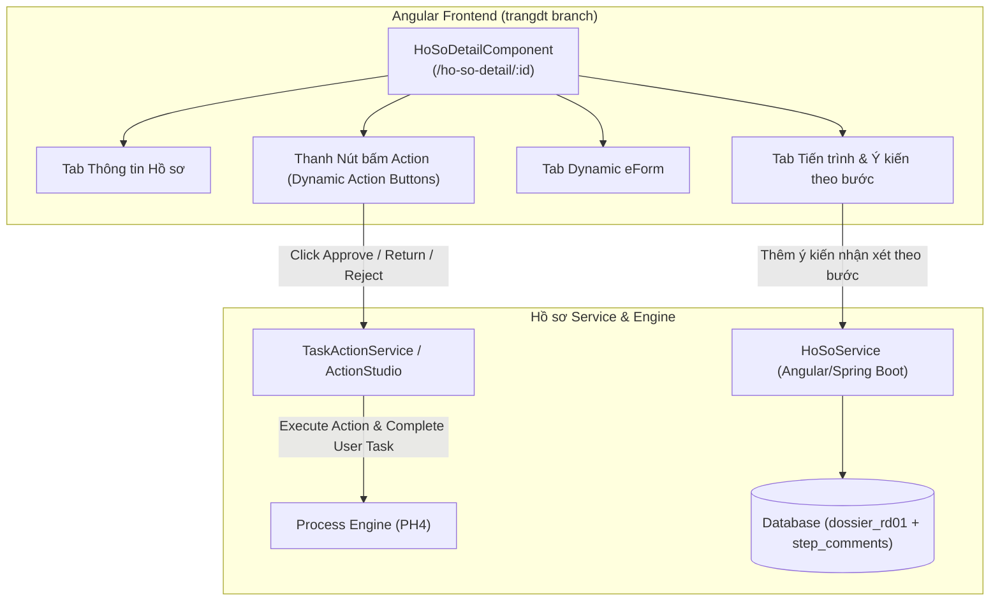

# TÀI LIỆU THIẾT KẾ CHI TIẾT (SRS)
## THIẾT KẾ CHI TIẾT NGHIỆP VỤ XÉT DUYỆT CHỦ TRƯƠNG NHIỆM VỤ KHCN CẤP CƠ SỞ (RD01-CS)

**Phân hệ**: RD01 — Xét duyệt Chủ trương Nhiệm vụ KHCN (Cấp Cơ sở)

### Bảng ghi nhận thay đổi
| Phiên bản | Ngày | Tác giả | Nội dung thay đổi |
|---|---|---|---|
| 0.1 | 2026-08-05 | BA-AI | Khởi tạo bản thảo SRS pilot cho Nghiệp vụ RD01-CS |
| 0.2 | 2026-08-05 | BA-AI | Cập nhật chi tiết màn Chi tiết hồ sơ `HoSoDetailComponent`, tab Ý kiến/Bình luận theo bước duyệt (Step Comments) và Action Buttons từ nhánh `trangdt` |

### Trang ký
| Vai trò | Người thực hiện | Chức danh | Ngày ký | Chữ ký |
|---|---|---|---|---|
| Người lập | BA-AI | Business Analyst | 2026-08-05 | |
| Người kiểm tra | | BA Lead / Tech Lead | | |
| Người phê duyệt | | Product Owner | | |
| Đại diện khách hàng | | VTS / VTIT | | |

### Mục lục
- [1. GIỚI THIỆU](#1-giới-thiệu)
- [2. TỔNG QUAN GIẢI PHÁP](#2-tổng-quan-giải-pháp)
- [3. THIẾT KẾ CHI TIẾT](#3-thiết-kế-chi-tiết)
  - [3.0 Quy trình nghiệp vụ tổng thể](#30-quy-trình-nghiệp-vụ-tổng-thể)
  - [3.1 Khởi tạo & xây dựng hồ sơ chủ trương](#31-khởi-tạo--xây-dựng-hồ-sơ-chủ-trương)
  - [3.2 Trình ký & ký duyệt cấp Trung tâm/Khối](#32-trình-ký--ký-duyệt-cấp-trung-tâmkhối)
  - [3.3 Góp ý / thẩm định Chuyên quản Nghiệp vụ & Ý kiến theo bước](#33-góp-ý--thẩm-định-chuyên-quản-nghiệp-vụ--ý-kiến-theo-bước)
  - [3.4 Lập Báo cáo thẩm định chủ trương](#34-lập-báo-cáo-thẩm-định-chủ-trương)
  - [3.5 Thành lập / quản lý danh sách Hội đồng KHCN](#35-thành-lập--quản-lý-danh-sách-hội-đồng-khcn)
  - [3.6 Hội đồng KHCN phê duyệt Báo cáo thẩm định](#36-hội-đồng-khcn-phê-duyệt-báo-cáo-thẩm-định)
  - [3.7 Tổng Giám đốc ban hành Quyết định chủ trương](#37-tổng-giám-đốc-ban-hành-quyết-định-chủ-trương)
  - [3.8 Xem lịch sử / nhật ký bình luận theo bước duyệt (Step Comments)](#38-xem-lịch-sử--nhật-ký-bình-luận-theo-bước-duyệt-step-comments)
  - [3.9 Danh sách & tra cứu hồ sơ chủ trương](#39-danh-sách--tra-cứu-hồ-sơ-chủ-trương)
- [4. THIẾT KẾ DÙNG CHUNG VÀ TÁI SỬ DỤNG](#4-thiết-kế-dùng-chung-và-tái-sử-dụng)
- [5. THIẾT KẾ ĐẢM BẢO TUÂN THỦ TIÊU CHUẨN QUẢN TRỊ DỮ LIỆU](#5-thiết-kế-đảm-bảo-tuân-thủ-tiêu-chuẩn-quản-trị-dữ-liệu)
- [6. PHỤ LỤC](#6-phụ-lục)

---

## 1. GIỚI THIỆU
Tài liệu SRS này mô tả chi tiết thiết kế phần mềm cho **Nghiệp vụ RD01-CS: Xét duyệt Chủ trương Nhiệm vụ Khoa học & Công nghệ Cấp Cơ sở**.

---

## 2. TỔNG QUAN GIẢI PHÁP
Sử dụng Process Key `RD01.01` trên Engine Camunda 8 để điều phối luồng duyệt hồ sơ chủ trương.

---

## 3. THIẾT KẾ CHI TIẾT

### 3.0 Quy trình nghiệp vụ tổng thể
Luồng End-to-End: Khởi tạo $\rightarrow$ Trình Khối $\rightarrow$ Thẩm định CQNV $\rightarrow$ Họp HĐ KHCN $\rightarrow$ Ban hành QĐ Chủ trương CS.

---

### 3.1 Khởi tạo & xây dựng hồ sơ chủ trương

#### 3.1.1 Mô tả chi tiết các thành phần (Bảng 7 cột)
| STT | Tên | Kiểu dữ liệu [Độ dài] | Input/Output | Giá trị khởi tạo | Mô tả mapping CSDL | Ghi chú |
|---|---|---|---|---|---|---|
| 1 | Tên nhiệm vụ KHCN* | Textbox [255] | Input | Blank | `dossier_rd01.ten_nhiem_vu` | Bắt buộc |
| 2 | Loại nhiệm vụ* | Combobox | Input | "Đề tài" | Trỏ tới Danh mục PH3-01 | |
| 3 | Lĩnh vực nghiên cứu* | Combobox | Input | Blank | Trỏ tới Danh mục PH3-01 | |
| 4 | Cơ quan chủ trì | Combobox | Input | Đơn vị user | Trỏ tới Organization PH2 | |
| 5 | Kinh phí dự kiến (Đồng)* | Number [15] | Input | `0` | `dossier_rd01.kinh_phi_du_kien` | |
| 6 | Thời gian thực hiện (Tháng) | Number [3] | Input | `12` | `dossier_rd01.thoi_gian_thang` | |
| 7 | File Đề xuất đính kèm | Upload File | Input | Blank | Lưu trữ minio/s3 link | Định dạng PDF/DOCX |

---

### 3.2 Trình ký & ký duyệt cấp Trung tâm/Khối
- Trưởng phòng / Lãnh đạo Trung tâm xem xét và duyệt chuyển CQNV thẩm định.

---

### 3.3 Góp ý / thẩm định Chuyên quản Nghiệp vụ & Ý kiến theo bước
- Chuyên quản KHCN, Kế toán, Nhân sự cho ý kiến thẩm định chuyên môn và pháp lý qua Phiếu nhận xét (FormKey: `phieu-nhan-xet-chu-truong`).

---

### 3.4 Lập Báo cáo thẩm định chủ trương
- Chuyên quản tổng hợp ý kiến lập Báo cáo thẩm định trình Hội đồng KHCN.

---

### 3.5 Thành lập / quản lý danh sách Hội đồng KHCN
- Tham chiếu chi tiết tại tài liệu [SRS-HD-01-Hoi-dong-va-Chuyen-gia-v0.1.md](../HD/SRS-HD-01-Hoi-dong-va-Chuyen-gia-v0.1.md).

---

### 3.6 Hội đồng KHCN phê duyệt Báo cáo thẩm định
- Các thành viên HĐ KHCN bỏ phiếu đánh giá (Đạt / Không đạt / Đạt có sửa đổi).

---

### 3.7 Tổng Giám đốc ban hành Quyết định chủ trương
- Tổng Giám đốc VHT ký duyệt ban hành Quyết định phê duyệt chủ trương nhiệm vụ KHCN Cấp Cơ sở.

---

### 3.8 Xem lịch sử / nhật ký bình luận theo bước duyệt (Step Comments)

#### 3.8.1 Tính năng Nổi bật: Tab Ý kiến theo bước (`HoSoDetailComponent` - Nhánh `trangdt`)
- Cho phép người dùng trao đổi, gửi nhận xét và xem nhật ký bình luận theo từng bước xử lý trên quy trình:
  - Hiển thị danh sách các bước (`DossierStepResponse`): Tên bước (`stepName`), Người xử lý (`assignee`), Thời gian (`createdAt`), Trạng thái (`COMPLETED` / `PROCESSING` / `PENDING`).
  - Khối nhập bình luận mới gắn trực tiếp với bước hiện tại của hồ sơ: Ô TextArea nhập nội dung + Nút **Gửi ý kiến**.

| STT | Tên | Kiểu dữ liệu [Độ dài] | Input/Output | Giá trị khởi tạo | Mô tả mapping CSDL | Ghi chú |
|---|---|---|---|---|---|---|
| 1 | Ô nhập ý kiến nhận xét | Textarea [1000] | Input | Blank | Nội dung bình luận cho bước hiện tại | |
| 2 | Nút Gửi ý kiến | Button | Input | Enabled | Lưu vào `dossier_step_comment` | Icon Send |
| 3 | Danh sách ý kiến các bước | Timeline / Comment List | Output | | Hiển thị tên người gửi, thời gian, tên bước và nội dung | Trực quan dạng Timeline |

---

### 3.9 Danh sách & tra cứu hồ sơ chủ trương
- Màn hình tra cứu tổng hợp hồ sơ chủ trương theo trạng thái (`Nháp`, `Đang thẩm định`, `Đã ban hành QĐ`, `Từ chối`).

---

## 4. THIẾT KẾ DÙNG CHUNG VÀ TÁI SỬ DỤNG
- Tái sử dụng `HoSoDetailComponent`, Form Renderer (PH3-02) và Action Studio (PH4).

---

## 5. THIẾT KẾ ĐẢM BẢO TUÂN THỦ TIÊU CHUẨN QUẢN TRỊ DỮ LIỆU
- Tuân thủ 7 tiêu chuẩn quản trị dữ liệu (5.1–5.7).

---

## 6. PHỤ LỤC
- Nguồn code: `frontend-angular/src/app/pages/ho-so-detail/ho-so-detail.ts`.
- Bảng CSDL: `dossier_rd01`, `dossier_step_comment`.
