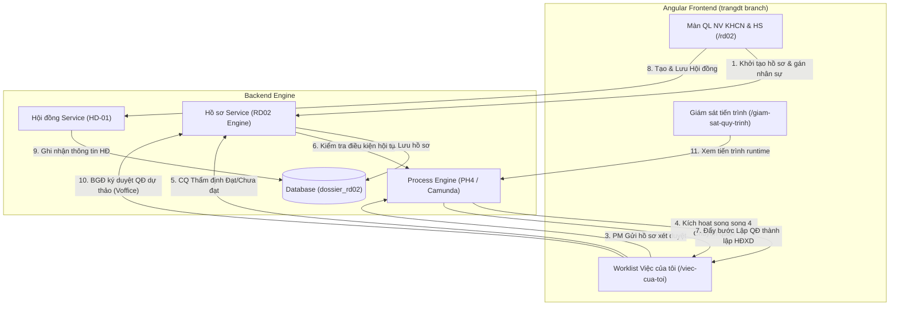

# NHÁP CHỜ VTS - ĐỢT RÀ SOÁT Fig-RD02.02 (OQ-QTKHCN-008, OQ-QTKHCN-009, OQ-QTKHCN-010, OQ-QTKHCN-011, OQ-QTKHCN-012)

# TÀI LIỆU THIẾT KẾ CHI TIẾT (SRS)
## THIẾT KẾ CHI TIẾT NGHIỆP VỤ XÉT DUYỆT NHIỆM VỤ KHCN CẤP CƠ SỞ (RD02-CS)

**Phân hệ**: RD02 — Xét duyệt Nhiệm vụ KHCN (Cấp Cơ sở)

### Bảng ghi nhận thay đổi
| Phiên bản | Ngày | Tác giả | Nội dung thay đổi |
|---|---|---|---|
| 0.1 | 2026-08-05 | BA-AI | Khởi tạo bản thảo SRS pilot cho Nghiệp vụ RD02-CS |
| 0.2 | 2026-08-05 | BA-AI | Cập nhật `HoSoDetailComponent` và dynamic action buttons từ nhánh `trangdt` |
| 0.3 | 2026-08-05 | BA-AI | Tự kiểm tra & nâng cấp đầy đủ các tiểu mục 3.X.1–3.X.5 và bảng 7 cột cho toàn bộ 8 tính năng theo DoD Harness |
| 0.4 | 2026-08-06 | BA-AI | Thực hiện gộp 13 Section Figma từ PROMPTS-GEMINI-RD02.02-theo-section.md vào tài liệu dùng chung |

### Trang ký
| Vai trò | Người thực hiện | Chức danh | Ngày ký | Chữ ký |
|---|---|---|---|---|
| Người lập | BA-AI | Business Analyst | 2026-08-06 | |
| Người kiểm tra | | BA Lead / Tech Lead | | |
| Người phê duyệt | | Product Owner | | |
| Đại diện khách hàng | | VTS / VTIT | | |

### Mục lục
- [1. GIỚI THIỆU](#1-giới-thiệu)
  - [1.1 Mục đích](#11-mục-đích)
  - [1.2 Phạm vi](#12-phạm-vi)
  - [1.3 Khái niệm và thuật ngữ](#13-khái-niệm-và-thuật-ngữ)
  - [1.4 Tài liệu tham khảo](#14-tài-liệu-tham-khảo)
  - [1.5 Mô tả tài liệu](#15-mô-tả-tài-liệu)
- [2. TỔNG QUAN GIẢI PHÁP](#2-tổng-quan-giải-pháp)
  - [2.1 Tổng quan chức năng](#21-tổng-quan-chức-năng)
  - [2.2 Mô hình giao tiếp với module/hệ thống khác](#22-mô-hình-giao-tiếp-với-modulehệ-thống-khác)
- [3. THIẾT KẾ CHI TIẾT](#3-thiết-kế-chi-tiết)
  - [3.0 Quy trình nghiệp vụ tổng thể](#30-quy-trình-nghiệp-vụ-tổng-thể)
  - [3.1 Khởi tạo hồ sơ xét duyệt (Kế thừa chủ trương)](#31-khởi-tạo-hồ-sơ-xét-duyệt-kế-thừa-chủ-trương)
  - [3.2 Chuyên quản thẩm định - trạng thái Đạt / Chưa đạt](#32-chuyên-quản-thẩm-định---trạng-thái-đạt--chưa-đạt)
  - [3.3 Lập & phê duyệt Quyết định thành lập HĐXD](#33-lập--phê-duyệt-quyết-định-thành-lập-hđxd)
  - [3.4 Hội đồng xét duyệt — Phiên 1 (GAP)](#34-hội-đồng-xét-duyệt--phiên-1-gap)
  - [3.5 Hội đồng xét duyệt — Phiên 2 (GAP)](#35-hội-đồng-xét-duyệt--phiên-2-gap)
  - [3.6 HĐ KHCN phê duyệt Báo cáo thẩm định xét duyệt (GAP)](#36-hđ-khcn-phê-duyệt-báo-cáo-thẩm-định-xét-duyệt-gap)
  - [3.7 TGĐ phê duyệt Quyết định mở mới đề tài (GAP)](#37-tgđ-phê-duyệt-quyết-định-mở-mới-đề-tài-gap)
  - [3.8 Danh sách & tra cứu hồ sơ xét duyệt (Worklist & Gửi hồ sơ)](#38-danh-sách--tra-cứu-hồ-sơ-xét-duyệt-worklist--gửi-hồ-sơ)
  - [3.9 Ký duyệt bộ hồ sơ xét duyệt / Quyết định dự thảo (BGĐ)](#39-ký-duyệt-bộ-hồ-sơ-xét-duyệt--quyết-định-dự-thảo-bgđ)
  - [3.10 Rework / hoàn chỉnh hồ sơ xét duyệt sau phiếu nhận xét (PM)](#310-rework--hoàn-chỉnh-hồ-sơ-xét-duyệt-sau-phiếu-nhận-xét-pm)
- [4. THIẾT KẾ DÙNG CHUNG VÀ TÁI SỬ DỤNG](#4-thiết-kế-dùng-chung-và-tái-sử-dụng)
- [5. THIẾT KẾ ĐẢM BẢO TUÂN THỦ TIÊU CHUẨN QUẢN TRỊ DỮ LIỆU](#5-thiết-kế-đảm-bảo-tuân-thủ-tiêu-chuẩn-quản-trị-dữ-liệu)
- [6. PHỤ LỤC](#6-phụ-lục)
  - [6.1 Mẫu tệp nhập và xuất dữ liệu](#61-mẫu-tệp-nhập-và-xuất-dữ-liệu)
  - [6.2 Đề xuất bổ sung thiết kế cơ sở dữ liệu](#62-đề-xuất-bổ-sung-thiết-kế-cơ-sở-dữ-liệu)
  - [6.3 Danh mục điểm chờ xác nhận](#63-danh-mục-điểm-chờ-xác-nhận)
  - [6.4 Phụ thuộc module/dữ liệu khác](#64-phụ-thuộc-moduledữ-liệu-khác)

---

## 1. GIỚI THIỆU

### 1.1 Mục đích
Tài liệu SRS này mô tả thiết kế chi tiết cho nghiệp vụ **Xét duyệt Nhiệm vụ KHCN Cấp Cơ sở (RD02-CS)**. Đây là tài liệu căn cứ để đội ngũ phát triển (BE/FE) và kiểm thử (QA/QC) xây dựng tính năng.

### 1.2 Phạm vi
- **Bao gồm**:
  - Khởi tạo nhiệm vụ KHCN mới kế thừa từ Chủ trương (RD01) đã phê duyệt.
  - Phối hợp thẩm định song song của 4 bộ phận chuyên quản (KHCN, TCKT, Mua sắm, Nhân sự).
  - Quy trình hoàn thiện hồ sơ (Rework) của PM khi có phiếu nhận xét chưa đạt.
  - Thành lập Hội đồng xét duyệt và ký duyệt Quyết định thành lập cấp BGĐ.
  - Tra cứu trạng thái và giám sát tiến trình hồ sơ xét duyệt.
- **Không bao gồm**: Quy trình cấp Tập đoàn (Phase 2), các khâu nghiệm thu (RD05) hay quyết toán (RD06).

### 1.3 Khái niệm và thuật ngữ
| Thuật ngữ | Diễn giải |
|---|---|
| **PM** | Project Manager / Chủ nhiệm đề tài. |
| **CQ** | Chuyên quản thẩm định hồ sơ (bao gồm KHCN, TCKT, MS, NS). |
| **HĐXD** | Hội đồng xét duyệt Nhiệm vụ KHCN. |
| **HSXD** | Hồ sơ xét duyệt. |

### 1.4 Tài liệu tham khảo
1. [PROMPTS-GEMINI-RD02.02-theo-section.md](file:///d:/ql-nvkhcn/docs/ba/PROMPTS-GEMINI-RD02.02-theo-section.md)
2. [SRS-FIGMA-MAP-RD02.02.md](file:///d:/ql-nvkhcn/docs/ba/SRS-FIGMA-MAP-RD02.02.md)

### 1.5 Mô tả tài liệu
Tài liệu tuân thủ nghiêm ngặt 6 mục tiêu chuẩn và quy định DoD của dự án.

---

## 2. TỔNG QUAN GIẢI PHÁP

### 2.1 Tổng quan chức năng
Nghiệp vụ RD02-CS được điều phối bởi Process Engine PH4 (Zeebe/Camunda 8) kết hợp với các Service dữ liệu nghiệp vụ của phân hệ.

### 2.2 Mô hình giao tiếp với module/hệ thống khác

---

## 3. THIẾT KẾ CHI TIẾT

### 3.0 Quy trình nghiệp vụ tổng thể
Quy trình nghiệp vụ diễn tiến từ khâu Khởi tạo nhiệm vụ KHCN mới -> PM gửi xét duyệt -> 4 Chuyên quản xử lý song song -> (Rework nếu Chưa đạt) -> Thành lập Hội đồng -> BGĐ ký duyệt Quyết định thành lập dự thảo -> Họp Hội đồng đánh giá -> Ban hành Quyết định mở mới.

---

### 3.1 Khởi tạo hồ sơ xét duyệt (Kế thừa chủ trương)

#### 3.1.1 Thông tin chung chức năng
- **Tác nhân**: Chủ nhiệm đề tài / PM (`ROLE_USER`).
- **Ý nghĩa**: Khởi tạo Thuyết minh chi tiết cho Nhiệm vụ KHCN mới trên cơ sở kế thừa dữ liệu từ Hồ sơ Chủ trương (RD01) đã được duyệt.
- **Đường dẫn**: Quản lý NV KHCN & HS > Thêm mới nhiệm vụ (`/rd02/them-moi`).

#### 3.1.2 Màn hình
| STT | Tên màn hình | Mô tả | Ảnh |
|---|---|---|---|
| 1 | Màn hình Danh sách NV KHCN | Danh sách và bộ lọc tra cứu các nhiệm vụ KHCN | `` |
| 2 | Màn hình Thêm mới NV KHCN | Form nhập thông tin thuyết minh nhiệm vụ KHCN | `` |
| 3 | Màn hình Xem chi tiết NV KHCN | Xem thông tin chi tiết và thêm mới hồ sơ đính kèm | `` |

#### 3.1.3 Mô tả chi tiết các thành phần (Bảng 7 cột)
| STT | Tên | Kiểu dữ liệu [Độ dài] | Input/Output | Giá trị khởi tạo | Mô tả mapping CSDL | Ghi chú |
|---|---|---|---|---|---|---|
| **Điều kiện tìm kiếm** | | | | | | |
| 1 | Từ khóa tìm kiếm | Textbox [100] | Input | Blank | So khớp chứa trong `ma_nhiem_vu`/`ten_nhiem_vu` | |
| 2 | Lĩnh vực nghiên cứu | Combobox | Input | "Tất cả" | Lọc theo `dossier_rd02.linh_vuc_id` | |
| **Datagrid Danh sách Nhiệm vụ** | | | | | | |
| 3 | Mã nhiệm vụ* | Link Column | Output | | Unique. `dossier_rd02.ma_nhiem_vu` | Click để xem chi tiết |
| 4 | Tên nhiệm vụ | Label Column | Output | | `dossier_rd02.ten_nhiem_vu` | |
| 5 | Chủ nhiệm nhiệm vụ | Label Column | Output | | Tên User từ PH2 | |
| 6 | Trạng thái | Tag Column | Output | | Enum: `DRAFT`, `PENDING_CQ`, `REWORK`, `APPROVED` | |
| **Thông tin chung nhiệm vụ (Thêm mới/Chỉnh sửa)** | | | | | | |
| 7 | Chọn hồ sơ chủ trương* | Combobox | Input | Blank | Trỏ tới `dossier_rd01.id` | Nạp dữ liệu từ chủ trương đã duyệt |
| 8 | Mã nhiệm vụ* | Textbox [50] | Input | Blank | Unique. `dossier_rd02.ma_nhiem_vu` | Bắt buộc nhập |
| 9 | Tên Thuyết minh* | Textbox [255] | Input | Nạp từ RD01 | `dossier_rd02.ten_nhiem_vu` | Cho phép chỉnh sửa |
| 10 | Chủ nhiệm nhiệm vụ* | Combobox | Input | Nạp từ RD01 | `dossier_rd02.chu_nhiem_id` | |
| 11 | Tổng kinh phí thuyết minh* | Number [15] | Input | Nạp từ RD01 | `dossier_rd02.kinh_phi_thuyet_minh` | |
| 12 | Số tiền bằng chữ | Textbox [255] | Output | Tự động sinh | `dossier_rd02.kinh_phi_bang_chu` | Tự động dịch từ số tiền |
| 13 | Nút Chọn mẫu tài liệu | Button | Input | Enabled | Mở pop-up Chọn mẫu tài liệu | |
| 14 | Nút Chọn nhân sự đề tài | Button | Input | Enabled | Mở pop-up Chọn nhân sự | |
| 15 | Nút Lưu nhiệm vụ | Button | Input | Enabled | Lưu thông tin vào CSDL | Sau khi Lưu mới hiển thị phần thêm hồ sơ |
| **Thêm mới hồ sơ & tệp đính kèm (sau khi Lưu nhiệm vụ)** | | | | | | |
| 16 | Tên hồ sơ* | Textbox [255] | Input | Blank | `dossier_rd02_files.file_name` | |
| 17 | Tệp đính kèm* | Upload Button | Input | Blank | PDF/Word đính kèm | |
| 18 | Nút Lưu hồ sơ | Button | Input | Enabled | Lưu vào bảng `dossier_rd02_files` | |

#### 3.1.4 Luồng nghiệp vụ
##### A. Khởi tạo & Lưu nháp nhiệm vụ
| Bước | Mô tả |
|---|---|
| 1 | PM click nút **Thêm mới nhiệm vụ**, chọn Hồ sơ chủ trương (RD01) để kế thừa dữ liệu. |
| 2 | Hệ thống tự động nạp các trường dữ liệu tương ứng. PM nhập mã nhiệm vụ và điều chỉnh thông tin nếu cần. |
| 3 | Click **Chọn nhân sự đề tài** để chọn và gán danh sách thành viên đề tài. |
| 4 | Click **Lưu nhiệm vụ**. Backend kiểm tra tính hợp lệ và ghi nhận vào bảng `dossier_rd02` ở trạng thái `DRAFT`. |
| 5 | Hệ thống hiển thị thêm khối **Thêm mới hồ sơ**. PM tải lên các file thuyết minh dự toán và bấm **Lưu hồ sơ**. |

#### 3.1.5 Quy tắc nghiệp vụ
| Mã quy tắc | Quy tắc | Áp dụng cho | Trạng thái |
|---|---|---|---|
| `BR-RD0201-01-01` | Mã nhiệm vụ không chứa khoảng trắng, ký tự đặc biệt và không trùng lặp trong CSDL. | Tạo mới | Chốt |
| `BR-RD0201-01-02` | Hồ sơ xét duyệt bắt buộc phải kế thừa và trỏ tới một Quyết định chủ trương (RD01) đã phê duyệt. | Tạo mới | Chốt |
| `BR-RD0201-01-03` | Kinh phí thuyết minh không được vượt quá kinh phí chủ trương đã duyệt tại RD01. | Tạo mới | `[CẦN XÁC NHẬN]` `OQ-QTKHCN-008` |

---

### 3.2 Chuyên quản thẩm định - trạng thái Đạt / Chưa đạt

#### 3.2.0 Tổng quan luồng song song chuyên quản
Quy trình kích hoạt 4 tác vụ song song cho 4 bộ phận chuyên quản: Chuyên quản KHCN, Chuyên quản TCKT, Chuyên quản Mua sắm (MS), Chuyên quản Nhân sự (NS). Cả 4 chuyên quản xử lý độc lập từ Worklist của mình.

#### 3.2.1 Thẩm định hồ sơ xét duyệt — Chuyên quản KHCN
##### a) Thông tin chung chức năng
- **Tác nhân**: Chuyên quản KHCN (`ROLE_CQ_KHCN`).
- **Ý nghĩa**: Thẩm định nội dung thuyết minh khoa học của hồ sơ nhiệm vụ.
- **Đường dẫn**: Việc của tôi > Thẩm định hồ sơ (`/viec-cua-toi/xu-ly`).

##### b) Màn hình
| STT | Tên màn hình | Mô tả | Ảnh |
|---|---|---|---|
| 1 | Màn hình Thẩm định (KHCN) | Giao diện hiển thị chi tiết hồ sơ, e-form và form nhập nhận xét | `` |

##### c) Mô tả chi tiết các thành phần (Bảng 7 cột)
| STT | Tên | Kiểu dữ liệu [Độ dài] | Input/Output | Giá trị khởi tạo | Mô tả mapping CSDL | Ghi chú |
|---|---|---|---|---|---|---|
| **Form ý kiến chuyên quản** | | | | | | |
| 1 | Kết quả thẩm định* | Radio Group | Input | "Đạt" | Enum: `DAT`, `CHUA_DAT` | |
| 2 | Ý kiến thẩm định* | Textarea [1000] | Input | Blank | `dossier_rd02.cq_khcn_comment` | Bắt buộc nhập |
| 3 | Phiếu nhận xét đính kèm | Upload File | Input | Blank | Tải lên phiếu nhận xét PDF | |
| 4 | Nút Gửi ý kiến | Button | Input | Enabled | Đẩy kết quả và ghi nhận hoàn tất task | |

##### d) Luồng nghiệp vụ
| Bước | Mô tả |
|---|---|
| 1 | Chuyên quản KHCN vào Worklist **Việc của tôi**, chọn hồ sơ cần xử lý. |
| 2 | Hệ thống nạp giao diện chi tiết hồ sơ và form ý kiến. |
| 3 | Chuyên quản chọn kết quả (Đạt/Chưa đạt), nhập nhận xét, đính kèm file phiếu thẩm định và bấm **Gửi ý kiến**. |
| 4 | Backend lưu thông tin ý kiến vào bảng `dossier_rd02`, cập nhật trạng thái nhánh trên Camunda Engine. |

##### e) Quy tắc nghiệp vụ
| Mã quy tắc | Quy tắc | Áp dụng cho | Trạng thái |
|---|---|---|---|
| `BR-RD0201-02-01` | Chuyên quản bắt buộc phải nhập ý kiến thẩm định chi tiết khi chọn kết quả "Chưa đạt". | Gửi ý kiến | Chốt |

---

#### 3.2.2 Thẩm định hồ sơ xét duyệt — Chuyên quản TCKT
##### a) Thông tin chung chức năng
- **Tác nhân**: Chuyên quản TCKT (`ROLE_CQ_TCKT`).
- **Ý nghĩa**: Thẩm định dự toán tài chính và tính hợp lệ của ngân sách nhiệm vụ.

##### b) Màn hình
Giao diện tương tự Chuyên quản KHCN nhưng được cấu hình dành riêng cho vai trò Chuyên quản TCKT.

##### c) Mô tả chi tiết các thành phần (Bảng 7 cột)
| STT | Tên | Kiểu dữ liệu [Độ dài] | Input/Output | Giá trị khởi tạo | Mô tả mapping CSDL | Ghi chú |
|---|---|---|---|---|---|---|
| **Form ý kiến chuyên quản** | | | | | | |
| 1 | Kết quả thẩm định* | Radio Group | Input | "Đạt" | Enum: `DAT`, `CHUA_DAT` | |
| 2 | Ý kiến thẩm định* | Textarea [1000] | Input | Blank | `dossier_rd02.cq_tckt_comment` | Bắt buộc nhập |
| 3 | Phiếu nhận xét đính kèm | Upload File | Input | Blank | Tải lên phiếu nhận xét PDF | |
| 4 | Nút Gửi ý kiến | Button | Input | Enabled | Đẩy kết quả và ghi nhận hoàn tất task | |

##### d) Luồng nghiệp vụ
Tương tự luồng của Chuyên quản KHCN.

---

#### 3.2.3 Thẩm định hồ sơ xét duyệt — Chuyên quản Mua sắm (MS)
##### a) Thông tin chung chức năng
- **Tác nhân**: Chuyên quản MS (`ROLE_CQ_MS`).
- **Ý nghĩa**: Thẩm định danh mục trang thiết bị, gói thầu mua sắm của nhiệm vụ.

##### b) Mô tả chi tiết các thành phần (Bảng 7 cột)
| STT | Tên | Kiểu dữ liệu [Độ dài] | Input/Output | Giá trị khởi tạo | Mô tả mapping CSDL | Ghi chú |
|---|---|---|---|---|---|---|
| **Form ý kiến chuyên quản** | | | | | | |
| 1 | Kết quả thẩm định* | Radio Group | Input | "Đạt" | Enum: `DAT`, `CHUA_DAT` | |
| 2 | Ý kiến thẩm định* | Textarea [1000] | Input | Blank | `dossier_rd02.cq_ms_comment` | Bắt buộc nhập |
| 3 | Phiếu nhận xét đính kèm | Upload File | Input | Blank | Tải lên phiếu nhận xét PDF | |
| 4 | Nút Gửi ý kiến | Button | Input | Enabled | Đẩy kết quả và ghi nhận hoàn tất task | |

##### d) Luồng nghiệp vụ
Tương tự luồng của Chuyên quản KHCN.

---

#### 3.2.4 Thẩm định hồ sơ xét duyệt — Chuyên quản Nhân sự (NS)
##### a) Thông tin chung chức năng
- **Tác nhân**: Chuyên quản NS (`ROLE_CQ_NS`).
- **Ý nghĩa**: Thẩm định định mức nhân công, vai trò và năng lực của nhân sự đề tài.

##### b) Mô tả chi tiết các thành phần (Bảng 7 cột)
| STT | Tên | Kiểu dữ liệu [Độ dài] | Input/Output | Giá trị khởi tạo | Mô tả mapping CSDL | Ghi chú |
|---|---|---|---|---|---|---|
| **Form ý kiến chuyên quản** | | | | | | |
| 1 | Kết quả thẩm định* | Radio Group | Input | "Đạt" | Enum: `DAT`, `CHUA_DAT` | |
| 2 | Ý kiến thẩm định* | Textarea [1000] | Input | Blank | `dossier_rd02.cq_ns_comment` | Bắt buộc nhập |
| 3 | Phiếu nhận xét đính kèm | Upload File | Input | Blank | Tải lên phiếu nhận xét PDF | |
| 4 | Nút Gửi ý kiến | Button | Input | Enabled | Đẩy kết quả và ghi nhận hoàn tất task | |

##### d) Luồng nghiệp vụ
Tương tự luồng của Chuyên quản KHCN.

---

### 3.3 Lập & phê duyệt Quyết định thành lập HĐXD

#### 3.3.1 Thông tin chung chức năng
- **Tác nhân**: Thư ký Hội đồng (`ROLE_SECRETARY`).
- **Ý nghĩa**: Lập tờ trình và quyết định thành lập hội đồng xét duyệt sau khi hồ sơ đã qua vòng thẩm định của các chuyên quản.
- **Đường dẫn**: Quản lý NV KHCN & HS > Quản lý Hội đồng > Thêm mới Hội đồng (`/hoi-dong/danh-sach`).

#### 3.3.2 Màn hình
| STT | Tên màn hình | Mô tả | Ảnh |
|---|---|---|---|
| 1 | Màn hình Thêm mới Hội đồng | Form thêm mới Hội đồng và gán quyết định thành lập | `` |

#### 3.3.3 Mô tả chi tiết các thành phần (Bảng 7 cột)
| STT | Tên | Kiểu dữ liệu [Độ dài] | Input/Output | Giá trị khởi tạo | Mô tả mapping CSDL | Ghi chú |
|---|---|---|---|---|---|---|
| **Khối thông tin Quyết định thành lập** | | | | | | |
| 1 | Số Quyết định* | Textbox [100] | Input | Blank | `council_decision.decision_no` | Bắt buộc nhập |
| 2 | Ngày ban hành* | Datepicker | Input | Ngày hiện tại | `council_decision.issued_date` | |
| 3 | Người ký Quyết định | Combobox | Input | Blank | Lãnh đạo ban hành quyết định | |
| 4 | Danh sách thành viên* | Dropdown Multi | Input | Nạp từ Service | `council_member` | Nạp từ `HoiDongCandidateService` (`ungVienHoiDong`) |
| 5 | Nút Lưu Hội đồng | Button | Input | Enabled | Ghi nhận thông tin vào CSDL | |

#### 3.3.4 Luồng nghiệp vụ
| Bước | Mô tả |
|---|---|
| 1 | Thư ký mở form Tạo mới Hội đồng từ quản lý danh mục hội đồng. |
| 2 | Nhập Số quyết định, Ngày ban hành và click **Danh sách thành viên** để chọn và gán vai trò các thành viên. |
| 3 | Click **Lưu Hội đồng**. Backend kiểm tra và cập nhật trạng thái quy trình. |

#### 3.3.5 Quy tắc nghiệp vụ
| Mã quy tắc | Quy tắc | Áp dụng cho | Trạng thái |
|---|---|---|---|
| `BR-RD0201-03-01` | Chỉ hệ thống tạo Hội đồng xét duyệt sau khi cả 4 chuyên quản thẩm định cùng đánh giá "Đạt". | Tạo Hội đồng | `[CẦN XÁC NHẬN]` `OQ-QTKHCN-011` |

---

### 3.4 Hội đồng xét duyệt — Phiên 1 (GAP)
> [!WARNING]
> **GAP**: Mockup Figma hiện tại chưa có thiết kế giao diện chi tiết cho phiên họp 1 của Hội đồng xét duyệt, các mẫu phiếu đánh giá và Biên bản họp phiên 1. Phần thiết kế này tạm thời đánh GAP nghiệp vụ (`[CẦN XÁC NHẬN] OQ-QTKHCN-009`).

---

### 3.5 Hội đồng xét duyệt — Phiên 2 (GAP)
> [!WARNING]
> **GAP**: Mockup Figma hiện tại chưa có thiết kế giao diện chi tiết cho phiên họp 2 của Hội đồng xét duyệt. Tạm thời đánh GAP nghiệp vụ (`[CẦN XÁC NHẬN] OQ-QTKHCN-009`).

---

### 3.6 HĐ KHCN phê duyệt Báo cáo thẩm định xét duyệt (GAP)
> [!WARNING]
> **GAP**: Mockup Figma hiện tại chưa có thiết kế màn hình cho bước Hội đồng KHCN thông qua và phê duyệt Báo cáo thẩm định tổng hợp. Tạm thời đánh GAP nghiệp vụ.

---

### 3.7 TGĐ phê duyệt Quyết định mở mới đề tài (GAP)
> [!WARNING]
> **GAP**: Mockup Figma hiện tại chưa có thiết kế màn hình phê duyệt Quyết định mở mới chính thức cấp Tổng Giám đốc. Tạm thời đánh GAP nghiệp vụ.

---

### 3.8 Danh sách & tra cứu hồ sơ xét duyệt (Worklist & Gửi hồ sơ)

#### 3.8.1 Thông tin chung chức năng
- **Tác nhân**: PM (`ROLE_USER`).
- **Ý nghĩa**: Worklist cá nhân hiển thị các công việc được giao xử lý, điền E-form BM.02.02.DTO.NV_2024 để gửi hồ sơ xét duyệt.
- **Đường dẫn**: Việc của tôi (`/viec-cua-toi`).

#### 3.8.2 Màn hình
| STT | Tên màn hình | Mô tả | Ảnh |
|---|---|---|---|
| 1 | Màn hình Việc của tôi (PM) | Danh sách công việc cần PM xử lý | `` |
| 2 | Màn hình Chi tiết công việc cần xử lý | Xem thông tin hồ sơ và e-form chi tiết | `` |

#### 3.8.3 Mô tả chi tiết các thành phần (Bảng 7 cột)
| STT | Tên | Kiểu dữ liệu [Độ dài] | Input/Output | Giá trị khởi tạo | Mô tả mapping CSDL | Ghi chú |
|---|---|---|---|---|---|---|
| **Danh sách Việc của tôi** | | | | | | |
| 1 | Lưới công việc | Datagrid | Output | | Hiển thị các task gán cho PM | |
| 2 | Nút Xử lý | Button | Input | Enabled | Mở chi tiết công việc để điền e-form | |
| **Chi tiết xử lý & E-form** | | | | | | |
| 3 | Xem BPMN | Button | Input | Enabled | Mở popup xem sơ đồ tiến trình Camunda runtime | |
| 4 | E-form BM.02.02.DTO.NV_2024 | E-Form | Input | Blank | Lưu vào CSDL `dossier_rd02_data` | Giao diện e-form động |
| 5 | Nút Gửi hồ sơ | Button | Input | Enabled | Kích hoạt gửi và chuyển trạng thái hồ sơ | Chuyển tới 4 CQ song song |

#### 3.8.4 Luồng nghiệp vụ
| Bước | Mô tả |
|---|---|
| 1 | PM truy cập Worklist **Việc của tôi**, tìm hồ sơ ở bước khởi tạo và click **Xử lý**. |
| 2 | Hệ thống mở e-form BM.02.02.DTO.NV_2024. PM điền đầy đủ các thông tin và đính kèm các tài liệu thuyết minh. |
| 3 | Click **Gửi hồ sơ**. Hệ thống xác nhận và đẩy quy trình lên Camunda Engine, kích hoạt 4 nhánh chuyên quản song song. |

#### 3.8.5 Quy tắc nghiệp vụ
| Mã quy tắc | Quy tắc | Áp dụng cho | Trạng thái |
|---|---|---|---|
| `BR-RD0201-08-01` | Phải hoàn tất điền e-form BM.02.02.DTO.NV_2024 trước khi thực hiện gửi hồ sơ xét duyệt. | Gửi hồ sơ | Chốt |

---

### 3.9 Ký duyệt bộ hồ sơ xét duyệt / Quyết định dự thảo (BGĐ)

#### 3.9.1 Thông tin chung chức năng
- **Tác nhân**: Ban Giám đốc VHT (`ROLE_BGD`).
- **Ý nghĩa**: Kiểm tra và ký ban hành quyết định thành lập Hội đồng xét duyệt dự thảo qua hệ thống Voffice.
- **Đường dẫn**: Việc của tôi > Ký duyệt hồ sơ (`/viec-cua-toi/xu-ly`).

#### 3.9.2 Màn hình
| STT | Tên màn hình | Mô tả | Ảnh |
|---|---|---|---|
| 1 | Màn hình Ký duyệt (BGĐ) | Giao diện mở xem quyết định dự thảo và chuyển ký Voffice | `` |

#### 3.9.3 Mô tả chi tiết các thành phần (Bảng 7 cột)
| STT | Tên | Kiểu dữ liệu [Độ dài] | Input/Output | Giá trị khởi tạo | Mô tả mapping CSDL | Ghi chú |
|---|---|---|---|---|---|---|
| **Khối ký duyệt** | | | | | | |
| 1 | Tệp Quyết định dự thảo | File Viewer | Output | | Hiển thị file PDF quyết định | |
| 2 | Nút Ký duyệt | Button | Input | Enabled | Kích hoạt kết nối Voffice để ký số | |
| 3 | Nút Từ chối | Button | Input | Enabled | Mở pop-up nhập lý do từ chối | Trả về bước trước |

#### 3.9.4 Luồng nghiệp vụ
| Bước | Mô tả |
|---|---|
| 1 | BGĐ vào Worklist **Việc của tôi**, chọn hồ sơ cần ký quyết định thành lập HĐ. |
| 2 | Hệ thống hiển thị tệp quyết định dự thảo trực quan trên File Viewer. |
| 3 | BGĐ click **Ký duyệt**, hệ thống kích hoạt API tích hợp Voffice để thực hiện ký số tài liệu. |

#### 3.9.5 Quy tắc nghiệp vụ
| Mã quy tắc | Quy tắc | Áp dụng cho | Trạng thái |
|---|---|---|---|
| `BR-RD0201-09-01` | Sau khi ký duyệt thành công trên Voffice, trạng thái quyết định thành lập HĐ được cập nhật thành `APPROVED` trên hệ thống. | Ký duyệt | `[CẦN XÁC NHẬN]` `OQ-QTKHCN-010` |

---

### 3.10 Rework / hoàn chỉnh hồ sơ xét duyệt sau phiếu nhận xét (PM)

#### 3.10.1 Thông tin chung chức năng
- **Tác nhân**: Chủ nhiệm đề tài / PM (`ROLE_USER`).
- **Ý nghĩa**: Nhận các phiếu nhận xét từ chuyên quản, thực hiện chỉnh sửa, hoàn chỉnh thuyết minh và dự toán để trình duyệt lại.
- **Đường dẫn**: Việc của tôi > Hoàn chỉnh hồ sơ (`/viec-cua-toi/xu-ly`).

#### 3.10.2 Màn hình
| STT | Tên màn hình | Mô tả | Ảnh |
|---|---|---|---|
| 1 | Màn hình Hoàn chỉnh hồ sơ | Form chỉnh sửa e-form, xem phiếu ý kiến và tải lên tài liệu đính kèm mới | `` |

#### 3.10.3 Mô tả chi tiết các thành phần (Bảng 7 cột)
| STT | Tên | Kiểu dữ liệu [Độ dài] | Input/Output | Giá trị khởi tạo | Mô tả mapping CSDL | Ghi chú |
|---|---|---|---|---|---|---|
| **Thông tin Rework** | | | | | | |
| 1 | Phiếu nhận xét chuyên quản | File Grid | Output | | Đọc từ `dossier_rd02_files` | Danh sách phiếu chuyên quản đã nộp |
| 2 | Cập nhật E-form | E-Form | Input | Nạp từ bản ghi cũ | Cập nhật `dossier_rd02_data` | |
| 3 | Tải lên tài liệu chỉnh sửa | Upload Button | Input | Blank | Tải lên bản thuyết minh/dự toán cập nhật | |
| 4 | Nút Trình duyệt lại | Button | Input | Enabled | Đẩy lại quy trình lên chuyên quản thẩm định | |

#### 3.10.4 Luồng nghiệp vụ
| Bước | Mô tả |
|---|---|
| 1 | PM vào Worklist **Việc của tôi**, chọn hồ sơ có trạng thái `REWORK` và click **Xử lý**. |
| 2 | Hệ thống nạp danh sách các phiếu nhận xét của chuyên quản để PM rà soát. |
| 3 | PM thực hiện điều chỉnh e-form và tải lên các bản thuyết minh/dự toán đã chỉnh sửa. |
| 4 | Click **Trình duyệt lại**. Backend ghi nhận cập nhật và kích hoạt lại bước thẩm định song song của chuyên quản. |

#### 3.10.5 Quy tắc nghiệp vụ
| Mã quy tắc | Quy tắc | Áp dụng cho | Trạng thái |
|---|---|---|---|
| `BR-RD0201-10-01` | Trình duyệt lại sẽ xóa trạng thái "Chưa đạt" tạm thời của các chuyên quản ở lượt đánh giá trước và reset trạng thái thẩm định về mặc định. | Trình duyệt lại | `[CẦN XÁC NHẬN]` `OQ-QTKHCN-012` |

---

## 4. THIẾT KẾ DÙNG CHUNG VÀ TÁI SỬ DỤNG
- **Quy trình nạp Worklist Việc của tôi**: Dùng chung cho tất cả các tác nhân (PM, 4 Chuyên quản, BGĐ). Hệ thống nạp dữ liệu từ `/api/v1/tasks/my-tasks` lọc theo Candidate Group/Role của phiên làm việc.
- **Thư viện biểu mẫu (PH3-02)**: BM.02.02.DTO.NV_2024 được render động qua component e-form của phân hệ dùng chung.

---

## 5. THIẾT KẾ ĐẢM BẢO TUÂN THỦ TIÊU CHUẨN QUẢN TRỊ DỮ LIỆU
- **5.1 Chất lượng dữ liệu**: Kiểm tra tính hợp lệ của mã nhiệm vụ và định dạng số tiền kinh phí.
- **5.2 Lịch sử và khả năng truy vết**: Lưu vết lịch sử phê duyệt của 4 chuyên quản và các phiên bản tệp đính kèm.
- **5.3 Phân quyền và kiểm soát truy cập**: Phân quyền theo vai trò (`ROLE_USER`, `ROLE_CQ_KHCN`, `ROLE_CQ_TCKT`, `ROLE_CQ_MS`, `ROLE_CQ_NS`, `ROLE_SECRETARY`, `ROLE_BGD`) và Data Scope tương ứng.
- **5.4 Vòng đời và lưu trữ dữ liệu**: Hồ sơ được lưu trữ ở trạng thái soft delete khi hủy bỏ.
- **5.5 Dữ liệu cá nhân**: Mã hóa thông tin liên hệ và email của thành viên hội đồng.
- **5.6 Quản trị dữ liệu**: Ghi nhận mã hội đồng và mã nhiệm vụ làm Master Data.
- **5.7 Kiến trúc & tích hợp dữ liệu**: Giao tiếp chuẩn REST API định dạng JSON và tích hợp Camunda 8 Engine.

---

## 6. PHỤ LỤC

### 6.1 Mẫu tệp nhập và xuất dữ liệu
- File xuất biên bản hội đồng xét duyệt: `BM-02-09-bbh-nv.docx` (sẽ được cấu hình schema xuất tài liệu động).

### 6.2 Đề xuất bổ sung thiết kế cơ sở dữ liệu
- Bảng `dossier_rd02`: Lưu thông tin nhiệm vụ KHCN kế thừa từ RD01.
- Bảng `dossier_rd02_files`: Lưu thông tin các tệp thuyết minh, dự toán đính kèm.

### 6.3 Danh mục điểm chờ xác nhận
| Mã OQ | Câu hỏi | Ưu tiên | Chặn? | Phản hồi VTS | Nguồn/Ghi chú |
|---|---|---|---|---|---|
| `OQ-QTKHCN-008` | Mockup ghi RD02.02 cấp Tập đoàn nhưng tài liệu viết cho cấp Cơ sở (CS), các nhãn và trường dữ liệu có đồng nhất 100% không? | Cao | Có | | Figma node `11:56` |
| `OQ-QTKHCN-009` | Thiếu mockup chi tiết cho Hội đồng xét duyệt Phiên 1, Phiên 2, phiếu đánh giá và Biên bản họp. | Cao | Có | | Gặp GAP thiết kế |
| `OQ-QTKHCN-010` | Cơ chế tích hợp Voffice / chữ ký số khi BGĐ ký quyết định thành lập HĐXD dự thảo. | Trung bình | Không | | Figma node `932:256` |
| `OQ-QTKHCN-011` | Cần cả 4 chuyên quản (KHCN, TCKT, MS, NS) đều Đạt để chuyển bước hay chỉ một số chuyên quản chính? | Trung bình | Có | | Luồng song song |
| `OQ-QTKHCN-012` | Khi PM rework hồ sơ, đích trả về và phạm vi chỉnh sửa thuyết minh/kinh phí có bị giới hạn gì không? | Trung bình | Không | | Rework loop |

### 6.4 Phụ thuộc module/dữ liệu khác
- **PH2**: Identity & Access Management (phân quyền vai trò và App Access).
- **RD01**: Xét duyệt chủ trương (kế thừa quyết định chủ trương đã phê duyệt).
- **HD**: Hội đồng & Chuyên gia (thành lập thành viên hội đồng).
