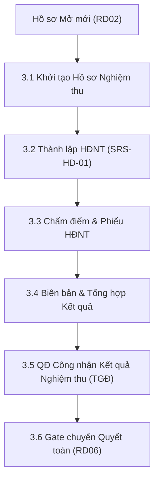

# TÀI LIỆU THIẾT KẾ CHI TIẾT (SRS)
## THIẾT KẾ CHI TIẾT NGHIỆP VỤ NGHIỆM THU NHIỆM VỤ KHCN CẤP CƠ SỞ (RD05-CS)

**Phân hệ**: RD05 — Nghiệm thu Nhiệm vụ KHCN (Cấp Cơ sở)

### Bảng ghi nhận thay đổi
| Phiên bản | Ngày | Tác giả | Nội dung thay đổi |
|---|---|---|---|
| 0.1 | 2026-08-05 | BA-AI | Khởi tạo bản thảo SRS pilot cho Nghiệm thu CS |
| 0.2 | 2026-08-05 | BA-AI | Cập nhật UI HoSoDetailComponent từ nhánh `trangdt` |
| 0.3 | 2026-08-05 | BA-AI | Tự kiểm tra & nâng cấp đầy đủ các tiểu mục 3.X.1–3.X.5 và bảng 7 cột cho toàn bộ 7 tính năng theo DoD Harness |

### Trang ký
| Vai trò | Người thực hiện | Chức danh | Ngày ký | Chữ ký |
|---|---|---|---|---|
| Người lập | BA-AI | Business Analyst | 2026-08-05 | |
| Người kiểm tra | | BA Lead / Tech Lead | | |
| Người phê duyệt | | Product Owner | | |
| Đại diện khách hàng | | VTS / VTIT | | |

### Mục lục
- [1. GIỚI THIỆU](#1-giới-thiệu)
- [2. TỔNG QUAN GIẢI PHÁP](#2-tổng-quan-giải-pháp)
- [3. THIẾT KẾ CHI TIẾT](#3-thiết-kế-chi-tiết)
  - [3.0 Quy trình nghiệp vụ tổng thể](#30-quy-trình-nghiệp-vụ-tổng-thể)
  - [3.1 Khởi tạo hồ sơ nghiệm thu](#31-khởi-tạo-hồ-sơ-nghiệm-thu)
  - [3.2 Quyết định thành lập Hội đồng nghiệm thu](#32-quyết-định-thành-lập-hội-đồng-nghiệm-thu)
  - [3.3 Phiếu đánh giá / nhận xét HĐNT](#33-phiếu-đánh-giá--nhận-xét-hđnt)
  - [3.4 Tổng hợp kết quả nghiệm thu](#34-tổng-hợp-kết-quả-nghiệm-thu)
  - [3.5 TGĐ công nhận kết quả nghiệm thu](#35-tgđ-công-nhận-kết-quả-nghiệm-thu)
  - [3.6 Gate mở sang quyết toán](#36-gate-mở-sang-quyết-toán)
  - [3.7 Danh sách & tra cứu hồ sơ nghiệm thu](#37-danh-sách--tra-cứu-hồ-sơ-nghiệm-thu)
- [4. THIẾT KẾ DÙNG CHUNG VÀ TÁI SỬ DỤNG](#4-thiết-kế-dùng-chung-và-tái-sử-dụng)
- [5. THIẾT KẾ ĐẢM BẢO TUÂN THỦ TIÊU CHUẨN QUẢN TRỊ DỮ LIỆU](#5-thiết-kế-đảm-bảo-tuân-thủ-tiêu-chuẩn-quản-trị-dữ-liệu)
- [6. PHỤ LỤC](#6-phụ-lục)

---

## 1. GIỚI THIỆU
Tài liệu SRS cho quy trình Đánh giá & Nghiệm thu kết quả thực hiện Nhiệm vụ KHCN Cấp Cơ sở (Process Key `RD05.01`).

---

## 2. TỔNG QUAN GIẢI PHÁP

---

## 3. THIẾT KẾ CHI TIẾT

### 3.0 Quy trình nghiệp vụ tổng thể
Luồng Nghiệm thu CS: Khởi tạo $\rightarrow$ HĐNT Đánh giá $\rightarrow$ Tổng hợp Kết quả $\rightarrow$ QĐ Công nhận Kết quả $\rightarrow$ Gate mở Quyết toán (RD06).

---

### 3.1 Khởi tạo hồ sơ nghiệm thu

#### 3.1.1 Thông tin chung
- **Tác nhân**: Chủ nhiệm đề tài (`ROLE_USER`).
- **Ý nghĩa**: Khởi tạo hồ sơ nghiệm thu và nạp báo cáo tổng kết kết quả đề tài.

#### 3.1.2 Mô tả chi tiết thành phần (Bảng 7 cột)
| STT | Tên | Kiểu dữ liệu [Độ dài] | Input/Output | Giá trị khởi tạo | Mô tả mapping CSDL | Ghi chú |
|---|---|---|---|---|---|---|
| 1 | Chọn Nhiệm vụ KHCN* | Combobox | Input | Blank | Trỏ tới `dossier_rd02.id` đã mở mới | Bắt buộc |
| 2 | Báo cáo Tổng kết nhiệm vụ | Upload File | Input | Blank | File đính kèm PDF/DOCX | Bắt buộc |
| 3 | Danh mục Sản phẩm đạt được | Table Input | Input | Empty | Danh sách các sản phẩm (Bài báo, SHTT, Thiết bị...) | |

---

### 3.2 Quyết định thành lập Hội đồng nghiệm thu

#### 3.2.1 Thông tin chung
- **Tác nhân**: Thư ký / Lãnh đạo VHT.
- **Ý nghĩa**: Ban hành Quyết định thành lập HĐNT Cấp Cơ sở (kết nối SRS-HD-01).

---

### 3.3 Phiếu đánh giá / nhận xét HĐNT

#### 3.3.1 Thông tin chung
- **Tác nhân**: Thành viên HĐNT.
- **Ý nghĩa**: Nhập phiếu chấm điểm nghiệm thu cá nhân.

#### 3.3.2 Mô tả chi tiết thành phần (Bảng 7 cột)
| STT | Tên | Kiểu dữ liệu [Độ dài] | Input/Output | Giá trị khởi tạo | Mô tả mapping CSDL | Ghi chú |
|---|---|---|---|---|---|---|
| 1 | Điểm đánh giá* | InputNumber [5,2] | Input | `0.0` | `dossier_rd05_vote.score` | Thang điểm 100 |
| 2 | Đánh giá xếp loại* | Radio Group | Input | "Đạt" | Enum: `XUAT_SAC`, `DAT`, `KHONG_DAT` | |

---

### 3.4 Tổng hợp kết quả nghiệm thu

#### 3.4.1 Thông tin chung
- **Tác nhân**: Thư ký HĐNT.
- **Ý nghĩa**: Lập Báo cáo tổng hợp điểm trung bình và kết luận nghiệm thu.

---

### 3.5 TGĐ công nhận kết quả nghiệm thu

#### 3.5.1 Thông tin chung
- **Tác nhân**: Tổng Giám đốc VHT.
- **Ý nghĩa**: Ban hành Quyết định chính thức công nhận kết quả nghiệm thu đề tài CS.

---

### 3.6 Gate mở sang quyết toán

#### 3.6.1 Thông tin chung
- **Tác nhân**: Hệ thống tự động.
- **Ý nghĩa**: Bật cờ `is_eligible_for_settlement = true` mở đường cho phân hệ RD06 khởi tạo hồ sơ quyết toán.

---

### 3.7 Danh sách & tra cứu hồ sơ nghiệm thu

#### 3.7.1 Thông tin chung
- **Tác nhân**: Tất cả người dùng.
- **Ý nghĩa**: Màn hình tra cứu và theo dõi trạng thái hồ sơ nghiệm thu.

---

## 4. THIẾT KẾ DÙNG CHUNG VÀ TÁI SỬ DỤNG
Dùng chung HD-01, PH3-02, PH4 Action Studio.

---

## 5. THIẾT KẾ ĐẢM BẢO TUÂN THỦ TIÊU CHUẨN QUẢN TRỊ DỮ LIỆU
Tuân thủ 7 tiêu chuẩn quản trị dữ liệu (5.1–5.7).

---

## 6. PHỤ LỤC
Bảng CSDL: `dossier_rd05`, `dossier_rd05_product`.
