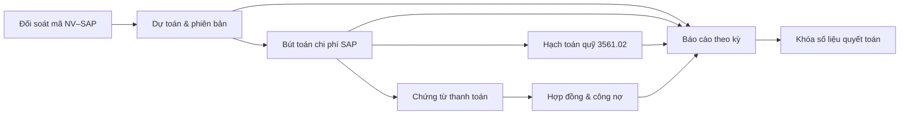

# Luồng quyết toán RD06.02 theo nhóm dữ liệu

Tài liệu mô tả **luồng quyết toán nhiệm vụ KHCN cấp Tập đoàn** gắn với các nhóm dữ liệu cần thu thập / đối soát / chốt số. Tham chiếu bước quy trình: B01–B44 trong bảng luồng RD06.02.

---

## 0. Tổng quan các pha

| Pha | Bước | Mục đích dữ liệu |
|---|---|---|
| A. Khởi tạo | B01 → B04 | Xác nhận đủ điều kiện; neo **Mã nhiệm vụ ↔ Mã SAP** |
| B. Lập bộ biểu mẫu & chứng từ | B05 → B13 (song song) | Gom **dự toán, bút toán, quỹ, thanh toán, HĐ/công nợ, tài sản, nhân công** |
| C. Thẩm định chung & ký trong VHT | B14 → B24 | Đối soát chéo số liệu; khóa bản nháp HS trước khi lên TĐ |
| D. Thẩm định Tập đoàn | B25 → B37 | Rà soát lại số liệu / hoàn thiện theo Phiếu nhận xét |
| E. Phê duyệt & khóa số | B38 → B44 | Chốt **báo cáo theo kỳ**, giá trị quyết toán, khóa không ghi đè |

---

## 1. Dữ liệu đối soát — Mã nhiệm vụ, Mã SAP theo nhiệm vụ

**Vai trò trong luồng:** chìa khóa neo mọi số liệu tài chính về đúng một nhiệm vụ.

| Thời điểm | Việc làm | Đầu ra |
|---|---|---|
| B02 | Kiểm tra nhiệm vụ đã có mã SAP (Internal Order / WBS) gắn với mã NV KHCN | `du_dieu_kien` / `khong_du_dieu_kien` |
| B04–B05 | Gắn hồ sơ RD06.02 với cặp mã đã đối soát | Hồ sơ khởi tạo |
| B07, B11, B14 | Mọi dòng chi phí / HĐ / thanh toán phải thuộc đúng cặp mã | Không lẫn số liệu NV khác |
| B43 | Khóa số liệu theo mã NV + mã SAP đã chốt | Không sửa mapping sau khóa |

**Trường tối thiểu:** Mã nhiệm vụ KHCN · Mã SAP (IO/WBS) · Đơn vị chủ trì · Trạng thái mapping (đã đối soát / lệch / thiếu).

**Nguồn:** QLKHCN Core + SAP CO/FM.

---

## 2. Dữ liệu dự toán — Ban đầu, điều chỉnh, phiên bản, hiệu lực, khoản mục, chuyển DTMS/KTTC

**Vai trò:** khung số “được phép chi” để đối chiếu với thực chi và giải ngân.

| Thành phần | Ý nghĩa trong quyết toán |
|---|---|
| Dự toán ban đầu | Bản phê duyệt khi xét duyệt / giao nhiệm vụ |
| Dự toán điều chỉnh | Các lần RD04 (không tăng / tăng trong chủ trương / …) |
| Phiên bản + ngày hiệu lực | Bản dự toán **hiệu lực tại thời điểm quyết toán** (không dùng bản đã hết hiệu lực) |
| Số tiền theo khoản mục | Cơ sở lập BM3 / BM4 / BM8 (B07) |
| Ngày chuyển DTMS / KTTC | Mốc sang hệ thống quản lý dự toán / kế toán tài chính — dùng đối chiếu thời điểm số liệu được “nhận” chính thức |

**Gắn bước:** B07 (lập BM dự toán–chi phí) → B14 (thẩm định chung: thực chi ≤ / khớp khung dự toán hiệu lực) → B16 / B38 (báo cáo).

**Quy tắc:** Khi có nhiều phiên bản, chỉ một phiên bản **đang hiệu lực** được đưa vào bộ HS quyết toán; lịch sử điều chỉnh giữ để giải trình.

---

## 3. Bút toán chi phí — Chứng từ ghi sổ, gốc, nội dung, số tiền, khoản mục, đối tượng, điều chỉnh / hoàn nhập

**Vai trò:** chứng minh **chi phí thực tế** đã ghi sổ.

| Trường | Dùng để |
|---|---|
| Số chứng từ ghi sổ | Khóa dòng trên sổ kế toán / SAP |
| Số chứng từ gốc | Liên kết hóa đơn / phiếu chi / biên bản |
| Nội dung chứng từ | Diễn giải nghiệp vụ |
| Số tiền | Cộng dồn theo khoản mục & NV |
| Khoản mục chi phí | Map về cấu trúc dự toán / BM |
| Đối tượng chi | Nhà cung cấp / nội bộ / nhân sự |
| Bút toán điều chỉnh hoặc hoàn nhập theo số chứng từ | Loại trừ / điều chỉnh các dòng không đủ điều kiện quyết toán |

**Gắn bước:** Đồng bộ SAP trước/trong B07 → đối soát tại B14, B26, B35 → chốt tại B43.

**Quy tắc:** Mọi điều chỉnh / hoàn nhập phải truy vết được về **số chứng từ gốc**; không xóa lịch sử dòng đã đồng bộ.

---

## 4. Hạch toán quỹ KHCN — Chứng từ ghi sổ, ngày & giá trị, TK 3561.02, quyết toán / hoàn / nhận–điều chỉnh quỹ

**Vai trò:** phản ánh hình thành và sử dụng **quỹ KHCN** gắn nhiệm vụ.

| Trường | Ý nghĩa |
|---|---|
| Số chứng từ ghi sổ + ngày + giá trị hạch toán quỹ | Mốc ghi nhận quỹ |
| Số phát sinh trên TK **3561.02** | Phát sinh quỹ theo tài khoản quy định |
| Số đã quyết toán quỹ | Phần đã đưa vào quyết toán NV |
| Hoàn quỹ | Phần hoàn lại khi không sử dụng / sau quyết toán |
| Nhận / điều chỉnh quỹ | Tăng / giảm quỹ trong kỳ |

**Gắn bước:** Tập hợp trong nhánh TCKT (B07, B14) → giải trình khi thẩm định TĐ (B26–B35) → khóa cùng B43.

**Quy tắc:** Số quyết toán quỹ + hoàn quỹ + số còn lại phải khớp phát sinh TK 3561.02 trong kỳ báo cáo.

---

## 5. Chứng từ thanh toán — Số CT, ngày, đối tượng nhận, HĐ kèm, số tiền, nguồn vốn, đầu kỳ / phát sinh / lũy kế

**Vai trò:** chứng minh **giải ngân thực tế** (cash / chuyển khoản), khác với bút toán ghi nhận chi phí.

| Trường | Ý nghĩa |
|---|---|
| Số chứng từ · ngày thanh toán | Định danh giao dịch thanh toán |
| Đối tượng nhận tiền | Bên hưởng |
| Hợp đồng kèm theo | Neo sang nhóm HĐ/công nợ |
| Số tiền · nguồn vốn · phân loại nguồn vốn | Phân tách nguồn (ngân sách / quỹ / khác) |
| Số đầu kỳ · phát sinh trong kỳ · lũy kế | Cơ sở bảng giải ngân theo kỳ |

**Gắn bước:** B11 (BM2 / mua sắm–thanh toán) + B07 (TCKT) → B14 → báo cáo B16/B38.

---

## 6. Hợp đồng và công nợ — Mã/số/ngày HĐ, đối tác, GT trước/sau VAT, đã thanh toán, phải thu/trả, ngày TT kế tiếp

**Vai trò:** khung cam kết mua sắm / dịch vụ và dư nợ còn lại tại thời điểm quyết toán.

| Trường | Ý nghĩa |
|---|---|
| Mã / số / ngày hợp đồng | Định danh pháp lý |
| Tên đơn vị đối tác | Bên ký |
| Giá trị thực hiện trước VAT / sau VAT | Trần thanh toán theo HĐ |
| Số đã thanh toán | Đã giải ngân |
| Số phải thu / phải trả | Dư nợ tại ngày chốt |
| Ngày thanh toán kế tiếp | Kế hoạch còn lại (nếu chưa tất toán) |

**Gắn bước:** B11 lập BM2 → B19 TTMS ký thẩm định → B32 hoàn thiện nếu TĐ yêu cầu → đối soát với chứng từ thanh toán & SAP.

**Quy tắc:** Tổng đã thanh toán + phải trả (phải thu) phải khớp giá trị thực hiện trong phạm vi HĐ và chứng từ thanh toán đã đính kèm.

---

## 7. Số liệu báo cáo theo kỳ — Chi phí / giải ngân theo năm–tháng–kỳ; đầu / phát sinh / cuối kỳ; trạng thái quyết toán; quỹ & tài sản

**Vai trò:** mặt **báo cáo quản trị** trình ký / thẩm định / phê duyệt.

| Nhóm chỉ tiêu | Nội dung |
|---|---|
| Theo thời gian | Chi phí thực hiện & giải ngân theo **năm / tháng / kỳ** |
| Số dư kỳ | Đầu kỳ · phát sinh · cuối kỳ |
| Trạng thái số liệu NV | Đã quyết toán · Đang thực hiện · Đã hoàn thành chờ quyết toán |
| Quỹ & tài sản | Giá trị quỹ đã hình thành · Tài sản còn lại (sau xử lý TS) |

**Gắn bước:**
- B16 — Báo cáo tổng hợp quyết toán + Tờ trình (VHT)
- B38 — Báo cáo thẩm tra + dự thảo QĐ (Tập đoàn)
- B43 — Cập nhật trạng thái NV = đã quyết toán cấp TĐ; **khóa** bộ số liệu báo cáo

**Quy tắc:** Sau B43, mọi thay đổi số liệu phải qua hồ sơ điều chỉnh có thẩm quyền — không ghi đè kỳ đã khóa.

---

## 8. Ánh xạ nhóm dữ liệu → bước quy trình (tóm tắt)

| Nhóm dữ liệu | Thu thập / đồng bộ | Đối soát | Chốt / khóa |
|---|---|---|---|
| Đối soát mã NV–SAP | B02, B04 | B07, B14 | B43 |
| Dự toán & phiên bản | Trước QT + B07 | B14, B26 | B16, B43 |
| Bút toán chi phí | SAP → B07 | B14, B26, B35 | B43 |
| Hạch toán quỹ 3561.02 | B07 | B14, B26 | B43 |
| Chứng từ thanh toán | B07, B11 | B14, B19 | B43 |
| Hợp đồng & công nợ | B11 | B19, B32 | B43 |
| Báo cáo theo kỳ | B16, B38 | B23, B26, B41 | B43–B44 |

---

## 9. Điểm mở (cần chốt với nghiệp vụ / KTTC)

1. Danh mục khoản mục chuẩn map giữa dự toán ↔ SAP ↔ BM3/4/8.
2. Công thức chính thức: phát sinh TK 3561.02 ↔ đã quyết toán quỹ ↔ hoàn quỹ.
3. Source of truth khi lệch giữa SAP, báo cáo đơn vị và chứng từ gốc (đã nêu trong B14 — mức P0).
4. Kỳ báo cáo mặc định (tháng / quý / năm tài chính) trên BM và Báo cáo tổng hợp.

---

*Tài liệu nháp phục vụ mô tả luồng dữ liệu quyết toán. Cần rà soát người nghiệp vụ TCKT / QLKHCN trước khi đưa vào SRS chính thức hoặc ký duyệt.*
