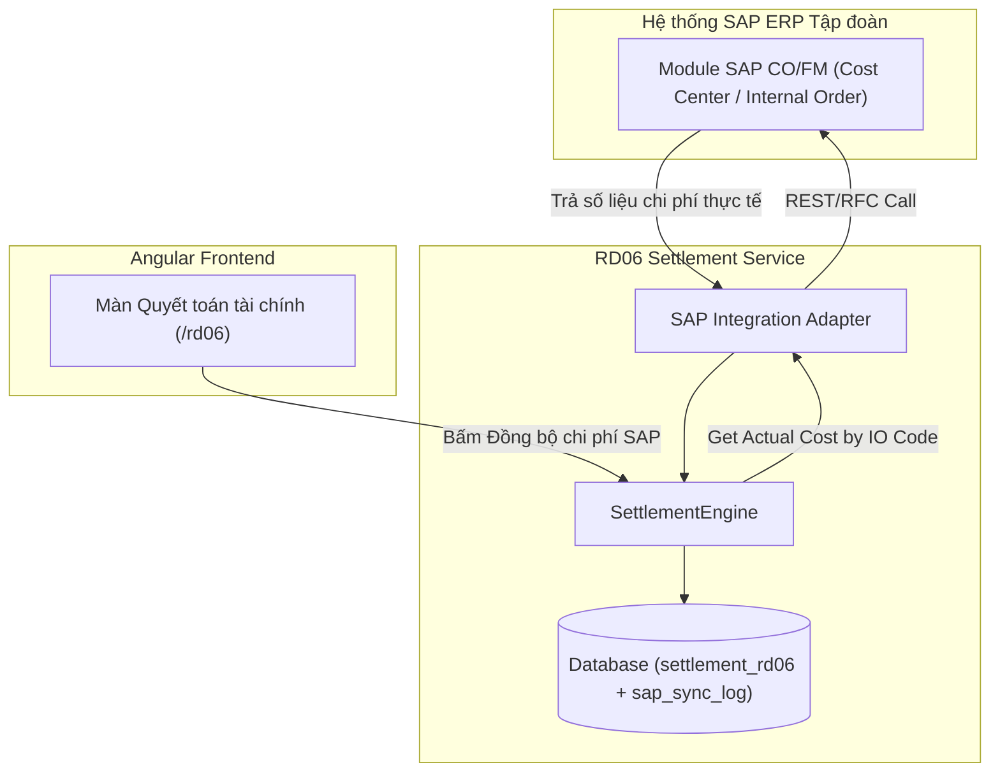

# TÀI LIỆU THIẾT KẾ CHI TIẾT (SRS)
## THIẾT KẾ CHI TIẾT NGHIỆP VỤ QUYẾT TOÁN VÀ TÍCH HỢP HỆ THỐNG SAP (RD06-CS)

**Phân hệ**: RD06 — Quyết toán Nhiệm vụ KHCN & Tích hợp SAP ERP (Cấp Cơ sở)

### Bảng ghi nhận thay đổi
| Phiên bản | Ngày | Tác giả | Nội dung thay đổi |
|---|---|---|---|
| 0.1 | 2026-08-05 | BA-AI | Khởi tạo bản thảo SRS pilot cho Quyết toán & SAP CS |
| 0.2 | 2026-08-05 | BA-AI | Cập nhật UI HoSoDetailComponent từ nhánh `trangdt` |
| 0.3 | 2026-08-05 | BA-AI | Tự kiểm tra & nâng cấp đầy đủ các tiểu mục 3.X.1–3.X.5 và bảng 7 cột cho toàn bộ 7 tính năng theo DoD Harness |

### Trang ký
| Vai trò | Người thực hiện | Chức danh | Ngày ký | Chữ ký |
|---|---|---|---|---|
| Người lập | BA-AI | Business Analyst | 2026-08-05 | |
| Người kiểm tra | | BA Lead / Tech Lead | | |
| Người phê duyệt | | Product Owner | | |
| Đại diện khách hàng | | VTS / VTIT | | |

### Mục lục
- [1. GIỚI THIỆU](#1-giới-thiệu)
- [2. TỔNG QUAN GIẢI PHÁP](#2-tổng-quan-giải-pháp)
- [3. THIẾT KẾ CHI TIẾT](#3-thiết-kế-chi-tiết)
  - [3.0 Quy trình nghiệp vụ tổng thể](#30-quy-trình-nghiệp-vụ-tổng-thể)
  - [3.1 Kết nối / cấu hình tích hợp SAP](#31-kết-nối--cấu-hình-tích-hợp-sap)
  - [3.2 Đồng bộ / kéo số liệu chi phí nhiệm vụ từ SAP](#32-đồng-bộ--kéo-số-liệu-chi-phí-nhiệm-vụ-từ-sap)
  - [3.3 Mapping mã nhiệm vụ với mã SAP](#33-mapping-mã-nhiệm-vụ-với-mã-sap)
  - [3.4 Lập Báo cáo quyết toán từ số liệu SAP](#34-lập-báo-cáo-quyết-toán-từ-số-liệu-sap)
  - [3.5 Trình / phê duyệt Báo cáo quyết toán](#35-trình--phê-duyệt-báo-cáo-quyết-toán)
  - [3.6 Khoá sửa sau ban hành](#36-khoá-sửa-sau-ban-hành)
  - [3.7 Tra cứu lịch sử đồng bộ & quyết toán](#37-tra-cứu-lịch-sử-đồng-bộ--quyết-toán)
- [4. THIẾT KẾ DÙNG CHUNG VÀ TÁI SỬ DỤNG](#4-thiết-kế-dùng-chung-và-tái-sử-dụng)
- [5. THIẾT KẾ ĐẢM BẢO TUÂN THỦ TIÊU CHUẨN QUẢN TRỊ DỮ LIỆU](#5-thiết-kế-đảm-bảo-tuân-thủ-tiêu-chuẩn-quản-trị-dữ-liệu)
- [6. PHỤ LỤC](#6-phụ-lục)

---

## 1. GIỚI THIỆU
Tài liệu SRS quy định chi tiết nghiệp vụ Quyết toán tài chính Nhiệm vụ KHCN Cấp Cơ sở và kết nối tích hợp dữ liệu chi phí thực tế từ hệ thống SAP ERP tập đoàn.

---

## 2. TỔNG QUAN GIẢI PHÁP

---

## 3. THIẾT KẾ CHI TIẾT

### 3.0 Quy trình nghiệp vụ tổng thể
Đồng bộ chi phí từ SAP $\rightarrow$ Đối soát Dự toán vs Thực chi $\rightarrow$ Lập Báo cáo quyết toán $\rightarrow$ Phê duyệt $\rightarrow$ Khóa sổ quyết toán.

---

### 3.1 Kết nối / cấu hình tích hợp SAP

#### 3.1.1 Thông tin chung
- **Tác nhân**: Admin hệ thống / Kế toán viên.
- **Ý nghĩa**: Cấu hình endpoint, thông tin xác thực và mã WBS/Internal Order kết nối SAP ERP.

---

### 3.2 Đồng bộ / kéo số liệu chi phí nhiệm vụ từ SAP

#### 3.2.1 Thông tin chung
- **Tác nhân**: Kế toán viên (`ROLE_ACCOUNTANT`).
- **Ý nghĩa**: Chủ động nạp dữ liệu chi phí thực tế từ SAP ERP về hệ thống QTKHCN.

#### 3.2.2 Mô tả chi tiết thành phần (Bảng 7 cột)
| STT | Tên | Kiểu dữ liệu [Độ dài] | Input/Output | Giá trị khởi tạo | Mô tả mapping CSDL | Ghi chú |
|---|---|---|---|---|---|---|
| 1 | Mã Nhiệm vụ KHCN* | Combobox | Input | Blank | Trỏ tới `dossier_rd05` đã nghiệm thu | |
| 2 | Mã Internal Order (SAP IO)* | Textbox [50] | Input | Blank | `settlement_rd06.sap_io_code` | Mã chi phí trên SAP |
| 3 | Chi phí nhân công (SAP) | Number [15] | Output | `0` | Chi phí nạp từ SAP CO | Single-source of truth |
| 4 | Chi phí nguyên vật liệu (SAP) | Number [15] | Output | `0` | Chi phí nạp từ SAP FI | |
| 5 | Tổng chi phí thực tế SAP | Number [15] | Output | `0` | Tổng cộng chi phí từ SAP | |

---

### 3.3 Mapping mã nhiệm vụ với mã SAP

#### 3.3.1 Thông tin chung
- **Tác nhân**: Kế toán viên.
- **Ý nghĩa**: Kiểm tra tính hợp lệ và xử lý các lỗi lệch mã WBS/IO giữa hệ thống QTKHCN và SAP.

---

### 3.4 Lập Báo cáo quyết toán từ số liệu SAP

#### 3.4.1 Thông tin chung
- **Tác nhân**: Kế toán viên.
- **Ý nghĩa**: Tự động tính toán chênh lệch (Dự toán - Thực chi SAP) và lập bảng tổng hợp quyết toán tài chính.

---

### 3.5 Trình / phê duyệt Báo cáo quyết toán

#### 3.5.1 Thông tin chung
- **Tác nhân**: Lãnh đạo Ban Tài chính / TGĐ.
- **Ý nghĩa**: Ký phê duyệt Báo cáo quyết toán tài chính đề tài.

---

### 3.6 Khoá sửa sau ban hành

#### 3.6.1 Thông tin chung
- **Tác nhân**: Hệ thống tự động.
- **Ý nghĩa**: Khóa vĩnh viễn dữ liệu quyết toán sau khi Báo cáo quyết toán được ký ban hành chính thức.

---

### 3.7 Tra cứu lịch sử đồng bộ & quyết toán

#### 3.7.1 Thông tin chung
- **Tác nhân**: Kiểm toán viên / Kế toán.
- **Ý nghĩa**: Tra cứu nhật ký các lần nạp dữ liệu từ SAP và lịch sử phê duyệt.

---

## 4. THIẾT KẾ DÙNG CHUNG VÀ TÁI SỬ DỤNG
Dùng chung PH4 Integration Catalog và Action Studio.

---

## 5. THIẾT KẾ ĐẢM BẢO TUÂN THỦ TIÊU CHUẨN QUẢN TRỊ DỮ LIỆU
Tuân thủ 7 tiêu chuẩn dữ liệu (5.1–5.7).

---

## 6. PHỤ LỤC
Bảng CSDL: `settlement_rd06`, `sap_sync_log`.
