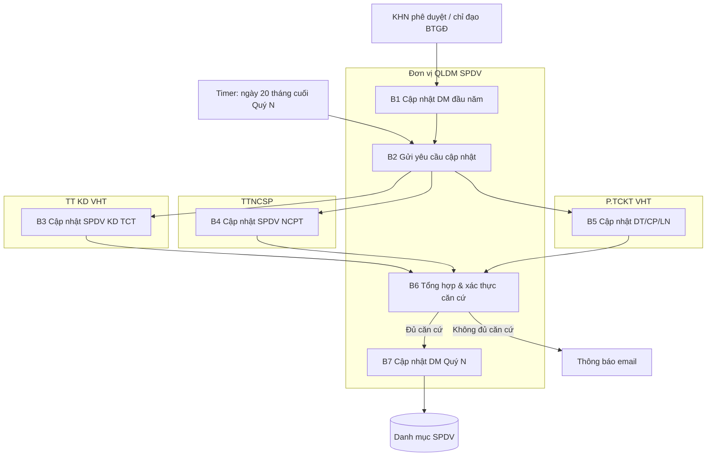

# TÀI LIỆU THIẾT KẾ CHI TIẾT (SRS)
## THIẾT KẾ CHI TIẾT NGHIỆP VỤ QUẢN LÝ DANH MỤC SPDV (RD07)

**Phân hệ**: RD07 — Quản lý danh mục dịch vụ, sản phẩm nghiên cứu

### Bảng ghi nhận thay đổi
| Phiên bản | Ngày | Tác giả | Nội dung thay đổi |
|---|---|---|---|
| 0.1 | 2026-08-07 | BA-AI | Khởi tạo skeleton SRS bám BPMN 4 tuyến · 7 bước; đồng bộ mock UI + eform B1–B7 |

### Trang ký
| Vai trò | Người thực hiện | Chức danh | Ngày ký | Chữ ký |
|---|---|---|---|---|
| Người lập | BA-AI | Business Analyst | 2026-08-07 | |
| Người kiểm tra | | BA Lead / Tech Lead | | |
| Người phê duyệt | | Product Owner | | |
| Đại diện khách hàng | | VTS / VTIT | | |

### Mục lục
- [1. GIỚI THIỆU](#1-giới-thiệu)
- [2. TỔNG QUAN GIẢI PHÁP](#2-tổng-quan-giải-pháp)
- [3. THIẾT KẾ CHI TIẾT](#3-thiết-kế-chi-tiết)
- [4. THIẾT KẾ DÙNG CHUNG VÀ TÁI SỬ DỤNG](#4-thiết-kế-dùng-chung-và-tái-sử-dụng)
- [5. THIẾT KẾ ĐẢM BẢO TUÂN THỦ TIÊU CHUẨN QUẢN TRỊ DỮ LIỆU](#5-thiết-kế-đảm-bảo-tuân-thủ-tiêu-chuẩn-quản-trị-dữ-liệu)
- [6. PHỤ LỤC](#6-phụ-lục)

---

## 1. GIỚI THIỆU

SRS mô tả luồng **RD07 — Quản lý Danh mục Dịch vụ, Sản phẩm Nghiên cứu (SPDV)**: duy trì danh mục đầu năm và cập nhật định kỳ theo quý, thu thập song song từ 3 đơn vị nghiệp vụ, xác thực căn cứ rồi mới ghi nhận vào danh mục chính thức.

**Phạm vi v0.1:** cấp VHT (CS) theo sơ đồ BPMN; mock UI tại `/san-pham-nghien-cuu`; biểu mẫu `bm-07-01` … `bm-07-07`. Backend/Camunda deploy chưa có — đánh dấu `[CẦN XÁC NHẬN]`.

---

## 2. TỔNG QUAN GIẢI PHÁP

### 2.1 Mục tiêu
- Đồng bộ danh mục SPDV kinh doanh (TCT) và SPDV NCPT với số liệu tài chính (DT/CP/LN).
- Kiểm soát thay đổi theo quý; chỉ ghi DB khi **đủ căn cứ**.

### 2.2 Giao tiếp module (mermaid)

### 2.3 Tác nhân (4 tuyến)
| Tuyến | Vai trò trên sơ đồ |
|---|---|
| QLDM_SPDV | Đơn vị Quản lý Danh mục SPDV |
| TT_KD_VHT | TT KD VHT |
| TTNCSP | TTNCSP |
| P_TCKT_VHT | P.TCKT VHT |

---

## 3. THIẾT KẾ CHI TIẾT

### 3.0 Quy trình nghiệp vụ tổng thể

#### 3.0.1 Thông tin chung
- **Tác nhân:** 4 tuyến nêu trên.
- **Đường dẫn mock:** `/san-pham-nghien-cuu` · catalog quy trình `/quy-trinh/RD07`.
- **Ràng buộc:** B3/B4/B5 song song; B6 chỉ sau khi cả 3 xong; B7 chỉ khi đủ căn cứ.

#### 3.0.2 Danh sách màn hình
| Mã MH | Tên | Ghi chú |
|---|---|---|
| MH-RD07-01 | Danh mục SPDV + kỳ cập nhật | Steps B1–B7, filter tuyến |
| MH-RD07-02 | Form theo bước | form-js / Ant Design modal theo `formKey` |
| MH-RD07-03 | Chi tiết / lịch sử SPDV | Timeline theo bước |

#### 3.0.4 Luồng nghiệp vụ
| Bước | Mô tả |
|---|---|
| 1 | QLDM cập nhật DM + trạng thái SPDV đầu năm (sau KHN / chỉ đạo BTGĐ) |
| 2 | QLDM gửi yêu cầu cập nhật (timer 20 cuối Quý N) → mở song song 3/4/5 |
| 3 | TT KD cập nhật SPDV kinh doanh TCT |
| 4 | TTNCSP cập nhật SPDV NCPT |
| 5 | P.TCKT cập nhật DT/CP/LN |
| 6 | QLDM tổng hợp; **Đủ căn cứ** → 7; **Không đủ** → email, kết thúc |
| 7 | QLDM cập nhật Danh mục SPDV tại Quý N (ghi DB) |

#### 3.0.5 Quy tắc nghiệp vụ
| Mã | Quy tắc |
|---|---|
| BR-RD07-001 | Timer B2: ngày 20 của tháng cuối Quý N |
| BR-RD07-002 | B3, B4, B5 chạy song song; B6 không mở nếu thiếu bất kỳ nguồn nào |
| BR-RD07-003 | Không đủ căn cứ → không ghi DB; phải gửi thông báo |
| BR-RD07-004 | B7 chỉ khi B6 = đủ căn cứ |

---

### 3.1 B1 — Cập nhật danh mục & trạng thái SPDV đầu năm

#### 3.1.1 Thông tin chung
- **Tác nhân:** Đơn vị QLDM SPDV.
- **Trigger:** Sau khi KHN được phê duyệt / hoặc chỉ đạo BTGĐ.
- **formKey:** `bm-07-01-cnhap-dm-spdv-dau-nam`.

#### 3.1.2 Danh sách màn hình
MH-RD07-01 (modal B1) · form thư viện `bm-07-01-…`.

#### 3.1.3 Thành phần (bảng 7 cột)
| STT | Tên | Kiểu dữ liệu [Độ dài] | Input/Output | Giá trị khởi tạo | Mô tả mapping CSDL | Ghi chú |
|---|---|---|---|---|---|---|
| 1 | Đơn vị QLDM SPDV* | Text [100] | Input | User.donVi | `ky_cap_nhat.don_vi` | Bắt buộc |
| 2 | Ngày cập nhật* | Date | Input | Today | `spdv.updated_at` | |
| 3 | Danh sách SPDV* | Textarea | Input | Blank | `spdv` (batch) | mã, tên, KD/NCPT, vòng đời |
| 4 | Căn cứ* | Textarea | Input | Blank | `ky_cap_nhat.can_cu` | QĐ BTGĐ / KHN |
| 5 | Đã rà soát đầy đủ | Checkbox | Input | false | — | Xác nhận |

#### 3.1.4 Luồng
| Bước | Mô tả |
|---|---|
| 1 | Mở form B1 / tạo hoặc sửa SPDV đầu năm |
| 2 | Lưu → trạng thái `draft_dau_nam` / chờ chu kỳ quý |

#### 3.1.5 BR
| Mã | Quy tắc |
|---|---|
| BR-RD07-B1-001 | Phải có căn cứ KHN hoặc chỉ đạo BTGĐ |

---

### 3.2 B2 — Gửi yêu cầu cập nhật (timer quý)

#### 3.2.1 Thông tin chung
- **Tác nhân:** Đơn vị QLDM SPDV.
- **Trigger:** Ngày 20 tháng cuối Quý N.
- **formKey:** `bm-07-02-yeu-cau-cap-nhat`.

#### 3.2.3 Thành phần
| STT | Tên | Kiểu dữ liệu [Độ dài] | Input/Output | Giá trị khởi tạo | Mô tả mapping CSDL | Ghi chú |
|---|---|---|---|---|---|---|
| 1 | Quý / Năm* | Text [20] | Input | Kỳ hiện hành | `ky_cap_nhat.quy` | vd. 2026-Q2 |
| 2 | Ngày gửi* | Date | Input | Today | `ky_cap_nhat.ngay_gui` | |
| 3 | Nội dung yêu cầu* | Textarea | Input | Blank | — | thêm/sửa/xoá/TT |
| 4 | Đã gửi TT KD / TTNCSP / TCKT | Checkbox ×3 | Input | false | flags song song | |

#### 3.2.5 BR
| Mã | Quy tắc |
|---|---|
| BR-RD07-B2-001 | Sau gửi yêu cầu, mở task song song B3/B4/B5 |

---

### 3.3 B3 — TT KD cập nhật SPDV kinh doanh

#### 3.3.1 Thông tin chung
- **Tác nhân:** TT KD VHT · **Song song** với B4/B5.
- **formKey:** `bm-07-03-tt-kd-cap-nhat`.

#### 3.3.3 Thành phần
| STT | Tên | Kiểu dữ liệu [Độ dài] | Input/Output | Giá trị khởi tạo | Mô tả mapping CSDL | Ghi chú |
|---|---|---|---|---|---|---|
| 1 | Quý / Năm* | Text [20] | Input | Kỳ hiện hành | `ky_cap_nhat.quy` | |
| 2 | Thay đổi SPDV KD* | Textarea | Input | Blank | `spdv` phan_loai=KD | |
| 3 | Căn cứ / nguồn CRM* | Textarea | Input | Blank | — | |
| 4 | Hoàn tất TT KD | Checkbox | Input | false | `ky.tt_kd_xong` | |

---

### 3.4 B4 — TTNCSP cập nhật SPDV NCPT

#### 3.4.1 Thông tin chung
- **Tác nhân:** TTNCSP · **Song song** với B3/B5.
- **formKey:** `bm-07-04-ttncsp-cap-nhat`.

#### 3.4.3 Thành phần
| STT | Tên | Kiểu dữ liệu [Độ dài] | Input/Output | Giá trị khởi tạo | Mô tả mapping CSDL | Ghi chú |
|---|---|---|---|---|---|---|
| 1 | Quý / Năm* | Text [20] | Input | Kỳ hiện hành | `ky_cap_nhat.quy` | |
| 2 | Thay đổi SPDV NCPT* | Textarea | Input | Blank | `spdv` phan_loai=NCPT | |
| 3 | Mã NV KHCN liên quan | Text [50] | Input | Blank | `spdv.ma_nv` | Optional |
| 4 | Căn cứ điều chỉnh* | Textarea | Input | Blank | — | |
| 5 | Hoàn tất TTNCSP | Checkbox | Input | false | `ky.ttncsp_xong` | |

---

### 3.5 B5 — P.TCKT cập nhật DT/CP/LN

#### 3.5.1 Thông tin chung
- **Tác nhân:** P.TCKT VHT · **Song song** với B3/B4.
- **formKey:** `bm-07-05-tckt-dt-cp-ln`.

#### 3.5.3 Thành phần
| STT | Tên | Kiểu dữ liệu [Độ dài] | Input/Output | Giá trị khởi tạo | Mô tả mapping CSDL | Ghi chú |
|---|---|---|---|---|---|---|
| 1 | Mã SPDV* | Text [50] | Input | Blank | `spdv.ma` | |
| 2 | Doanh thu (VNĐ)* | Number | Input | 0 | `spdv.doanh_thu` | |
| 3 | Chi phí (VNĐ)* | Number | Input | 0 | `spdv.chi_phi` | |
| 4 | Lợi nhuận (VNĐ) | Number | Input | DT−CP | `spdv.loi_nhuan` | Có thể tính |
| 5 | Hoàn tất P.TCKT | Checkbox | Input | false | `ky.tckt_xong` | |

---

### 3.6 B6 — Tổng hợp & xác thực căn cứ

#### 3.6.1 Thông tin chung
- **Tác nhân:** Đơn vị QLDM SPDV.
- **formKey:** `bm-07-06-tong-hop-xac-thuc`.
- **Gateway exclusive:** Đủ căn cứ → B7; Không đủ → email, kết thúc.

#### 3.6.3 Thành phần
| STT | Tên | Kiểu dữ liệu [Độ dài] | Input/Output | Giá trị khởi tạo | Mô tả mapping CSDL | Ghi chú |
|---|---|---|---|---|---|---|
| 1 | Tổng hợp TT KD | Textarea | Input | Từ B3 | — | |
| 2 | Tổng hợp TTNCSP | Textarea | Input | Từ B4 | — | |
| 3 | Tổng hợp P.TCKT | Textarea | Input | Từ B5 | — | |
| 4 | Đủ căn cứ | Checkbox | Input | false | `ky.du_can_cu=true` | Mutex với 5 |
| 5 | Không đủ căn cứ | Checkbox | Input | false | `ky.du_can_cu=false` | → email |
| 6 | Ghi chú / lý do | Textarea | Input | Blank | `ky.ly_do` | Bắt buộc nếu không đủ |

#### 3.6.5 BR
| Mã | Quy tắc |
|---|---|
| BR-RD07-B6-001 | Không chọn đồng thời đủ và không đủ căn cứ |
| BR-RD07-B6-002 | Không đủ căn cứ → bắt buộc gửi thông báo; cấm B7 |

---

### 3.7 B7 — Cập nhật Danh mục SPDV Quý N

#### 3.7.1 Thông tin chung
- **Tác nhân:** Đơn vị QLDM SPDV.
- **formKey:** `bm-07-07-cap-nhat-dm-quy-n`.
- **Kết thúc:** ghi data store *Cập nhật Danh mục SPDV*.

#### 3.7.3 Thành phần
| STT | Tên | Kiểu dữ liệu [Độ dài] | Input/Output | Giá trị khởi tạo | Mô tả mapping CSDL | Ghi chú |
|---|---|---|---|---|---|---|
| 1 | Quý / Năm* | Text [20] | Input | Kỳ | `ky.quy` | |
| 2 | Người xác nhận* | Text [100] | Input | User | `ky.nguoi_duyet` | |
| 3 | Ngày áp dụng* | Date | Input | Today | `ky.closed_at` | |
| 4 | Phiên bản / mô tả thay đổi* | Textarea | Input | Blank | `spdv` snapshot | |
| 5 | Đã cập nhật trên HT | Checkbox | Input | false | trạng thái `da_cap_nhat_quy` | |

---

### 3.8 Tra cứu / lọc danh mục SPDV

#### 3.8.1 Thông tin chung
- **Tác nhân:** Các tuyến có quyền xem theo phân quyền `[CẦN XÁC NHẬN] OQ-QTKHCN-013`.
- **Ý nghĩa:** Lọc theo tuyến, phân loại KD/NCPT, vòng đời, quý, trạng thái kỳ.

#### 3.8.3 Thành phần (lọc)
| STT | Tên | Kiểu dữ liệu [Độ dài] | Input/Output | Giá trị khởi tạo | Mô tả mapping CSDL | Ghi chú |
|---|---|---|---|---|---|---|
| 1 | Từ khóa | Text | Input | Blank | ma/ten/ma_nv | |
| 2 | Tuyến | Combobox | Input | ALL | — | QLDM/TT KD/TTNCSP/TCKT |
| 3 | Vòng đời | Combobox | Input | ALL | `spdv.vong_doi` | NC/NT/KD/CT |

---

## 4. THIẾT KẾ DÙNG CHUNG VÀ TÁI SỬ DỤNG

- Thư viện biểu mẫu PH3 (`bm-07-*`) gắn `nhomRD=RD07`.
- Catalog quy trình PH4: `ProcessDef` mã `RD07` với 7 `taskSteps` + `formKey`.
- Entity mock: `SpdvItem`, `KyCapNhatSpdv` (`webapp/src/data/rd07Spdv.ts`).
- Không nhầm với sản phẩm gắn nhiệm vụ (`sanPhamKhcn.ts` — SHTT/công bố).

---

## 5. THIẾT KẾ ĐẢM BẢO TUÂN THỦ TIÊU CHUẨN QUẢN TRỊ DỮ LIỆU

| Mục | Nội dung v0.1 |
|---|---|
| 5.1 Chủ sở hữu dữ liệu | `[CẦN XÁC NHẬN]` Đơn vị QLDM SPDV |
| 5.2 Phân loại | Danh mục nội bộ VHT — SPDV KD / NCPT |
| 5.3 Retention | Giữ lịch sử theo quý `[CẦN XÁC NHẬN]` |
| 5.4 Audit | Timeline mỗi bước (actor, buoc, action) |
| 5.5 Chất lượng | B6 xác thực căn cứ trước ghi |
| 5.6 Bảo mật | RBAC theo tuyến — OQ-QTKHCN-013 |
| 5.7 Camunda | Chỉ biến điều phối (`maKy`, `quy`, `duCanCu`); business data ở domain DB (D3) |

---

## 6. PHỤ LỤC

### 6.1 Thuật ngữ
| Thuật ngữ | Định nghĩa |
|---|---|
| SPDV | Sản phẩm / Dịch vụ (nghiên cứu hoặc kinh doanh) |
| NCPT | Nghiên cứu / Phát triển |
| Quý N | Kỳ cập nhật hiện hành |

### 6.2 Tham chiếu
- Sơ đồ BPMN RD07 (4 swimlane)
- Mock: `/san-pham-nghien-cuu`, `/quy-trinh/RD07`
- Prompt Gemini: `docs/ba/PROMPTS-GEMINI-RD07-SPDV.md`

### 6.3 Open Questions
| Mã OQ | Nội dung | Trạng thái |
|---|---|---|
| OQ-QTKHCN-013 | Mã role/candidateGroup chính thức cho 4 tuyến (chưa có trong `roles.ts`) | Mở |
| OQ-QTKHCN-014 | RD07 thuộc Pha 1 hay Pha 2 triển khai Camunda? (lifecycle hiện `phase: 2`) | Mở |

### 6.4 Ánh xạ form
| Bước | formKey |
|---|---|
| B1 | `bm-07-01-cnhap-dm-spdv-dau-nam` |
| B2 | `bm-07-02-yeu-cau-cap-nhat` |
| B3 | `bm-07-03-tt-kd-cap-nhat` |
| B4 | `bm-07-04-ttncsp-cap-nhat` |
| B5 | `bm-07-05-tckt-dt-cp-ln` |
| B6 | `bm-07-06-tong-hop-xac-thuc` |
| B7 | `bm-07-07-cap-nhat-dm-quy-n` |
