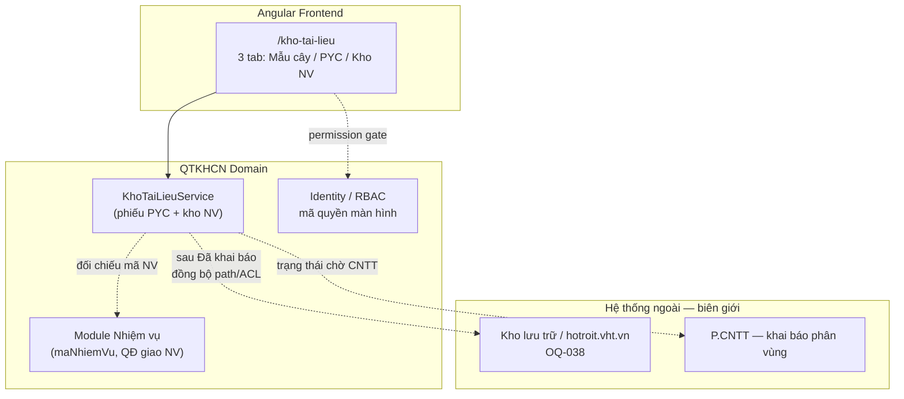
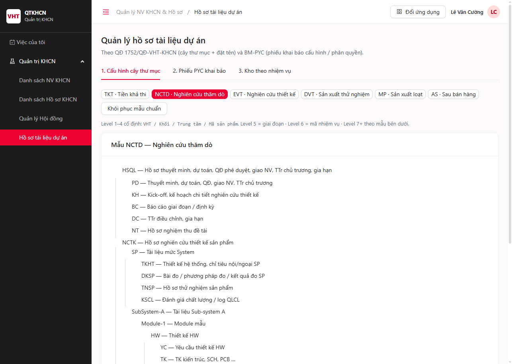
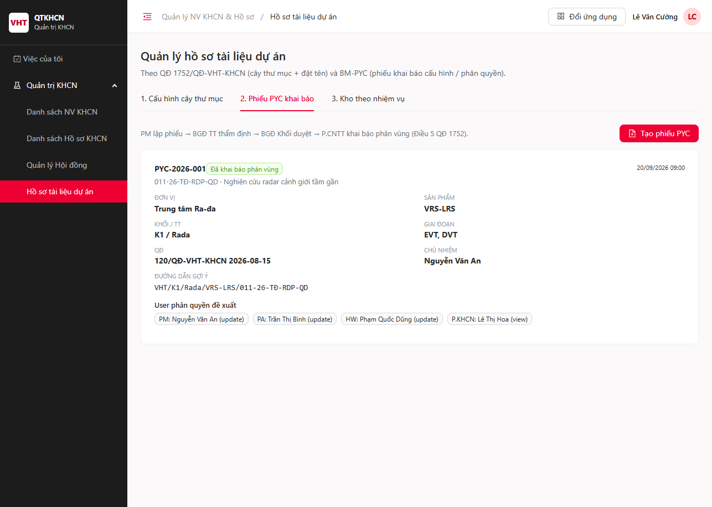
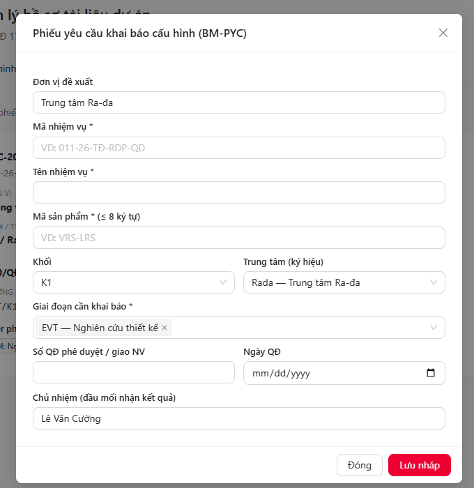
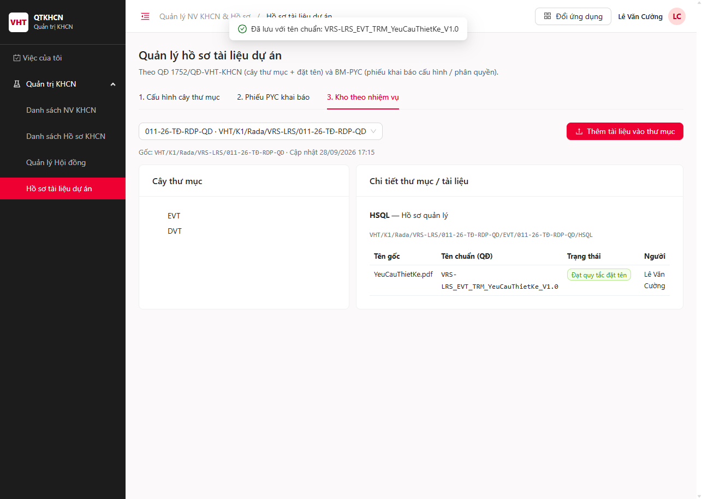
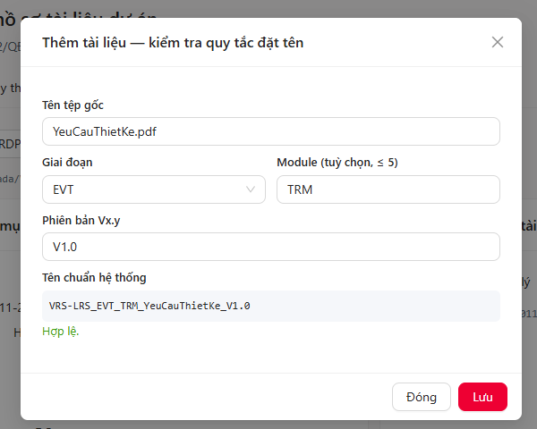

# TÀI LIỆU THIẾT KẾ CHI TIẾT (SRS)

## THIẾT KẾ CHI TIẾT NGHIỆP VỤ QUẢN LÝ CẤU HÌNH LƯU TRỮ HỒ SƠ TÀI LIỆU DỰ ÁN (RD10)

**Phân hệ**: RD10 — Quản lý, lưu trữ Hồ sơ, tài liệu (QTKHCN / VHT)

> **Nháp chờ VTS** — còn OQ mức Cao đang Mở: `OQ-QTKHCN-038` (tích hợp kho lưu trữ thật), `OQ-QTKHCN-040` (mã quyền catalog). Không dùng cho ký chính thức trước khi human review.

### Bảng ghi nhận thay đổi

| Phiên bản | Ngày | Tác giả | Nội dung thay đổi |
|---|---|---|---|
| 0.1 | 2026-09-28 | BA-AI | Khởi tạo SRS theo form BM04 Thiết kế chi tiết (Trang ký), nguồn QĐ 1752 + BM-PYC + UI `/kho-tai-lieu` |
| 0.1.1 | 2026-09-28 | BA-AI | Chèn ảnh chụp thật từ `http://localhost:4200/kho-tai-lieu` (HÌNH 001–006) + mô tả bố cục màn hình |

### Trang ký

| Vai trò | Người thực hiện | Chức danh | Ngày ký | Chữ ký |
|---|---|---|---|---|
| Người lập | BA-AI | Business Analyst | 2026-09-28 | |
| Người kiểm tra | | BA Lead / Tech Lead | | |
| Người phê duyệt | | Product Owner | | |
| Đại diện khách hàng | | VTS / VTIT / P.KHCN VHT | | |

### Mục lục

- [1. GIỚI THIỆU](#1-giới-thiệu)
- [2. TỔNG QUAN GIẢI PHÁP](#2-tổng-quan-giải-pháp)
- [3. THIẾT KẾ CHI TIẾT](#3-thiết-kế-chi-tiết)
  - [3.1 Xem mẫu cấu hình cây thư mục theo giai đoạn](#31-xem-mẫu-cấu-hình-cây-thư-mục-theo-giai-đoạn)
  - [3.2 Quản lý phiếu PYC khai báo cấu hình lưu trữ](#32-quản-lý-phiếu-pyc-khai-báo-cấu-hình-lưu-trữ)
  - [3.3 Kho tài liệu theo nhiệm vụ và kiểm tra quy tắc đặt tên](#33-kho-tài-liệu-theo-nhiệm-vụ-và-kiểm-tra-quy-tắc-đặt-tên)
- [4. THIẾT KẾ DÙNG CHUNG VÀ TÁI SỬ DÙNG](#4-thiết-kế-dùng-chung-và-tái-sử-dụng)
- [5. THIẾT KẾ ĐẢM BẢO TUÂN THỦ TIÊU CHUẨN QUẢN TRỊ DỮ LIỆU](#5-thiết-kế-đảm-bảo-tuân-thủ-tiêu-chuẩn-quản-trị-dữ-liệu)
- [6. PHỤ LỤC](#6-phụ-lục)

---

## 1. GIỚI THIỆU

### 1.1 Mục đích

Tài liệu mô tả thiết kế chi tiết chức năng **Hồ sơ tài liệu dự án** trên hệ thống QTKHCN: xem mẫu cây thư mục theo giai đoạn sản phẩm, lập và duyệt phiếu PYC khai báo cấu hình, sinh phân vùng kho theo nhiệm vụ, và kiểm tra quy tắc đặt tên tài liệu theo Quyết định 1752/QĐ-VHT-KHCN. Tài liệu là căn cứ cho phát triển, kiểm thử và rà soát/ký duyệt trước khi triển khai.

### 1.2 Phạm vi

**Trong phạm vi:**

- Màn hình `/kho-tai-lieu` với 3 tab: Cấu hình cây thư mục; Phiếu PYC; Kho theo nhiệm vụ.
- Mẫu cây thư mục theo giai đoạn `TKT` / `NCTD` / `EVT` / `DVT` / `MP` / `AS` (Phụ lục 2 QĐ 1752 / BM-PYC Mục 1).
- Luồng trạng thái phiếu PYC: Nháp → Chờ BGĐ Trung tâm thẩm định → Chờ BGĐ Khối phê duyệt → Chờ P.CNTT khai báo → Đã khai báo phân vùng / Từ chối (Điều 5 QĐ + BM-PYC Mục 2).
- Sinh kho theo đường dẫn logic `VHT/{Khối}/{TT}/{MãSP}/{MãNV}/{GiaiDoan}/…` sau khi CNTT xác nhận khai báo.
- Quy tắc đặt tên tài liệu `MASANPHAM_GiaiDoan_[Module_]Ten_Vx.y`, tối đa 80 ký tự (Điều 3 QĐ 1752).
- Danh mục ký hiệu trung tâm / khối (Phụ lục 1 QĐ 1752).

**Ngoài phạm vi:**

- Tích hợp kho lưu trữ vật lý / hotroit.vht.vn (chỉ mô tả biên giới; `[CẦN XÁC NHẬN]` `OQ-QTKHCN-038`).
- ACL runtime theo từng thư mục trên storage thật (`OQ-QTKHCN-039`).
- Audit định kỳ của P.ĐBCL (`OQ-QTKHCN-041`).
- Camunda orchestration cho phiếu PYC — phiên bản này mô tả luồng trạng thái trong ứng dụng; không đưa dữ liệu nghiệp vụ PYC vào biến Camunda (D3).

### 1.3 Khái niệm, thuật ngữ

| Thuật ngữ | Giải thích |
|---|---|
| QĐ 1752 | Quyết định 1752/QĐ-VHT-KHCN về cấu hình lưu trữ tài liệu dự án |
| BM-PYC | Biểu mẫu Phiếu yêu cầu khai báo cấu hình lưu trữ (QT.VHT.CLKHCN) |
| Giai đoạn SP | Một trong: TKT, NCTD, EVT, DVT, MP, AS |
| Mẫu cây thư mục | Cấu trúc thư mục chuẩn theo giai đoạn; hệ thống seed sẵn — người dùng **không bắt buộc** tự dựng lại nếu dùng mẫu (`[GIẢ ĐỊNH]` đã khóa nghiệp vụ: tùy chọn chỉnh mẫu) |
| Phiếu PYC | Phiếu yêu cầu khai báo cấu hình phân vùng + đề xuất user/quyền theo vị trí |
| Kho nhiệm vụ | Phân vùng lưu trữ gắn một `maNhiemVu` sau khi phiếu PYC ở trạng thái Đã khai báo |
| Tên chuẩn | Tên file sinh theo Điều 3; hệ thống đánh dấu hợp lệ / không hợp lệ |
| Khối / TT | Khối K1–K3 và ký hiệu trung tâm theo Phụ lục 1 |

### 1.4 Tài liệu tham khảo

| STT | Tài liệu | Ghi chú |
|---|---|---|
| 1 | Quyết định 1752/QĐ-VHT-KHCN — Quản lý cấu hình lưu trữ tài liệu | Điều 3, 4, 5; Phụ lục 1, 2 |
| 2 | BM-PYC — Khai báo cấu hình (QT.VHT.CLKHCN) | Mục 1 cây thư mục; Mục 2 luồng PYC |
| 3 | `docs/ba/BA-Kho-Tai-Lieu-Du-An-QĐ1752-BM-PYC-v0.1.md` | Ghi chú BA + ánh xạ UI |
| 4 | Form BM04_ThietKeChiTiet_TrinhKy.docx | Khung mục lục / Trang ký / TKCT |
| 5 | `.harness/rules/srs-screen-template.md` (D16) | Bảng 7 cột, đánh số 3.X.1–3.X.5 |
| 6 | UI Angular `/kho-tai-lieu` | Model `kho-tai-lieu.ts`, service localStorage |
| 7 | `docs/req/scope-2-phanhe.md` | RD10 trong phạm vi lưu trữ hồ sơ |

> Ảnh màn hình: chụp từ UI đang chạy `http://localhost:4200/kho-tai-lieu` (app **Quản lý NV KHCN & Hồ sơ** → menu **Hồ sơ tài liệu dự án**), ngày 28/09/2026. Lưu tại `img/SRS-RD10-01/`. Không dùng Figma — đây là ảnh runtime mock.

### 1.5 Mô tả tài liệu

Ngoài phần giới thiệu, tài liệu gồm: Tổng quan giải pháp (mục 2); Thiết kế chi tiết 3 chức năng (mục 3); Thiết kế dùng chung (mục 4); Quản trị dữ liệu (mục 5); Phụ lục / Completeness Report (mục 6).

---

## 2. TỔNG QUAN GIẢI PHÁP

### 2.1 Tổng quan chức năng

Màn hình **Hồ sơ tài liệu dự án** cung cấp:

1. **Xem / khôi phục mẫu cây thư mục** theo giai đoạn sản phẩm (không bắt buộc cấu hình lại nếu dùng mẫu seed).
2. **Lập phiếu PYC**: căn cứ QĐ giao NV, mã SP, khối/TT, giai đoạn, chủ nhiệm, danh sách user đề xuất theo vị trí.
3. **Chuyển trạng thái duyệt** theo chuỗi thẩm định TT → Khối → CNTT khai báo / Từ chối.
4. **Sinh kho theo nhiệm vụ** khi CNTT xác nhận đã khai báo phân vùng.
5. **Thêm tài liệu vào thư mục**: sinh tên chuẩn, kiểm tra quy tắc Điều 3, hiển thị đạt/không đạt.

### 2.2 Mô hình giao tiếp với hệ thống / module khác



`[GIẢ ĐỊNH]` Phiên bản mock lưu PYC + kho trên `localStorage`; production thay bằng API domain DB + adapter storage — `OQ-QTKHCN-038`.

---

## 3. THIẾT KẾ CHI TIẾT

### 3.1 Xem mẫu cấu hình cây thư mục theo giai đoạn

#### 3.1.1 Thông tin chung chức năng



**Mô tả ảnh HÌNH 001**

| Vùng | Nội dung quan sát trên UI |
|---|---|
| Breadcrumb | `Quản lý NV KHCN & Hồ sơ / Hồ sơ tài liệu dự án` |
| Tiêu đề trang | Quản lý hồ sơ tài liệu dự án — chú thích căn cứ QĐ 1752 + BM-PYC |
| Tab | **1. Cấu hình cây thư mục** (active) · 2. Phiếu PYC · 3. Kho theo nhiệm vụ |
| Chip giai đoạn | TKT · **NCTD** (đang chọn) · EVT · DVT · MP · AS |
| Nút | **Khôi phục mẫu chuẩn** |
| Ghi chú level | Level 1–4 cố định `VHT / Khối / Trung tâm / Mã sản phẩm`; Level 5 = giai đoạn; Level 6 = mã NV; Level 7+ theo mẫu |
| Card | `Mẫu NCTD — Nghiên cứu thăm dò` + cây thư mục (HSQL / NC / Khac và nhánh con) |

- **Tác nhân**: PM / PA / Chuyên viên P.KHCN / Admin được phân quyền xem cấu hình (`[CẦN XÁC NHẬN]` mã quyền `OQ-QTKHCN-040`).
- **Ý nghĩa chức năng**: Cho phép người dùng xem cấu trúc thư mục chuẩn theo giai đoạn sản phẩm trước khi lập PYC; có thể khôi phục mẫu mặc định.
- **Nền tảng**: Web.
- **Đường dẫn truy cập**: Quản trị KHCN > Hồ sơ tài liệu dự án > tab **Cấu hình cây thư mục** (`/kho-tai-lieu`).
- **Ràng buộc, ngoại lệ**: Người dùng **không bắt buộc** tự cấu hình lại cây nếu dùng mẫu seed theo giai đoạn đã chọn trên phiếu PYC.

> **Ghi chú**
> - Nguồn: QĐ 1752 Điều 4 + Phụ lục 2; BM-PYC Mục 1; ảnh runtime 2026-09-28.
> - `[GIẢ ĐỊNH]` Chỉnh sửa sâu cây mẫu (thêm/xóa node tùy ý) ngoài phạm vi v0.1 UI — chỉ xem + khôi phục mẫu. `OQ-QTKHCN-042` nếu PO yêu cầu editor đầy đủ.

#### 3.1.2 Màn hình

| STT | Tên màn hình | Mô tả tại mục | Ảnh |
|---|---|---|---|
| 1 | Xem mẫu cây theo giai đoạn | 3.1.3.1 | HÌNH 001 |

#### 3.1.3 Mô tả chi tiết các thành phần

##### 3.1.3.1 Xem mẫu cây theo giai đoạn

| STT | Tên | Kiểu dữ liệu [Độ dài dữ liệu] | Input/Output | Giá trị khởi tạo | Mô tả (Mapping với CSDL nếu có) | Ghi chú |
|---|---|---|---|---|---|---|
| **Điều kiện xem** | | | | | | |
| 1 | Giai đoạn sản phẩm* | Combobox | Input | `NCTD` (hoặc giai đoạn đầu danh sách) | Giá trị: TKT, NCTD, EVT, DVT, MP, AS. Map `MauCayTheoGiaiDoan.giaiDoan` | QĐ Phụ lục 2 |
| 2 | Tên giai đoạn | Label | Output | Theo lựa chọn | `GIAI_DOAN_LABEL[giaiDoan]` | |
| **Thao tác** | | | | | | |
| 3 | Khôi phục mẫu mặc định | Button | Input | Enabled | Nạp lại `MAU_CAY_THEO_GIAI_DOAN` cho giai đoạn đang chọn | Toast thành công |
| **Cây thư mục** | | | | | | |
| 4 | Cây thư mục mẫu | Tree | Output | Theo giai đoạn | Node: `ma`, `ten`, `moTa`, `children[]` → bảng `folder_template` (tương lai) | Level theo BM-PYC |
| 5 | Mã thư mục | Label Column | Output | | `ThuMucMau.ma` | |
| 6 | Tên thư mục | Label Column | Output | | `ThuMucMau.ten` | |
| 7 | Mô tả | Label Column | Output | | `ThuMucMau.moTa` | |

#### 3.1.4 Luồng nghiệp vụ

*Sơ đồ `.drawio` chức năng: chờ sinh bằng `srs-to-drawio-flows` — chưa có file trong bản 0.1.*

**A. Xem mẫu**

| Bước | Mô tả |
|---|---|
| 1 | Người dùng mở menu **Hồ sơ tài liệu dự án**, chọn tab **Cấu hình cây thư mục** |
| 2 | Hệ thống hiển thị combobox giai đoạn và cây mẫu tương ứng |
| 3 | Người dùng đổi giai đoạn → hệ thống nạp cây của giai đoạn đó |
| 4 | Không có quyền: thông báo đỏ "Bạn không có quyền thực hiện chức năng này" (mục 4) |

**B. Khôi phục mẫu**

| Bước | Mô tả |
|---|---|
| 1 | Người dùng click **Khôi phục mẫu mặc định** |
| 2 | Hệ thống ghi đè cấu hình local/DB của giai đoạn đang chọn bằng seed chuẩn |
| 3 | Toast: "Đã khôi phục mẫu cây thư mục `<giai đoạn>`." |

#### 3.1.5 Quy tắc nghiệp vụ

| Mã | Quy tắc | Áp dụng cho | Trạng thái |
|---|---|---|---|
| `BR-RD10-01-01` | Mỗi giai đoạn TKT/NCTD/EVT/DVT/MP/AS có đúng một mẫu cây seed | 3.1.3.1 | Chốt theo QĐ Phụ lục 2 / BM-PYC |
| `BR-RD10-01-02` | Không bắt buộc người dùng tự cấu hình cây mới nếu phiếu PYC dùng mẫu seed của giai đoạn đã chọn | 3.1, 3.2 | Chốt nghiệp vụ |
| `BR-RD10-C-01` | Quy tắc thông báo lỗi/thành công chung → mục 4 | Toàn bộ 3.x | |

---

### 3.2 Quản lý phiếu PYC khai báo cấu hình lưu trữ

#### 3.2.1 Thông tin chung chức năng


**Mô tả ảnh HÌNH 002**

| Vùng | Nội dung quan sát trên UI |
|---|---|
| Tab active | **2. Phiếu PYC khai báo** |
| Luồng tóm tắt | PM lập phiếu → BGĐ TT thẩm định → BGĐ Khối duyệt → P.CNTT khai báo phân vùng (Điều 5) |
| Nút | **Tạo phiếu PYC** (primary đỏ) |
| Thẻ phiếu mẫu | `PYC-2026-001` · badge xanh **Đã khai báo phân vùng** · `20/09/2026 09:00` |
| Dòng NV | `011-26-TĐ-RDP-QD · Nghiên cứu radar cảnh giới tầm gần` |
| Lưới thuộc tính | Đơn vị, Sản phẩm, Khối/TT, Giai đoạn (EVT, DVT), QĐ, Chủ nhiệm |
| Đường dẫn gợi ý | `VHT/K1/Rada/VRS-LRS/011-26-TĐ-RDP-QD` |
| User đề xuất | Tag theo vị trí: PM/PA/HW (update), P.KHCN (view) |

> **HÌNH 004 (chuyển trạng thái):** cùng màn danh sách; nút hành động theo trạng thái (`Gửi TT thẩm định` / `TT đạt → gửi Khối` / `Khối duyệt → CNTT` / `CNTT đã khai báo` / `Từ chối`) hiện trên thẻ khi phiếu chưa ở `da_khai_bao`. Ảnh tham chiếu dùng HÌNH 002 (phiếu seed đã khai báo — không còn nút duyệt).



- **Tác nhân**: PM (tạo/sửa nháp, gửi thẩm định); BGĐ Trung tâm; BGĐ Khối; P.CNTT (khai báo); Admin.
- **Ý nghĩa chức năng**: Lập phiếu yêu cầu khai báo phân vùng lưu trữ và đề xuất user/quyền theo vị trí; theo dõi trạng thái duyệt đến khi CNTT khai báo xong.
- **Nền tảng**: Web.
- **Đường dẫn truy cập**: Quản trị KHCN > Hồ sơ tài liệu dự án > tab **Phiếu PYC** (`/kho-tai-lieu`).
- **Ràng buộc, ngoại lệ**: Chỉ phiếu **Nháp** (và **Từ chối** nếu PO cho phép sửa lại — `[GIẢ ĐỊNH]` cho phép mở lại từ Từ chối về Nháp) mới được chỉnh sửa nội dung.

> Nguồn: QĐ 1752 Điều 5; BM-PYC Mục 2; Phụ lục 1 (ký hiệu TT); ảnh runtime 2026-09-28.

#### 3.2.2 Màn hình

| STT | Tên màn hình | Mô tả tại mục | Ảnh |
|---|---|---|---|
| 1 | Danh sách phiếu PYC | 3.2.3.1 | HÌNH 002 |
| 2 | Tạo mới phiếu PYC | 3.2.3.2 | HÌNH 003 |
| 3 | Chỉnh sửa / xem chi tiết | 3.2.3.3 | HÌNH 003 |
| 4 | Chuyển trạng thái duyệt | 3.2.3.4 | HÌNH 004 |

#### 3.2.3 Mô tả chi tiết các thành phần

##### 3.2.3.1 Danh sách phiếu PYC

> **UI thực tế (HÌNH 002):** danh sách dạng **thẻ phiếu** (không phải datagrid + ô tìm kiếm). Các dòng tìm kiếm/datagrid dưới đây là khung field-level chuẩn DoD để triển khai đầy đủ; mapping hiển thị hiện tại khớp các trường trên thẻ.

| STT | Tên | Kiểu dữ liệu [Độ dài dữ liệu] | Input/Output | Giá trị khởi tạo | Mô tả (Mapping với CSDL nếu có) | Ghi chú |
|---|---|---|---|---|---|---|
| **Điều kiện tìm kiếm** | | | | | | |
| 1 | Từ khóa | Textbox [100] | Input | Blank | Hint: Mã PYC, mã NV, mã SP. So khớp **Chứa**, không phân biệt hoa thường | |
| 2 | Trạng thái | Combobox | Input | Tất cả | `TrangThaiPyc` | |
| 3 | Thiết lập lại | Button | Input | Enabled | Reset điều kiện | |
| 4 | Tìm kiếm | Button | Input | Enabled | | |
| **Thao tác** | | | | | | |
| 5 | Thêm phiếu PYC | Button | Input | Enabled | Mở form tạo mới | |
| **Datagrid** Load từ `pyc_khai_bao` / mock `PycKhaiBaoCauHinh[]`. Sort `ngayTao` DESC. Phân trang theo quy định chung. | | | | | | |
| 6 | Mã PYC | Label Column | Output | | `maPyc` | Link xem chi tiết |
| 7 | Mã nhiệm vụ | Label Column | Output | | `maNhiemVu` | |
| 8 | Tên nhiệm vụ | Label Column | Output | | `tenNhiemVu` | |
| 9 | Mã sản phẩm | Label Column | Output | | `maSanPham` | |
| 10 | Khối / Trung tâm | Label Column | Output | | `khoi` + `trungTam` | |
| 11 | Giai đoạn | Tag Column | Output | | `giaiDoan[]` | |
| 12 | Trạng thái | Badge | Output | | Theo `TRANG_THAI_PYC_LABEL` / color | |
| 13 | Ngày tạo | Date Column | Output | | `ngayTao` | |
| 14 | Người tạo | Label Column | Output | | `nguoiTao` | |
| **Thao tác dòng** | | | | | | |
| 15 | Xem / Sửa | Icon | Input | | Sửa chỉ khi Nháp (hoặc Từ chối theo giả định) | |
| 16 | Gửi thẩm định | Icon/Button | Input | | Chỉ Nháp → `cho_bgd_trung_tam` | |
| 17 | Duyệt bước tiếp | Icon/Button | Input | | Theo vai trò & trạng thái hiện tại | |
| 18 | Từ chối | Icon/Button | Input | | Các bước chờ duyệt | |

##### 3.2.3.2 Tạo mới phiếu PYC



**Mô tả ảnh HÌNH 003:** Modal overlay tiêu đề *Phiếu yêu cầu khai báo cấu hình (BM-PYC)*; trường Đơn vị đề xuất, Mã/Tên NV, Mã SP (≤8), Khối, Trung tâm (ký hiệu), Giai đoạn multi-select (chip EVT…), Số/Ngày QĐ, Chủ nhiệm; footer **Đóng** / **Lưu nháp**.

| STT | Tên | Kiểu dữ liệu [Độ dài dữ liệu] | Input/Output | Giá trị khởi tạo | Mô tả (Mapping với CSDL nếu có) | Ghi chú |
|---|---|---|---|---|---|---|
| **Thao tác** | | | | | | |
| 1 | Quay lại | Button | Input | Enabled | Đóng form, không lưu | |
| 2 | Lưu nháp | Button | Input | Enabled | Lưu `trangThai = nhap` | |
| 3 | Lưu & gửi thẩm định | Button | Input | Enabled | Lưu + chuyển `cho_bgd_trung_tam` | |
| **Thông tin phiếu** | | | | | | |
| 4 | Đơn vị đề xuất* | Textbox [200] | Input | Blank | `donViDeXuat` | |
| 5 | Mã nhiệm vụ* | Textbox [50] | Input | Blank | `maNhiemVu` — đối chiếu module NV khi có API | |
| 6 | Tên nhiệm vụ* | Textbox [500] | Input | Blank | `tenNhiemVu` | |
| 7 | Mã sản phẩm* | Textbox [8] | Input | Blank | `maSanPham` — dùng cho đặt tên file | ≤ 8 ký tự theo quy tắc tên |
| 8 | Khối* | Combobox | Input | Blank | K1 / K2 / K3 | Phụ lục 1 |
| 9 | Trung tâm* | Combobox | Input | Blank | Lọc theo khối từ `TRUNG_TAM_KY_HIEU` | |
| 10 | Giai đoạn* | Checkbox group / Multi-select | Input | Blank | Ít nhất 1 giá trị trong TKT…AS | Seed cây tương ứng |
| 11 | Số quyết định* | Textbox [100] | Input | Blank | `soQuyetDinh` | Căn cứ giao NV |
| 12 | Ngày quyết định* | Datepicker | Input | Blank | `ngayQuyetDinh` | |
| 13 | Chủ nhiệm* | Textbox [200] | Input | Blank | `chuNhiem` | |
| 14 | Đầu mối trung tâm | Textbox [200] | Input | Blank | `dauMoiTrungTam` | |
| 15 | Ghi chú | Textarea [1000] | Input | Blank | `ghiChu` | |
| **Bảng user đề xuất phân quyền** | | | | | | |
| 16 | Vị trí* | Combobox | Input | | `VI_TRI_PHAN_QUYEN_MAU` | BM-PYC |
| 17 | Họ tên* | Textbox [200] | Input | Blank | `users[].hoTen` | |
| 18 | Mã NV* | Textbox [50] | Input | Blank | `users[].maNv` | |
| 19 | Quyền mặc định* | Combobox | Input | `view` | `view` / `update` / `none` | Chưa = ACL runtime `OQ-039` |
| 20 | Thêm dòng user | Button | Input | Enabled | Thêm dòng vào `users[]` | |
| 21 | Xóa dòng user | Icon | Input | | | |

##### 3.2.3.3 Chỉnh sửa / xem chi tiết

| STT | Tên | Kiểu dữ liệu [Độ dài dữ liệu] | Input/Output | Giá trị khởi tạo | Mô tả (Mapping với CSDL nếu có) | Ghi chú |
|---|---|---|---|---|---|---|
| **Thao tác** | | | | | | |
| 1 | Quay lại | Button | Input | Enabled | | |
| 2 | Lưu | Button | Input | Enabled khi được sửa | | |
| **Khi chỉnh sửa, giá trị mặc định load từ CSDL** | | | | | | |
| 3 | Mã PYC | Label | Output | *(nạp từ bản ghi)* | Disable — khóa nhận diện | Sinh khi tạo |
| 4 | Trạng thái | Badge | Output | *(nạp)* | Disable | |
| 5 | Các trường mục 3.2.3.2 (4–21) | Như trên | Input | *(nạp)* | Cho sửa khi Nháp / Từ chối; Disable khi đang chờ duyệt hoặc Đã khai báo | |

##### 3.2.3.4 Chuyển trạng thái duyệt

| STT | Tên | Kiểu dữ liệu [Độ dài dữ liệu] | Input/Output | Giá trị khởi tạo | Mô tả (Mapping với CSDL nếu có) | Ghi chú |
|---|---|---|---|---|---|---|
| 1 | Hành động duyệt | Button group | Input | Theo trạng thái | Chuyển: `cho_bgd_trung_tam` → `cho_bgd_khoi` → `cho_cntt` → `da_khai_bao` | Vai trò khớp bước |
| 2 | Từ chối | Button | Input | Enabled ở bước chờ | → `tu_choi` | Bắt buộc ghi chú `[GIẢ ĐỊNH]` |
| 3 | Lý do từ chối* | Textarea [500] | Input | Blank khi Từ chối | Ghi vào `ghiChu` hoặc trường riêng tương lai | |
| 4 | Xác nhận khai báo CNTT | Button | Input | Khi `cho_cntt` | → `da_khai_bao` + sinh kho NV (3.3) | |

#### 3.2.4 Luồng nghiệp vụ

**A. Xem danh sách & tìm kiếm**

| Bước | Mô tả |
|---|---|
| 1 | Người dùng mở tab **Phiếu PYC** |
| 2 | Hệ thống tải danh sách phiếu |
| 3 | Người dùng nhập từ khóa / trạng thái, click **Tìm kiếm** |
| 4 | Hệ thống lọc trên `maPyc`, `maNhiemVu`, `tenNhiemVu`, `maSanPham`, `trangThai` |

**B. Tạo mới / Chỉnh sửa**

| Bước | Mô tả |
|---|---|
| 1 | Click **Thêm phiếu PYC** hoặc icon Sửa |
| 2 | Nhập liệu; trường bắt buộc không trống |
| 3 | Validate UI: báo "Vui lòng nhập/chọn `<Tên trường>`" |
| 4 | Validate: ít nhất 1 giai đoạn; ít nhất 1 user đề xuất `[GIẢ ĐỊNH]` — `OQ` nếu PO nới |
| 5 | Lưu nháp hoặc Lưu & gửi thẩm định |
| 6 | Thành công: toast "Thêm mới/Cập nhật phiếu PYC `<maPyc>` thành công." |

**C. Duyệt / Từ chối / CNTT khai báo**

| Bước | Mô tả |
|---|---|
| 1 | Người đúng vai trò chọn hành động trên dòng |
| 2 | Dialog xác nhận: "Chuyển trạng thái phiếu `<maPyc>` sang `<trạng thái mới>`?" |
| 3 | Từ chối: bắt buộc lý do |
| 4 | Khi chuyển sang **Đã khai báo phân vùng**: hệ thống gọi sinh `KhoNhiemVu` (3.3) cho từng giai đoạn đã chọn |
| 5 | Không có quyền bước: thông báo đỏ theo mục 4 |

**Máy trạng thái (bảng)**

| Từ | Đến | Điều kiện |
|---|---|---|
| nhap | cho_bgd_trung_tam | PM gửi thẩm định |
| cho_bgd_trung_tam | cho_bgd_khoi | BGĐ TT duyệt |
| cho_bgd_khoi | cho_cntt | BGĐ Khối duyệt |
| cho_cntt | da_khai_bao | P.CNTT xác nhận khai báo |
| *chờ duyệt* | tu_choi | Người duyệt từ chối |
| tu_choi | nhap | `[GIẢ ĐỊNH]` PM mở lại để sửa |

#### 3.2.5 Quy tắc nghiệp vụ

| Mã | Quy tắc | Áp dụng cho | Trạng thái |
|---|---|---|---|
| `BR-RD10-02-01` | Phiếu có mã `maPyc` duy nhất trong hệ thống | Tạo mới | Chốt |
| `BR-RD10-02-02` | Chỉ sửa nội dung khi `nhap` hoặc `tu_choi` | Chỉnh sửa | `[GIẢ ĐỊNH]` mở lại từ từ chối |
| `BR-RD10-02-03` | Chuỗi duyệt bắt buộc TT → Khối → CNTT; không bỏ bước | 3.2.3.4 | Chốt theo Điều 5 / BM-PYC |
| `BR-RD10-02-04` | Trung tâm phải thuộc đúng khối đã chọn (Phụ lục 1) | Tạo/Sửa | Chốt |
| `BR-RD10-02-05` | Khi `da_khai_bao`, sinh kho NV; không cho sửa nội dung phiếu | 3.2, 3.3 | Chốt |
| `BR-RD10-02-06` | Danh sách user trên PYC là **đề xuất**; chưa gán ACL runtime lên storage | User table | `[CẦN XÁC NHẬN]` `OQ-039` |

---

### 3.3 Kho tài liệu theo nhiệm vụ và kiểm tra quy tắc đặt tên

#### 3.3.1 Thông tin chung chức năng



**Mô tả ảnh HÌNH 005**

| Vùng | Nội dung quan sát trên UI |
|---|---|
| Tab active | **3. Kho theo nhiệm vụ** |
| Combobox NV | `011-26-TĐ-RDP-QD · VHT/K1/Rada/VRS-LRS/011-26-TĐ-RDP-QD` |
| Nút | **Thêm tài liệu vào thư mục** |
| Gốc / cập nhật | `Gốc: VHT/K1/Rada/VRS-LRS/011-26-TĐ-RDP-QD` · timestamp cập nhật |
| Cột trái | Card **Cây thư mục**: EVT → mã NV → HSQL / NCTK / … |
| Cột phải | Card **Chi tiết thư mục / tài liệu**: mã–mô tả–path; bảng Tên gốc / Tên chuẩn (QĐ) / Trạng thái / Người — hoặc empty *Chọn một thư mục trên cây* |

- **Tác nhân**: PM / thành viên NV có quyền cập nhật thư mục; người chỉ xem; Admin.
- **Ý nghĩa chức năng**: Duyệt cây kho đã sinh theo nhiệm vụ; thêm tài liệu; hệ thống sinh tên chuẩn và báo hợp lệ theo Điều 3.
- **Nền tảng**: Web.
- **Đường dẫn truy cập**: Quản trị KHCN > Hồ sơ tài liệu dự án > tab **Kho theo nhiệm vụ** (`/kho-tai-lieu`).
- **Ràng buộc**: Chỉ nhiệm vụ đã có phiếu PYC **Đã khai báo** mới có kho. File vật lý trên storage thật ngoài phạm vi mock (`OQ-038`).

#### 3.3.2 Màn hình

| STT | Tên màn hình | Mô tả tại mục | Ảnh |
|---|---|---|---|
| 1 | Chọn kho / duyệt cây | 3.3.3.1 | HÌNH 005 |
| 2 | Thêm tài liệu | 3.3.3.2 | HÌNH 006 |

#### 3.3.3 Mô tả chi tiết các thành phần

##### 3.3.3.1 Chọn kho / duyệt cây

| STT | Tên | Kiểu dữ liệu [Độ dài dữ liệu] | Input/Output | Giá trị khởi tạo | Mô tả (Mapping với CSDL nếu có) | Ghi chú |
|---|---|---|---|---|---|---|
| 1 | Nhiệm vụ / kho* | Combobox | Input | Blank hoặc kho đầu tiên | Danh sách `KhoNhiemVu` theo `maNhiemVu` | |
| 2 | Đường dẫn gốc | Label | Output | | `rootPath` dạng `VHT/{Khối}/{TT}/{MãSP}/{MãNV}/…` | |
| 3 | Cây thư mục kho | Tree | Output | Theo mẫu giai đoạn đã khai báo | `NodeKhoNhiemVu` | |
| 4 | Danh sách file trong node | Datagrid | Output | | `files[]` | |
| 5 | Tên file gốc | Label Column | Output | | `FileKhoNhiemVu.ten` | |
| 6 | Tên chuẩn | Label Column | Output | | `tenChuan` | |
| 7 | Hợp lệ tên | Badge | Output | | `hopLeTen` true/false | |
| 8 | Người tải lên | Label Column | Output | | `nguoi` | |
| 9 | Thời điểm | DateTime Column | Output | | `uploadedAt` | |

##### 3.3.3.2 Thêm tài liệu



**Mô tả ảnh HÌNH 006:** Modal *Thêm tài liệu — kiểm tra quy tắc đặt tên*; nhập Tên tệp gốc, Giai đoạn, Module (≤5), Phiên bản Vx.y; xem trước **Tên chuẩn hệ thống** (vd. `VRS-LRS_EVT_TRM_YeuCauThietKe_V1.0`) và thông báo **Hợp lệ.** / lỗi; footer **Đóng** / **Lưu**. Bắt buộc chọn thư mục trên cây trước khi mở (toast cảnh báo nếu chưa chọn).

| STT | Tên | Kiểu dữ liệu [Độ dài dữ liệu] | Input/Output | Giá trị khởi tạo | Mô tả (Mapping với CSDL nếu có) | Ghi chú |
|---|---|---|---|---|---|---|
| **Thao tác** | | | | | | |
| 1 | Hủy | Button | Input | Enabled | | |
| 2 | Thêm tài liệu | Button | Input | Enabled | | |
| **Nhập liệu** | | | | | | |
| 3 | Thư mục đích* | Label | Output | Node đang chọn | `path` của node | |
| 4 | Mã sản phẩm* | Textbox [8] | Input | Từ phiếu PYC | Dùng build tên | |
| 5 | Giai đoạn* | Combobox | Input | Từ ngữ cảnh kho | TKT…AS | |
| 6 | Module | Textbox [5] | Input | Blank | Tùy chọn trong tên | |
| 7 | Tên hồ sơ* | Textbox [60] | Input | Blank | Phần mô tả; khoảng trắng → `-` | |
| 8 | Phiên bản* | Textbox [10] | Input | `V1.0` | Dạng `Vx.y` | |
| 9 | Tên chuẩn (xem trước) | Label | Output | Sinh realtime | `buildTenTaiLieuChuan` | ≤ 80 |
| 10 | Kết quả kiểm tra | Label | Output | | `validateTenTaiLieu` | Đỏ nếu fail |
| 11 | File đính kèm | File | Input | Blank | Mock: chỉ metadata; production upload storage `OQ-038` | |

#### 3.3.4 Luồng nghiệp vụ

**A. Duyệt kho**

| Bước | Mô tả |
|---|---|
| 1 | Người dùng chọn nhiệm vụ có kho |
| 2 | Hệ thống hiển thị `rootPath` và cây |
| 3 | Click node → hiển thị file trong node |

**B. Thêm tài liệu**

| Bước | Mô tả |
|---|---|
| 1 | Chọn node thư mục, click **Thêm tài liệu** |
| 2 | Nhập thông tin; hệ thống cập nhật tên chuẩn |
| 3 | Click lưu: nếu tên không hợp lệ vẫn cho lưu metadata nhưng gắn `hopLeTen = false` **hoặc** chặn lưu — `[GIẢ ĐỊNH]` **chặn lưu khi không hợp lệ** (khuyến nghị tuân thủ QĐ) |
| 4 | Toast thành công; dòng mới trên lưới |

**C. Sinh kho khi CNTT khai báo** (từ 3.2)

| Bước | Mô tả |
|---|---|
| 1 | Phiếu → `da_khai_bao` |
| 2 | Với mỗi `giaiDoan` trên phiếu: clone mẫu cây → `NodeKhoNhiemVu[]` |
| 3 | `rootPath = VHT/{khoi}/{trungTam}/{maSanPham}/{maNhiemVu}/{giaiDoan}` `[GIẢ ĐỊNH]` thứ tự segment — chốt với P.CNTT `OQ-038` |

#### 3.3.5 Quy tắc nghiệp vụ

| Mã | Quy tắc | Áp dụng cho | Trạng thái |
|---|---|---|---|
| `BR-RD10-03-01` | Tên tài liệu: `MASANPHAM_GiaiDoan_[Module_]TenHoSo_Vx.y`; không khoảng trắng; ≤ 80 ký tự | Thêm tài liệu | Chốt Điều 3 |
| `BR-RD10-03-02` | Regex kiểm tra: mã SP 1–8; giai đoạn thuộc tập 6 giá trị; module tùy chọn ≤ 5; version `V`+số+`.`+số | Thêm tài liệu | Chốt theo implement `validateTenTaiLieu` |
| `BR-RD10-03-03` | Không có kho nếu chưa `da_khai_bao` | 3.3.3.1 | Chốt |
| `BR-RD10-03-04` | Từ chối lưu khi tên không hợp lệ | 3.3.3.2 | `[GIẢ ĐỊNH]` khuyến nghị |

---

## 4. THIẾT KẾ DÙNG CHUNG VÀ TÁI SỬ DÙNG

| Hạng mục | Quy ước |
|---|---|
| Thông báo thành công | Toast xanh, tự ẩn theo cấu hình chung hệ thống |
| Thông báo lỗi validate | Đỏ dưới trường hoặc message: "Vui lòng nhập/chọn `<Tên trường>`" |
| Không có quyền | "Bạn không có quyền thực hiện chức năng này" |
| Lỗi hệ thống | Thông báo đỏ theo mẫu chung; **giữ nguyên dữ liệu đã nhập** |
| Phân trang | Theo quy định chung QTKHCN |
| Locale | Tiếng Việt (`vi_VN`) |
| RBAC | Fail-closed; mã quyền màn hình chờ catalog `OQ-QTKHCN-040` — UI hiện tạm gắn `NV01` |
| Camunda | Không lưu field nghiệp vụ PYC/kho vào process variables (D3) |

---

## 5. THIẾT KẾ ĐẢM BẢO TUÂN THỦ TIÊU CHUẨN QUẢN TRỊ DỮ LIỆU

### 5.1 Quản trị dữ liệu

| Đối tượng | Owner nghiệp vụ | Hệ thống ghi | Ghi chú |
|---|---|---|---|
| Mẫu cây thư mục | P.KHCN / chuẩn QĐ | QTKHCN | Seed theo QĐ |
| Phiếu PYC | PM đơn vị đề xuất | QTKHCN domain DB | |
| Kho / metadata file | Chủ nhiệm / PM | QTKHCN + storage | Storage `OQ-038` |
| ACL thư mục | P.CNTT sau khai báo | Storage / IdM | `OQ-039` |

### 5.2 Bảo mật dữ liệu

- Phân quyền theo vai trò bước duyệt PYC và quyền xem/cập nhật kho.
- Không log nội dung file; log metadata (ai, khi nào, path, tenChuan).
- Truyền file production qua HTTPS tới storage được phê duyệt.

### 5.3 Chất lượng dữ liệu

| Kiểm soát | Mô tả |
|---|---|
| Bắt buộc trường PYC | Theo bảng 3.2.3.2 |
| Khối ↔ Trung tâm | Phụ lục 1 |
| Tên file | Điều 3 + validator |
| Trạng thái PYC | Máy trạng thái 3.2.4; không nhảy cóc |

### 5.4 Quản lý siêu dữ liệu

#### 5.4.1 Thông tin đối tượng dữ liệu

| Đối tượng | Khóa | Thuộc tính chính |
|---|---|---|
| `PycKhaiBaoCauHinh` | `id` / `maPyc` | NV, SP, khối, TT, giai đoạn[], QĐ, users[], trangThai |
| `MauCayTheoGiaiDoan` | `giaiDoan` | cay[] |
| `KhoNhiemVu` | `maNhiemVu` + `pycId` | rootPath, cay[], capNhat |
| `FileKhoNhiemVu` | `id` | ten, tenChuan, hopLeTen, uploadedAt, nguoi |

#### 5.4.2 Thông tin hệ thống

| Thành phần | Vai trò |
|---|---|
| Frontend Angular | UI `/kho-tai-lieu` |
| KhoTaiLieuService | CRUD mock / API tương lai |
| Identity | Gate quyền màn hình |
| Storage adapter | Biên giới `OQ-038` |

#### 5.4.3 Thông tin luồng dữ liệu

PM tạo PYC → duyệt TT → duyệt Khối → CNTT khai báo → sinh kho → upload metadata/file → (tương lai) sync ACL/storage.

#### 5.4.4 Thông tin thuật ngữ nghiệp vụ

Xem mục 1.3.

### 5.5 Lưu trữ và vận hành

| Hạng mục | Thiết kế v0.1 | Production |
|---|---|---|
| Persistence | `localStorage` keys `qtkhcn.kho-tai-lieu.*` | Domain DB |
| File binary | Không lưu | Storage VHT / hotroit |
| Backup / audit P.ĐBCL | Chưa | `OQ-041` |
| Retention | Theo quy định lưu trữ hồ sơ KHCN VHT — `[CẦN XÁC NHẬN]` gom vào `OQ-041` |

---

## 6. PHỤ LỤC

### 6.1 Mapping trạng thái phiếu PYC

| Mã kỹ thuật | Nhãn UI | Màu (UI) |
|---|---|---|
| `nhap` | Nháp | default |
| `cho_bgd_trung_tam` | Chờ BGĐ Trung tâm thẩm định | gold |
| `cho_bgd_khoi` | Chờ BGĐ Khối phê duyệt | orange |
| `cho_cntt` | Chờ P.CNTT khai báo | blue |
| `da_khai_bao` | Đã khai báo phân vùng | green |
| `tu_choi` | Từ chối | red |

### 6.2 Quy tắc đặt tên (Điều 3) — tóm tắt

```
MASANPHAM_GiaiDoan_[Module_]TenHoSo_Vx.y
```

- Độ dài toàn chuỗi ≤ 80.
- Không khoảng trắng.
- `GiaiDoan` ∈ {TKT, NCTD, EVT, DVT, MP, AS}.

### 6.3 Ma trận truy vết nguồn → chức năng SRS

| Nguồn | Mục SRS |
|---|---|
| QĐ 1752 Điều 3 | 3.3, BR-RD10-03-01/02 |
| QĐ 1752 Điều 4 + Phụ lục 2 | 3.1, BR-RD10-01-01 |
| QĐ 1752 Điều 5 | 3.2, BR-RD10-02-03 |
| QĐ 1752 Phụ lục 1 | 3.2.3.2 Khối/TT |
| BM-PYC Mục 1 | 3.1 |
| BM-PYC Mục 2 | 3.2 |
| BA-Kho-Tai-Lieu v0.1 | 2.1, phạm vi ngoài |
| UI `/kho-tai-lieu` | 3.1–3.3 field |

### 6.4 Điểm chờ xác nhận (OQ)

| Mã | Câu hỏi | Ưu tiên | Chặn ký duyệt? | Phản hồi |
|---|---|---|---|---|
| OQ-QTKHCN-038 | Production dùng storage/API nào (hotroit hay hệ thống khác)? Path segment `rootPath` chốt thế nào? Upload binary ra sao? | Cao | Có — chặn go-live lưu file thật | |
| OQ-QTKHCN-039 | ACL runtime theo thư mục (view/update) áp dụng khi nào và đồng bộ từ danh sách user PYC thế nào? | Cao | Có — chặn nghiệm thu phân quyền thư mục | |
| OQ-QTKHCN-040 | Mã quyền catalog chính thức cho màn `/kho-tai-lieu` và từng hành động (xem mẫu, CRUD PYC, duyệt, upload)? Hiện tạm `NV01`. | Cao | Có — chặn cấu hình RBAC production | |
| OQ-QTKHCN-041 | Chu kỳ audit P.ĐBCL và retention metadata/file? | Trung bình | Không chặn thiết kế UI | |
| OQ-QTKHCN-042 | Có cần editor đầy đủ thêm/xóa/đổi tên node cây mẫu ngoài khôi phục seed không? | Thấp | Không | |

### 6.5 Completeness Report

Ngày chấm: 28/09/2026. Bản 0.1 — nháp theo form BM04 + D16.

| Hạng mục | Kết quả |
|---|---|
| Khung BM04 / 6 mục cấp 1 | Đủ 1–6 |
| Chức năng có 3.X.1–3.X.5 | 3/3 (3.1, 3.2, 3.3) |
| Bảng field 7 cột | Có tại 3.1.3, 3.2.3, 3.3.3 |
| §2.2 mermaid flowchart | Có |
| Ảnh màn hình nguồn | Có — HÌNH 001…006 từ `/kho-tai-lieu` (2026-09-28); HÌNH 004 dùng chung bố cục thẻ PYC |
| Sơ đồ `.drawio` mục 3.X.4 | Chưa sinh — ghi chú chờ skill |
| OQ đăng ký tracker | 038–042 |
| OQ Cao đang Mở | 038, 039, 040 → `nhap_cho_vts: true` |

**SRS này cần human review trước khi ký chính thức.**

Thứ tự gợi ý duyệt: (1) PO / P.KHCN — luồng PYC & bắt buộc tên file; (2) P.CNTT — path & storage; (3) Bảo mật / Identity — mã quyền & ACL; (4) QA — test case theo BR.
