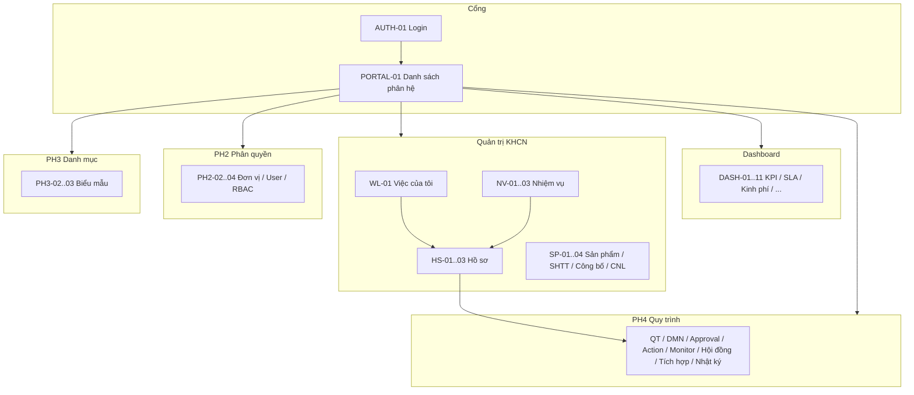
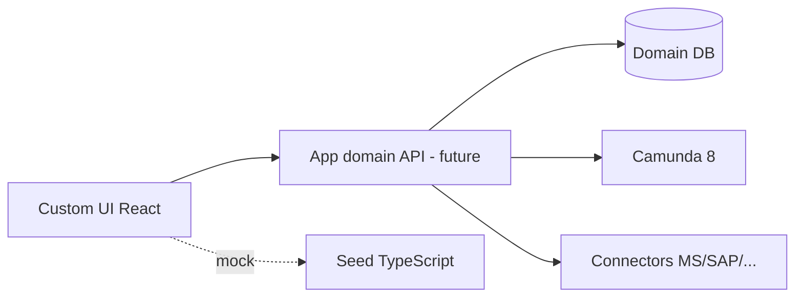

# TÀI LIỆU THIẾT KẾ CHI TIẾT (BM.04)

| Trường | Giá trị |
|---|---|
| **Tập đoàn** | Tập đoàn Công nghiệp – Viễn thông Quân đội Viettel |
| **Đơn vị** | Viettel High Tech (VHT) |
| **Dự án** | Hệ thống Quản trị Khoa học Công nghệ (QTKHCN) |
| **Mã hiệu dự án** | QTKHCN-2026 |
| **Mã hiệu tài liệu** | BM.04-QTKHCN-TKCT-v1.0 |
| **Loại tài liệu** | Thiết kế chi tiết (SRS / Detailed Design) theo biểu mẫu BM.04 |
| **Phiên bản** | 1.0 |
| **Ngày** | 31/07/2026 |
| **Trạng thái** | Bản nháp dựa trên frontend-mock hiện có — **chưa có backend/Camunda production** (Foundation 1 chưa khóa) |
| **Người lập** | BA / Frontend implementer (auto-draft từ codebase + yêu cầu) |
| **Người xem xét** | *(chờ)* |
| **Người phê duyệt** | *(chờ)* |

---

## BẢNG GHI NHẬN THAY ĐỔI TÀI LIỆU

| Ngày | Vị trí | A/M/D | Nguồn gốc | Phiên bản cũ | Mô tả thay đổi | Phiên bản mới |
|---|---|---|---|---|---|---|
| 31/07/2026 | Toàn bộ | A | Frontend mock + docs/req + BM.04 template | — | Tạo mới thiết kế chi tiết cho toàn bộ màn hình đã gắn route | 1.0 |

\*A – Tạo mới, M – Sửa đổi, D – Xóa bỏ

---

## MỤC LỤC

1. [Giới thiệu](#1-giới-thiệu)
2. [Tổng quan giải pháp](#2-tổng-quan-giải-pháp)
3. [Thiết kế chi tiết](#3-thiết-kế-chi-tiết)
4. [Thiết kế dùng chung và tái sử dụng](#4-thiết-kế-dùng-chung-và-tái-sử-dụng)
5. [Thiết kế đảm bảo tuân thủ tiêu chuẩn quản trị dữ liệu](#5-thiết-kế-đảm-bảo-tuân-thủ-tiêu-chuẩn-quản-trị-dữ-liệu)
6. [Phụ lục](#6-phụ-lục)

---

# 1. GIỚI THIỆU

Phần giới thiệu cung cấp bức tranh tổng quan về **Tài liệu thiết kế chi tiết hệ thống Quản trị Khoa học Công nghệ (QTKHCN)** của Viettel High Tech (VHT): mục đích sử dụng tài liệu, phạm vi áp dụng, hệ thống khái niệm/thuật ngữ dùng thống nhất trong toàn văn bản, danh mục tài liệu tham chiếu và cách đọc bố cục các chương tiếp theo. Tài liệu gắn với giai đoạn số hóa đa cấp phê duyệt nhiệm vụ KHCN (các nhóm nghiệp vụ RD01–RD10) trên nền tảng quy trình Camunda 8 và giao diện nghiệp vụ tiếng Việt tùy biến.

## 1.1 Mục đích

Tài liệu này cung cấp một bức tranh toàn cảnh về hệ thống QTKHCN thông qua nhiều góc nhìn bổ trợ nhau — **nghiệp vụ (chức năng/màn hình)**, **kiến trúc biên giới hệ thống** (ứng dụng domain ↔ Camunda ↔ tích hợp), **phân quyền/RBAC**, và **thiết kế UI/luồng thao tác** — nhằm ghi nhận và truyền đạt các quyết định quan trọng đã được thống nhất (hoặc đang áp dụng trên bản mock), tránh hiểu lệch giữa BA, Dev, QA và phía đơn vị nghiệp vụ VHT.

Cụ thể, tài liệu phục vụ các mục tiêu sau:

1. **Mô tả thiết kế chi tiết** các chức năng/màn hình đã triển khai trên frontend mock (và hướng mục tiêu khi có backend), theo cấu trúc biểu mẫu BM.04: thông tin chung → màn hình → thành phần → luồng nghiệp vụ → xử lý kỹ thuật (API/DB).
2. **Chuẩn hóa ngôn ngữ chung** về Nhiệm vụ, Hồ sơ, phân hệ PH2–PH4, nhóm RD, candidateGroup, phạm vi dữ liệu (scope), giúp các bên trao đổi không nhầm khái niệm.
3. **Làm đầu vào triển khai & kiểm thử**: Dev bám thiết kế màn hình/luồng; QA bám điều kiện tiên quyết, case lỗi và quyền; BA/PO đối chiếu với yêu cầu/RTM.
4. **Ghi nhận ranh giới kiến trúc đã khóa** (ví dụ: Camunda chỉ giữ biến điều khiển/tương quan; dữ liệu nghiệp vụ nằm ở domain DB; UI tùy biến không dùng mặc định Camunda Tasklist) để không tái mở các quyết định đã chốt.

**Đối tượng đọc và cách sử dụng:**

| Đối tượng | Cách dùng tài liệu |
|---|---|
| Business Analyst / Product Owner | Rà soát đủ nghiệp vụ, RTM, gap so với yêu cầu KH; làm cơ sở nghiệm thu mô tả chức năng |
| Solution Architect | Kiểm tra tính nhất quán với quyết định D1–D9 (Camunda, tách NV/Hồ sơ, RBAC…) |
| Frontend / Backend Developer | Hiện thực theo mô tả màn hình, luồng, quyền; bổ sung API/DB khi Foundation backend sẵn sàng |
| QA / Tester | Xây case kiểm thử từ tiền/hậu điều kiện, case lỗi, phân quyền fail-closed |
| Đơn vị nghiệp vụ VHT (tham khảo) | Hiểu phạm vi màn hình Phase 1 và cách hệ thống số hóa vòng đời NV KHCN |

Tóm tắt bố cục: sau phần Giới thiệu, tài liệu lần lượt trình bày Tổng quan giải pháp (§2), Thiết kế chi tiết theo phân hệ/chức năng (§3), Thiết kế dùng chung (§4), Tuân thủ quản trị dữ liệu (§5) và Phụ lục (§6).

## 1.2 Phạm vi

Tài liệu Kiến trúc / Thiết kế chi tiết này phục vụ việc **đặc tả và thống nhất thiết kế** hệ thống QTKHCN ở lớp ứng dụng nghiệp vụ (UI + mô hình chức năng + biên giới tích hợp), làm cầu nối giữa tài liệu yêu cầu (`docs/req`) và mã nguồn frontend mock hiện có (`webapp/`).

**Trong phạm vi tài liệu (phiên bản hiện tại):**

- Toàn bộ chức năng/màn hình **đã gắn route** trên ứng dụng web (cổng phân hệ, đăng nhập mock, dashboard điều hành, việc của tôi, nhiệm vụ & hồ sơ KHCN, sản phẩm nghiên cứu / SHTT / công bố / công nghệ lõi, PH2 phân quyền–tổ chức–người dùng, PH3 thư viện biểu mẫu, PH4 quản trị quy trình BPMN/DMN/phê duyệt/hành động/giám sát/hội đồng/tích hợp/nhật ký, trợ giúp).
- Kịch bản dùng chung: xác thực mock, phiên làm việc (mức hiện trạng), layout, thanh lọc, bảng danh sách, chế độ xem Grid/List/Process Map, trạng thái loading/empty/error.
- Mô hình quan hệ với các thành phần ngoài UI: Camunda 8 (orchestration), domain data (mục tiêu), hệ thống tích hợp minh họa (MS/SAP/QLNS… ở mức màn trạng thái), analytics/dashboard mock.
- Các quyết định kiến trúc đã khóa liên quan đến cách tách dữ liệu nghiệp vụ và engine quy trình.

**Ngoài phạm vi (không thay thế / không cam kết đầy đủ trong bản này):**

- Đặc tả chi tiết hạ tầng triển khai Camunda/DB production khi Foundation 1 chưa khóa stack.
- SSO/IAM Viettel đầy đủ, chữ ký số, NFR định lượng đã ký với khách (các mục đang mở / OQ).
- Các màn hình mới chỉ tồn tại dạng prototype **chưa gắn route** (một số catalog, báo cáo, mẫu thông báo…) — chỉ liệt kê để nhận diện, không coi là đã bàn giao thiết kế chi tiết.
- Thay thế tài liệu yêu cầu gốc (BRD/RTM quy trình RD); tài liệu này **bổ sung góc nhìn thiết kế**, không hủy hiệu lực docs/req.

**Tác động / ảnh hưởng:**

- Là cơ sở để đội dự án **đồng bộ hiểu** về phạm vi Phase 1 mock và hướng mở rộng.
- Khi backend/Camunda thật được nối, các mục API/DB trong §3 phải được cập nhật theo quyết định Foundation — **không dùng mô tả mock hiện tại như đặc tả CSDL production**.
- Sai lệch so với tài liệu này khi code hóa cần được ghi nhận vào bảng thay đổi tài liệu (A/M/D).

## 1.3 Khái niệm, thuật ngữ

| Thuật ngữ | Định nghĩa |
|---|---|
| **QTKHCN** | Hệ thống Quản trị Khoa học Công nghệ — phần mềm số hóa quản lý nhiệm vụ KHCN và quy trình phê duyệt đa cấp tại VHT |
| **Nhiệm vụ (Nhiệm vụ KHCN / NhiemVu)** | Đối tượng quản lý **master** xuyên suốt vòng đời một đề tài/nhiệm vụ (từ chủ trương đến quyết toán/chuyển giao); một nhiệm vụ có nhiều hồ sơ theo giai đoạn |
| **Hồ sơ (HoSo)** | Gói tài liệu và trạng thái xử lý của **một** luồng nghiệp vụ tại một giai đoạn (ví dụ hồ sơ xét duyệt chủ trương cấp cơ sở); quan hệ **1 Nhiệm vụ – N Hồ sơ**, không gộp hai thực thể thành một |
| **RD01 … RD10** | Mười nhóm nghiệp vụ chính theo tài liệu quy trình phần mềm KHCN (chủ trương, xét duyệt NV, thực hiện, điều chỉnh, nghiệm thu, quyết toán, danh mục SP, SHTT, tổng hợp thông tin, lưu trữ hồ sơ…) |
| **Vòng đời dự án (trên Process Map)** | Chuỗi giai đoạn tổng hợp để nhìn dataflow: Đề xuất → Tuyển chọn → Thực hiện → Nghiệm thu → Chuyển giao (ánh xạ các nhóm RD) |
| **Phân hệ (PH)** | Khối chức năng cổng ứng dụng: PH2 Phân quyền & xác thực; PH3 Danh mục dùng chung; PH4 Quản trị quy trình; các PH khác có thể ở trạng thái sắp ra mắt |
| **Camunda 8** | Nền tảng orchestration quy trình (Zeebe…); trong kiến trúc QTKHCN chỉ giữ **biến điều khiển/tương quan** (ví dụ mã hồ sơ, cấp, kết quả bước), không lưu toàn bộ dữ liệu nghiệp vụ |
| **candidateGroup / vaiTroCodes** | Tập mã vai trò được phép xử lý một bước hồ sơ; kiểm tra quyền theo hướng **fail-closed** (danh sách rỗng → chỉ admin) |
| **Worklist / Việc của tôi** | Danh sách công việc dạng user task mà người dùng hiện tại đủ vai trò để xử lý |
| **DMN / Ma trận quyết định** | Bảng quyết định cấu hình hóa (đạt/không đạt, phân cấp…) gắn quy trình |
| **Ma trận phê duyệt / Action Studio** | Cấu hình slot phê duyệt và khả dụng hành động trên UI hồ sơ |
| **RBAC / Scope-overlay** | Phân quyền theo vai trò/tính năng; scope-overlay bổ sung phạm vi dữ liệu (toàn hệ thống, theo trung tâm, theo đơn vị…) trên các vai trò đã gán |
| **Frontend-mock** | Bản UI chạy dữ liệu giả/in-memory phục vụ demo và thống nhất trải nghiệm; chưa phải tích hợp API production |
| **Toggle View** | Chế độ xem linh hoạt trên một số danh mục: Grid (thẻ), List (bảng), Process Map (sơ đồ tiến trình) |
| **Dashboard điều hành** | Tập màn hình KPI/SLA/kinh phí/nguồn lực… phục vụ lãnh đạo và cơ quan quản lý KHCN |
| **Form-js / Biểu mẫu Camunda Forms** | Thư viện biểu mẫu động được nhúng trong UI tùy biến (không dùng Tasklist mặc định làm UI chính) |

## 1.4 Tài liệu tham khảo

| # | Tên tài liệu | Nguồn / tổ chức | Vai trò đối với tài liệu này |
|---|---|---|---|
| 1 | BM.04 — Tài liệu thiết kế chi tiết (biểu mẫu) | Tập đoàn Viettel — bộ Template phát triển phần mềm | **Áp dụng bắt buộc** — khung mục lục và hình thức trình bày |
| 2 | V.CNM — Thiết kế chi tiết (SRS) Template | Đơn vị chuyên môn / bộ Skills SRS | **Áp dụng** — cấu trúc chi tiết từng chức năng (màn hình, thành phần, luồng, API/DB) |
| 3 | 4.2 Cấu trúc SRS | Skills SRS (nội bộ dự án/đơn vị) | **Tham chiếu cấu trúc** |
| 4 | Checklist SRS tổng quan / Checklist SRS chi tiết | Skills SRS | **Tham chiếu kiểm tra chất lượng** tài liệu |
| 5 | Phạm vi 2 phân hệ (`docs/req/scope-2-phanhe.md`) | Dự án QTKHCN | **Nguồn yêu cầu phạm vi** — dùng được cho đối chiếu |
| 6 | Data model Nhiệm vụ vs Hồ sơ | Dự án QTKHCN | **Nguồn quyết định miền dữ liệu** — dùng được |
| 7 | Quy trình phần mềm KHCN chi tiết (bản clean) | Dự án QTKHCN / nghiệp vụ VHT | **Nguồn 10 nhóm RD** — dùng được |
| 8 | RTM / backlog EPIC QLNVKHCN | Dự án QTKHCN | **Tham chiếu truy xuất yêu cầu** |
| 9 | Camunda design / architecture notes (`docs/arch`, `docs/research`) | Dự án QTKHCN | **Tham khảo kiến trúc** — một phần brainstorm chưa lock toàn bộ |
| 10 | Locked decisions (`.harness/state/decisions.md`) | Delivery harness dự án | **Áp dụng** — quyết định đã khóa không tái mở |
| 11 | Mã nguồn frontend mock (`webapp/`) | Dự án QTKHCN | **Tham chiếu hiện trạng UI** — phản ánh đã code |

> Ghi chú: với tài liệu ghi “tham khảo”, nội dung mang tính định hướng hoặc chưa khóa đầy đủ; khi mâu thuẫn với **decisions đã LOCKED** hoặc biểu mẫu BM.04 bắt buộc, ưu tiên quyết định đã khóa / biểu mẫu.

## 1.5 Mô tả tài liệu

Ngoài bốn mục trên, tài liệu được tổ chức để người đọc đi từ **tổng thể → chi tiết → tái sử dụng → tuân thủ dữ liệu**, cụ thể:

| Chương | Nội dung chính | Cách đọc gợi ý |
|---|---|---|
| **§2. Tổng quan giải pháp** | Sơ đồ phân rã chức năng; mô hình giao tiếp với Camunda/tích hợp/domain; ma trận truy xuất yêu cầu tổng quan (RTM) | Đọc trước khi vào từng màn hình để nắm bản đồ hệ thống |
| **§3. Thiết kế chi tiết** | Từng phân hệ/chức năng theo mẫu: mã chức năng, mục đích, user & quyền, đường dẫn, tiền/hậu điều kiện, mô tả màn hình & thành phần, luồng nghiệp vụ (khởi tạo / thực hiện / lỗi / kết quả), API & DB (mục tiêu và/hoặc mock) | Đọc theo đúng luồng người dùng hoặc theo phân hệ đang phụ trách |
| **§4. Thiết kế dùng chung và tái sử dụng** | Component UI dùng lại (PageHeader, FilterBar, EntityTable, ViewModeToggle, Process Map, dashboard shared…); kịch bản common (empty/loading/toast, fail-closed) | Tham chiếu thay vì copy lặp trong từng chức năng |
| **§5. Tuân thủ quản trị dữ liệu** | Nguyên tắc quản trị, bảo mật, chất lượng, siêu dữ liệu, lưu trữ/vận hành ở mức thiết kế | Đối chiếu với chính sách dữ liệu đơn vị khi chuyển production |
| **§6. Phụ lục** | Function list đầy đủ mã–URL, danh mục ngoài phạm vi, base URL môi trường mock, quyết định còn mở | Dùng khi cần tra cứu nhanh hoặc lập kế hoạch wave tiếp theo |

**Nguyên tắc trình bày trong tài liệu:** (1) phân biệt rõ **hiện trạng mock** và **thiết kế mục tiêu**; (2) không suy diễn API/DB production khi chưa có Foundation; (3) mọi thay đổi sau này ghi vào bảng ghi nhận thay đổi ở đầu tài liệu.

---

# 2. TỔNG QUAN GIẢI PHÁP

## 2.1 Tổng quan chức năng

**Function list tóm tắt (47 chức năng wired):** xem Phụ lục A.

## 2.2 Mô hình giao tiếp với hệ thống / Module khác

| Hệ thống / Module | Hướng | Nội dung (mục tiêu) | Hiện trạng mock |
|---|---|---|---|
| Camunda 8 (Zeebe/Tasklist API) | App → Engine | Start/complete user task, biến correlation | Chưa; worklist suy từ mock dossier |
| Domain DB QTKHCN | App ↔ DB | Nhiệm vụ, Hồ sơ, SP KHCN, RBAC | In-memory / seed TS |
| SSO / IAM Viettel | Auth | Đăng nhập tập trung | Login local mock email/password |
| Hệ thống tích hợp (MS, SAP, QLNS…) | Qua connector | RD03 dataflow | Màn `/tich-hop` mô phỏng trạng thái |
| Optimize / Analytics | Read | KPI dashboard | Seed `optimizeAnalytics` / dashboard mock |

## 2.3 Ma trận truy suất yêu cầu tổng quan — RTM

| Nhóm yêu cầu (docs/req) | Chức năng UI chính | Ghi chú |
|---|---|---|
| RD01 Chủ trương | HS-01..03, QT-01..03, WL-01 | Mock luồng đủ |
| RD02 Xét duyệt NV | HS, QT, HD-01 | Mock |
| RD03 Thực hiện | QT (planned), INT-01 | Pha 2 một phần |
| RD05 Nghiệm thu | HS, QT | Mock |
| RD06–RD10 | QT Process Map / seed planned | Một phần planned |
| Phân hệ Quản lý Quy trình | PH4 toàn bộ | Mock |
| Phân quyền / Org | PH2 | Mock scope-overlay |
| Dashboard lãnh đạo | DASH-01..11 | Mock |
| Sản phẩm / SHTT / Công bố / CNL | SP-01..04 | Mock list |

---

# 3. THIẾT KẾ CHI TIẾT

> **Quy ước API/DB:** Với mọi chức năng — *Hiện trạng = frontend-mock*. Endpoint/SQL dưới đây là **thiết kế mục tiêu** (TBD khi F1), kèm ghi chú mapping seed hiện tại.

> **Quy ước màn hình:** Số STT trong bảng thành phần map với chú thích UI (wireframe số). Khi chưa có ảnh chính thức, dùng layout mô tả + URL.

---

## 3.0 KỊCH BẢN DÙNG CHUNG (AUTH & SESSION)

### 3.0.1 AUTH-01 — Đăng nhập

#### 3.0.1.1 Thông tin chung

| Trường | Nội dung |
|---|---|
| **Mã chức năng** | AUTH-01 |
| **Mục đích** | Xác thực người dùng trước khi vào hệ thống |
| **Người dùng mục tiêu** | Mọi user (guest) |
| **Đường dẫn** | `/#/login` → sau thành công `/#/danh-sach-phan-he` |
| **Tiền điều kiện** | Chưa có session user |
| **Hậu điều kiện** | Có `user` trong AuthContext; sider/menu theo quyền |
| **RTM** | F4 IAM (tương lai); hiện mock `data/users.ts` |

#### 3.0.1.2 Màn hình (bố cục)

1. Logo + tiêu đề sản phẩm  
2. Email  
3. Mật khẩu  
4. Nút Đăng nhập  
5. (DEV) Card tài khoản demo điền nhanh  

#### 3.0.1.3 Thành phần

| STT | Tên | Kiểu | I/O | Khởi tạo | Mô tả |
|---|---|---|---|---|---|
| 1 | Email | Input email, required | In | Rỗng / placeholder | Validate required; khớp `users[].email` |
| 2 | Mật khẩu | Input password, required | In | Rỗng | So khớp `DEMO_PASSWORD` mock |
| 3 | Đăng nhập | Button primary | — | — | Submit form → `login()` |
| 4 | Tài khoản demo | List + fill | — | Chỉ DEV hoặc `VITE_SHOW_DEMO_ACCOUNTS` | Không hiện production mặc định |

#### 3.0.1.4 Luồng nghiệp vụ

**Khởi tạo:** Render form; nếu đã login → không hiện (App gate).

**Thực hiện:**

1. User nhập email/password → Submit.  
2. Hệ thống tìm user trong seed; so password.  
3. Thành công → message success → vào portal.  
4. Thất bại → message error (sai thông tin).

**Case lỗi:** thiếu trường (Ant Form validate); sai credentials; (chưa có) khóa TK / captcha / SSO.

**Kết quả:** Session in-memory (không JWT thật).

#### 3.0.1.5 API & DB (mục tiêu / mock)

| | Nội dung |
|---|---|
| **API mục tiêu** | `POST /api/auth/login` → token; `GET /api/auth/me` |
| **Mock** | `AuthContext.login` đọc `users` |
| **DB mục tiêu** | USER, USER_ROLE, LOGIN_AUDIT |
| **Chưa có** | SSO, Remember me, Forgot password, captcha, lockout, concurrent session policy |

### 3.0.2 Phiên đăng nhập / Logout

| Hạng mục | Thiết kế hiện tại (mock) | Mục tiêu F4 |
|---|---|---|
| Lưu phiên | State React / memory | JWT + refresh / cookie HttpOnly |
| TTL | Theo vòng đời tab | Cấu hình (VD 8h) + refresh |
| Hết phiên | Reload mất session → login | Redirect login + message |
| Logout | `logout()` clear user | `POST /logout` revoke token + audit |
| Đổi MK / Quên MK | **Chưa có màn** | Bổ sung theo checklist 1.4–1.5 |

---

## 3.1 PHÂN HỆ CỔNG & LAYOUT

### 3.1.1 PORTAL-01 — Danh sách Phân hệ

#### Thông tin chung

| | |
|---|---|
| **Mã** | PORTAL-01 |
| **Mục đích** | Portal sau login: chọn phân hệ; hỗ trợ Grid/List/Process Map |
| **User** | Đã đăng nhập |
| **URL** | `/#/danh-sach-phan-he` |
| **Tiền ĐK** | Đã login |
| **Hậu ĐK** | Điều hướng vào PH / module |
| **RTM** | Portal SSO app (docs research userflow) |

#### Thành phần chính

| STT | Tên | Kiểu | I/O | Khởi tạo | Mô tả |
|---|---|---|---|---|---|
| 1 | StatCard tổng/quyền/… | Output | Out | Từ `DANH_SACH_PHAN_HE` + permission | 4 KPI |
| 2 | Filter trạng thái | Button group | In | all | all / active / no-permission / coming-soon |
| 3 | Search | Input | In | Rỗng | Không dấu (`normalizeVietnamese`) |
| 4 | ViewModeToggle | Segmented | In | grid (LS) | grid / list / map |
| 5 | PhanHeCard | Card | Out | — | Click → route; pin localStorage |
| 6 | EntityTable list | Table | Out | — | Cột mã, tên, trạng thái, modules, pin |
| 7 | ProcessMapView | Swimlane | Out | Stats từ processes | 10 RD × 5 giai đoạn; click → `/quy-trinh` |

#### Luồng

1. Load danh sách PH + `getPhanHeStatus`.  
2. Lọc/search.  
3. Theo viewMode render Grid / List / Map.  
4. Click PH active → `openAppRoute(route)`; no-permission / coming-soon → không vào (CTA disabled).

#### API/DB

Mock: `data/phanHe.ts`, `ProcessContext`. Mục tiêu: `GET /api/subsystems`, `GET /api/processes/summary-by-rd`.

---

## 3.2 PHÂN HỆ DASHBOARD (DASH-01 … DASH-11)

### 3.2.1 Thông tin chung nhóm

| | |
|---|---|
| **Mã** | DASH-01 … DASH-11 |
| **Mục đích** | Quan sát KPI điều hành / danh mục / SLA / tải / hội đồng / kinh phí / nguồn lực / rủi ro / tích hợp / adoption |
| **User** | Theo `canViewDashboard(user, permission)` — Admin / Lãnh đạo / CQ QLKHCN; một số view chặn operator (Finance, Resource, Integration, Adoption) |
| **URL base** | `/#/dashboard/...` (xem Phụ lục A) |
| **Tiền ĐK** | Login + quyền view |
| **Hậu ĐK** | Xem KPI; export CSV (nếu có) |
| **Guard** | `DashboardRouteGuard` |

### 3.2.2 Bố cục dùng chung Dashboard

| STT | Thành phần | Mô tả |
|---|---|---|
| 1 | DashboardPageShell | Title + filter bar |
| 2 | DashboardFilterBar | Kỳ / đơn vị / … (query string) |
| 3 | KpiCard | Chỉ số |
| 4 | ChartCard | Recharts |
| 5 | AlertTable | Cảnh báo |
| 6 | Loading / Error / Empty | `useDashboardQuery` + `?mockError=1` |

### 3.2.3 Chi tiết từng dashboard

| Mã | Tên | File | Điểm nhấn dữ liệu |
|---|---|---|---|
| DASH-01 | Tổng quan điều hành | ExecutiveDashboard | KPI tổng hợp |
| DASH-02 | Danh mục nhiệm vụ | PortfolioDashboard | Portfolio |
| DASH-03 | Chi tiết nhiệm vụ | MissionDetailDashboard | Theo `:missionId` |
| DASH-04 | Quy trình & SLA | ProcessSlaDashboard → `pages/Dashboard.tsx` | Optimize leadership |
| DASH-05 | Tải xử lý | WorkloadDashboard | Workload |
| DASH-06 | Hội đồng | CouncilDashboard | Council KPI |
| DASH-07 | Kinh phí | FinanceDashboard | Finance |
| DASH-08 | Nguồn lực | ResourceDashboard | Resource |
| DASH-09 | Rủi ro | RiskDashboard | Risk |
| DASH-10 | Tích hợp DL | IntegrationDashboard | Data quality |
| DASH-11 | Mức độ sử dụng | AdoptionDashboard | Adoption |

**Luồng chung:** Mở route → guard quyền → filter → fetch mock (300–500ms) → render; lỗi → DashboardStates.

**API mục tiêu:** `GET /api/dashboard/{view}?from&to&org=…`  
**Mock:** `dashboard-mock.service.ts` / `optimizeAnalytics.ts`.

---

## 3.3 PHÂN HỆ QUẢN TRỊ KHCN

### 3.3.1 WL-01 — Việc của tôi

| | |
|---|---|
| **Mã** | WL-01 |
| **Mục đích** | Worklist user task (mỗi dòng = 1 task Camunda-like) |
| **URL** | `/#/viec-cua-toi` |
| **User** | Đã login; lọc theo `canProcessStep` (admin xem all) |

**Thành phần:** PageHeader; StatCard; Segmented lọc loại task; EntityTable (mã HS, bước, hạn, loại…); click → `/ho-so/:id`.

**Luồng:** Build tasks từ dossiers → filter kind → sort dueDate → mở hồ sơ.

**API mục tiêu:** Camunda user-task search. **Mock:** `buildUserTasksFromDossiers`.

### 3.3.2 NV-01 — Danh sách Nhiệm vụ

| | |
|---|---|
| **Mã** | NV-01 |
| **URL** | `/#/nhiem-vu` |
| **Loại** | List |

**UI:** FilterBar + bảng NV; CTA Tạo mới (nếu `canCreateNhiemVu`).

**Liên quan:** NV-02 Create `/nhiem-vu/moi`; NV-03 Detail `/nhiem-vu/:ma` (kèm link SP KHCN).

**API/DB mục tiêu:** `NhiemVu` master. Mock: `data/nhiemVu.ts`.

### 3.3.3 NV-02 — Tạo Nhiệm vụ

Form tạo; validate bắt buộc; lưu mock → về list/detail. Quyền: Admin hoặc PM/PA/NNC.

### 3.3.4 NV-03 — Chi tiết Nhiệm vụ

Hiển thị master; danh sách hồ sơ thuộc NV; card liên kết SP-01..04. Click hồ sơ → HS-03.

### 3.3.5 HS-01 / HS-02 / HS-03 — Hồ sơ

| Mã | URL | Loại | Ghi chú |
|---|---|---|---|
| HS-01 | `/ho-so` | List | Segmented trạng thái + filter |
| HS-02 | `/ho-so/tao-moi` | Create | Gắn NV + loại RD |
| HS-03 | `/ho-so/:id` | Detail | Timeline bước; action theo role; form-js |

**Business rule (D9):** Chỉ user có `vaiTroCodes` của bước hiện tại mới xử lý; list rỗng = admin-only (fail-closed).

**API mục tiêu:** Domain HoSo + Camunda complete task. Mock: `DossierContext`.

### 3.3.6 SP-01 … SP-04 — Sản phẩm KHCN

| Mã | Tên | URL |
|---|---|---|
| SP-01 | Sản phẩm nghiên cứu | `/san-pham-nghien-cuu` |
| SP-02 | Sở hữu trí tuệ | `/so-huu-tri-tue` |
| SP-03 | Công bố khoa học | `/cong-bo-khoa-hoc` |
| SP-04 | Công nghệ lõi | `/cong-nghe-loi` |

**UI chung:** List + drawer lịch sử (`HistoryDrawer`); seed `sanPhamKhcn.ts`; permission notes `SAN_PHAM_KHCN_PERMISSIONS`.

---

## 3.4 PHÂN HỆ PH2 — PHÂN QUYỀN & XÁC THỰC

### 3.4.1 PH2-01 — Tổng quan PH2

`PhanHePage` với modules: Đơn vị, Người dùng, Phân quyền. URL `/phan-he/PH2/tong-quan`. Quyền: `canManageSystem`.

### 3.4.2 PH2-02 — Cơ cấu tổ chức

Tree đơn vị + bảng thành viên (`OrgStructure`). Mock `orgUnits.ts`.

### 3.4.3 PH2-03 — Quản trị người dùng

| | |
|---|---|
| **Mã** | PH2-03 |
| **URL** | `/phan-he/PH2/nguoi-dung` |
| **View modes** | List (mặc định) / Grid / Process Map (vai trò theo vòng đời) |

**Thành phần list:** Họ tên+avatar, email, đơn vị, vai trò, scope, nút Phân quyền (drawer scope-overlay), Khoá (disabled — F4).

**Thêm user:** Disabled (F4).

**API mục tiêu:** User CRUD + assignment scope. Mock: `users.ts` + `RbacContext`.

### 3.4.4 PH2-04 — Phân quyền

Tabs: catalog role / permission matrix / simulator. Mock `rbac.ts` + engine.

---

## 3.5 PHÂN HỆ PH3 — DANH MỤC DÙNG CHUNG

### 3.5.1 PH3-01 Tổng quan; PH3-02 FormLibrary; PH3-03 FormDesigner

| Mã | URL | Mô tả |
|---|---|---|
| PH3-01 | `/phan-he/PH3/tong-quan` | Landing modules |
| PH3-02 | `/phan-he/PH3/bieu-mau` | Thư viện form-js |
| PH3-03 | `/phan-he/PH3/bieu-mau/:key/thiet-ke` | Designer canvas |

Quyền: `!isChuNhiemDeTai`. NFR UI: skin AntD trong `bpmnio-skin.css`.

---

## 3.6 PHÂN HỆ PH4 — QUẢN TRỊ QUY TRÌNH

### 3.6.1 QT-01 — Danh mục quy trình

| | |
|---|---|
| **Mã** | QT-01 |
| **URL** | `/quy-trinh` |
| **User** | `!isChuNhiemDeTai` |
| **View** | List / Grid / Process Map (persist LS) |

**Thành phần:** StatCard; search; filter nhóm RD + trạng thái; ViewModeToggle; EntityTable / ProcessCard / ProcessMapView (10 RD).

**Hành động:** Deploy BPMN (modal mock); Tạo & vẽ BPMN → QT-02; click dòng → QT-03.

**API mục tiêu:** Process definition registry. Mock: `ProcessContext` + `processes.ts` (đủ NHOM RD01–RD10).

### 3.6.2 QT-02 / QT-03 — Tạo & Chi tiết BPMN

BPMN modeler (`bpmn-js`); phiên bản; taskSteps; Need Role headers (mock). Deploy version mock.

### 3.6.3 DMN-01/02 — Ma trận quyết định

List + detail DMN. Admin only.

### 3.6.4 APPR-01 — Ma trận phê duyệt

Cấu hình slot phê duyệt. Admin.

### 3.6.5 ACT-01 — Action Studio

Cấu hình availability action + simulator (đợt 1–5 đã mock).

### 3.6.6 ST-01 — Service Task config

Cấu hình worker/service task. Admin.

### 3.6.7 MON-01 — Giám sát tiến trình

Tabs giám sát instance/SLA (ops). Admin.

### 3.6.8 HD-01/02 — Hội đồng

List/detail hội đồng xét duyệt. `/hoi-dong`, `/hoi-dong/:id`.

### 3.6.9 INT-01 — Tích hợp

Trạng thái hệ thống tích hợp + ghi chú Connector (Phase 2 framing). Admin.

### 3.6.10 LOG-01 — Nhật ký

Event log quy trình. Admin.

### 3.6.11 PH4-01 — Tổng quan PH4

Landing modules PH4.

---

## 3.7 HELP-01 — Hướng dẫn sử dụng

URL `/tro-giup`. Nội dung hướng dẫn theo section; HelpButton deep-link từ các màn.

---

## 3.8 PH-XX — Phân hệ coming-soon (PH5–PH7)

`PhanHePage` theo `:id`; trạng thái coming-soon / estimatedRelease; không vào module thật.

---

# 4. THIẾT KẾ DÙNG CHUNG VÀ TÁI SỬ DỤNG

| Component | Path | Dùng cho |
|---|---|---|
| PageHeader | `components/ui/PageHeader` | Mọi list/detail |
| StatCard | `StatCard` | KPI đầu trang |
| FilterBar | `FilterBar` | Search + selects + left/right slots |
| EntityTable | `EntityTable` | Bảng list chuẩn + scroll Y |
| ViewModeToggle | `ViewModeToggle` | Grid/List/Map |
| ProcessMapView | `components/ProcessMapView` | Dataflow 10 RD |
| StatusTag / ProcessStatusTag | `StatusTag` | Trạng thái |
| Dashboard\* shared | `features/dashboard/shared/*` | Dashboard suite |
| SubsystemSwitcher | Header | Đổi phân hệ |
| HelpButton | Help | Deep link trợ giúp |
| BpmnViewer | BPMN + heat markers | QT / Optimize |

**Kịch bản common (tham chiếu, không lặp):**

- Empty state / Loading spin / Toast success-error (`feedback`).
- Confirm trước thao tác hủy hại (khi có Modal.confirm).
- Phân quyền fail-closed trên bước hồ sơ.
- Toggle View persist `localStorage` key theo màn.
- Locale Ant Design `vi_VN`.

---

# 5. THIẾT KẾ ĐẢM BẢO TUÂN THỦ TIÊU CHUẨN QUẢN TRỊ DỮ LIỆU

## 5.1 Quản trị dữ liệu

- Tách **Nhiệm vụ** vs **Hồ sơ** (D8); Camunda không chứa business payload (D3).
- Master data PH2/PH3: org, user, role, form catalog.

## 5.2 Bảo mật dữ liệu

- RBAC feature + data scope-overlay (D11).
- Dashboard view permissions.
- Demo password UI chỉ DEV.
- **Gap:** chưa SSO, chưa mã hóa transit/token thật, chưa audit login đầy đủ.

## 5.3 Chất lượng dữ liệu

- Validate form Ant Design phía client.
- Dashboard integration view theo dõi chất lượng (mock).
- **Gap:** chưa rule DQ server-side.

## 5.4 Quản lý siêu dữ liệu

| Loại | Nơi mô tả |
|---|---|
| Đối tượng | `nhiemVu.ts`, `dossiers.ts`, `processes.ts`, `sanPhamKhcn.ts`, `rbac.ts` |
| Hệ thống | Tech stack CLAUDE.md / decisions.md |
| Luồng DL | `processLifecycle.ts` (RD → giai đoạn) |
| Thuật ngữ | §1.3 |

## 5.5 Lưu trữ và vận hành

- Mock: không persistence DB.
- Mục tiêu: backup/retention theo chính sách VHT (TBD F1).
- Log nghiệp vụ: ProcessEventLog mock; audit trail đầy đủ TBD.

---

# 6. PHỤ LỤC

## Phụ lục A — Function list (wired)

*(Bảng đầy đủ 47 dòng — STT / Mã / Tên / URL / Phân hệ / File / Loại / Quyền — xem inventory đã đối chiếu App.tsx; tóm tắt nhóm: AUTH 1, PORTAL 1, DASH 11, WL 1, NV 3, HS 3, SP 4, QT/PH4 ~12, PH2 4, PH3 3, PH4 landing 1, PH-XX 1, HELP 1.)*

Chi tiết URL:

| Mã | URL |
|---|---|
| AUTH-01 | `/login` |
| PORTAL-01 | `/danh-sach-phan-he` |
| DASH-01 | `/dashboard/tong-quan` |
| DASH-02 | `/dashboard/danh-muc-nhiem-vu` |
| DASH-03 | `/dashboard/nhiem-vu/:missionId` |
| DASH-04 | `/dashboard/quy-trinh-sla` |
| DASH-05 | `/dashboard/tai-xu-ly` |
| DASH-06 | `/dashboard/hoi-dong` |
| DASH-07 | `/dashboard/kinh-phi` |
| DASH-08 | `/dashboard/nguon-luc` |
| DASH-09 | `/dashboard/rui-ro` |
| DASH-10 | `/dashboard/tich-hop-du-lieu` |
| DASH-11 | `/dashboard/muc-do-su-dung` |
| WL-01 | `/viec-cua-toi` |
| NV-01..03 | `/nhiem-vu`, `/nhiem-vu/moi`, `/nhiem-vu/:ma` |
| HS-01..03 | `/ho-so`, `/ho-so/tao-moi`, `/ho-so/:id` |
| SP-01..04 | `/san-pham-nghien-cuu`, `/so-huu-tri-tue`, `/cong-bo-khoa-hoc`, `/cong-nghe-loi` |
| QT-01..03 | `/quy-trinh`, `/quy-trinh/moi`, `/quy-trinh/:ma` |
| DMN-01..02 | `/quan-ly-luat`, `/quan-ly-luat/:id` |
| APPR-01 | `/ma-tran-phe-duyet` |
| ACT-01 | `/cau-hinh-hanh-dong` |
| ST-01 | `/cau-hinh-service-task` |
| MON-01 | `/giam-sat` |
| HD-01..02 | `/hoi-dong`, `/hoi-dong/:id` |
| INT-01 | `/tich-hop` |
| LOG-01 | `/nhat-ky` |
| PH2-01..04 | `/phan-he/PH2/...` |
| PH3-01..03 | `/phan-he/PH3/...` |
| PH4-01 | `/phan-he/PH4/tong-quan` |
| PH-XX | `/phan-he/:id` |
| HELP-01 | `/tro-giup` |

## Phụ lục B — Orphan (ngoài phạm vi v1.0)

`catalog/*` (10), `bao-cao/*` (5), `thong-bao/*` (3), `ph2/*` prototype (3), `danh-muc-nghiep-vu/*` (2) — **chưa gắn route** trong App.tsx hiện hành.

## Phụ lục C — Base URL mock

- Dev: `http://localhost:5173/ql-nvkhcn/#/...`
- Vite `base: '/ql-nvkhcn/'`

## Phụ lục D — Open decisions ảnh hưởng TKCT

- Backend stack / DB / Camunda deploy model (F1).
- SSO & IAM (F4).
- NFR định lượng chính thức (SLA API, concurrent session…).

---

*Hết tài liệu BM.04 v1.0 — kèm file review checklist: `BM04-Checklist-Review-QTKHCN.md`.*

**Bổ sung 31/07/2026:** Mô tả chi tiết thành phần + luồng theo đúng mẫu bảng BM.04 cho các màn PH4 trong screenshot (Chi tiết quy trình, Ma trận phê duyệt, Loại phê duyệt, Ma trận hành động, Dashboard Optimize/DMN) → xem [`BM04-Mo-ta-chi-tiet-thanh-phan-man-hinh-PH4.md`](./BM04-Mo-ta-chi-tiet-thanh-phan-man-hinh-PH4.md).
